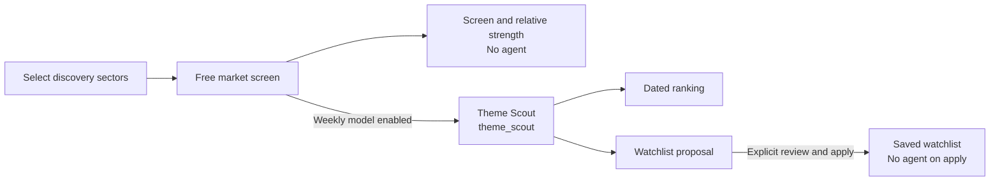
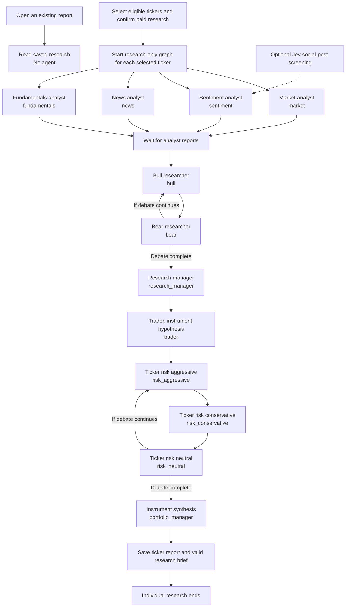
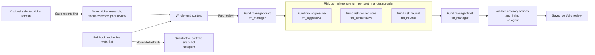
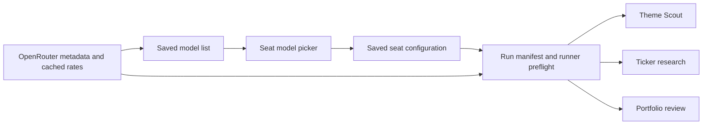

## Summary

A **seat ID** is the stable internal identifier for an agent role in Settings → Agents. The display name tells you the role, and the model picker assigns the model used for that role. For example, `theme_scout` identifies the **Theme Scout** role. Different seats can share a model. The same seat can run more than once, as `fm_manager` does for the draft and final review. Seat IDs in the diagrams map directly to the assignment table below.

Argus Settings currently lists 18 seats. A normal dashboard paid workflow can use 17 of them across three paths: one Theme Scout, twelve native per-ticker research seats, and four whole-fund seats. The eighteenth, **Memory reflection**, is used by the wrapper's ordinary portfolio-aware native path when prior decisions settle. The dashboard's research-only path skips that work.

Keep the 17 dashboard seats. Move the native `portfolio_manager` out of the whole-fund group and label it **Instrument synthesis** in Settings. Update the trader, native risk, and native prompt descriptions for research-only operation. Hide Memory reflection from the dashboard's active seats or label it **Standalone native only**. Retain its underlying seat while ordinary native use is supported.

## Details

### 1. Weekly Scout and watchlist

| Component | Description |
| --- | --- |
| SECTORS | Choose the discovery sectors in Runs. Weekly is a run mode that the user starts manually. |
| SCREEN | **Screen the market** runs without a model. **Find watchlist ideas** can also produce a weekly data pack with its model option off. |
| THEMES | Displays sector-relative-strength and discovery evidence. |
| SCOUT | With the model option enabled, **Find watchlist ideas** asks `theme_scout` to rank themes and suggest candidates. The Runs flow requests one model call. |
| REPORT | Saved scout rankings can later supply dated context to the whole-fund review. |
| PROPOSAL | Candidate additions and drops wait for separate user review. |
| WATCHLIST | Applying the reviewed proposal updates the saved watchlist. An active candidate can later be selected for individual research and belongs to the eligible universe for whole-fund review. |

### 2. Individual ticker analysis

| Component | Description |
| --- | --- |
| SAVED | Open a previously generated ticker report in **Reports**. |
| READ | Reads the saved report without a model call. Argus has no separate Runs option that generates a fresh no-model individual report. |
| SELECT | **Research selected tickers** requires an explicit eligible holding or watchlist selection. Argus reads the book and watchlist to validate the selection. |
| START | Runs the native graph with `--research-only`, four analysts, `--no-checkpoint`, and an isolated memory path. The graph receives instrument evidence and rejects portfolio input. Saved native prompt overrides are suppressed, and the `memory` seat does not run. |
| MARKET | `market` analyzes prices, trends, volatility, and technical evidence. |
| SENTIMENT | `sentiment` assesses dated sentiment across news and social sources. It can return unavailable without calling its model when every source fails. |
| NEWS | `news` examines headlines, catalysts, and event risks. |
| FUNDAMENTALS | `fundamentals` analyzes the business, financials, and valuation evidence. |
| JEV | Optional classifier for public social posts, configured separately from Settings seat IDs. |
| JOIN | The four analyst nodes start in parallel. The debate waits for their reports. |
| BULL | `bull` makes the strongest supported upside case. |
| BEAR | `bear` makes the strongest supported downside case. The configured debate rounds govern the loop. |
| RM | `research_manager` weighs the debate, evidence, and uncertainty. |
| TRADER | `trader` forms an instrument hypothesis and identifies relevant market conditions. |
| AGGRESSIVE | `risk_aggressive` challenges the hypothesis from the upside and opportunity-cost viewpoint. |
| CONSERVATIVE | `risk_conservative` challenges downside assumptions and weak evidence. |
| NEUTRAL | `risk_neutral` weighs the competing ticker scenarios. The configured risk rounds govern the loop. |
| SYNTHESIS | `portfolio_manager` is the ID for the final per-ticker synthesis seat. It produces the instrument outlook and supported valuation or thesis horizon. |
| REPORT | Saves the dated ticker report and versioned `research_brief.json` when the structured brief is valid. |
| STOP | The runner returns before launching the whole-fund manager. |

This path can use **12 Settings seats per ticker**. That count describes the roles in the graph. Debate and tool loops can repeat calls, and a seat can skip a call when inputs are unavailable.

### 3. Whole-fund manager portfolio

| Component | Description |
| --- | --- |
| BOOK | The account book and active watchlist define the review universe. |
| EVIDENCE | Reuses dated research, limited legacy analyst evidence where appropriate, optional saved scout evidence, and prior eligible completed review context. |
| COMBINED | **Research + portfolio review** refreshes only the selected tickers before continuing to a whole-fund review. If a selected refresh fails, the bundle stops before the fund manager. |
| INPUTS | Combines account context, whole-book analytics, reused evidence, and optional FRED data. **Review portfolio** starts here with already saved research. A holding report cutoff limits what evidence is reused and leaves the review universe intact. |
| DRAFT | `fm_manager` drafts whole-fund dispositions, sizing, and proposed actions. |
| RISK | The standard invocation uses one round. The three distinct seats speak sequentially, get the preceding committee comments, and rotate the opening seat by decision date and round. |
| AGGRESSIVE | `fm_aggressive` challenges opportunity cost and the case for taking risk across the fund. |
| CONSERVATIVE | `fm_conservative` challenges portfolio downside, liquidity, and concentration. |
| NEUTRAL | `fm_neutral` challenges comparative tradeoffs and proposed sizing across the book. |
| FINAL | The same `fm_manager` seat incorporates the debate and makes the final portfolio recommendations. |
| VALIDATE | Deterministic checks apply cash, fees, sellability, and quantity constraints to current advice. Deferred advice contributes zero current effective shares or cash movement. |
| REVIEW | Saves the dated advisory review with observed holdings, proposed targets, and hypothetical validation effects in separate fields. |
| SNAPSHOT | **Refresh prices & portfolio metrics** runs the quantitative part of the whole-book path without model calls. |

A standard paid review has **four Settings seats across five steps**. The `fm_manager` seat runs twice, and the committee has one turn per seat. Provider retries can add calls.

**The boundary:** **Research selected tickers** ends at the individual reports. A portfolio review happens when the user chooses **Review portfolio** or **Research + portfolio review**. In the combined scenario, the selected tickers control which research gets refreshed. The review still covers the full holdings and active watchlist. For the decision contract, see [Fund manager decision continuity](./fund-manager-decision-continuity.md).

### How Settings reaches runtime

| Component | Description |
| --- | --- |
| CATALOG | Supplies model details, capability signals and rates. The bundled seed supports first use, and successful refreshes populate `data/openrouter_models_cache.json`. Pricing and provider availability can change. |
| LIST | Stores membership in `data/agent_models.json`. Adding a model makes it eligible for compatible seats. An old model can be removed once all active assignments are moved. |
| EDIT | Settings → Agents shows the current effective seat configuration and compatible saved choices. Reset prompt changes the role text only. |
| SAVE | Argus stores per-seat overrides in TradingAgents `addons/agent_config.json`. Role configuration defaults, current assignments, and model-list membership are separate. |
| PREVIEW | Shows the planned workflow and rates, binds them to paid confirmation, and then checks the execution fingerprint again at runner preflight. Provider-reported cost remains authoritative in the ledger. |
| SCOUT | Resolves `theme_scout` and uses its model, effort, output cap, and configured prompt. |
| NATIVE | The wrapper installs seat-specific clients. It uses model and supported generation settings while the research-only guard suppresses saved native custom system-prompt replacements. |
| FUND | Resolves the four fund seats and uses their configured roles and models, subject to the neutral-model rule below. The draft and final share one manager seat. |

### Audit of the current Settings seats

Settings → Agents shows the current assignment for each seat. The seat IDs and duties below are independent of which model is selected.

| Path | Seat ID | Current responsibility in Argus |
| --- | --- | --- |
| Discovery | `theme_scout` | Weekly themes, relative strength, and watchlist ideas |
| Native research | `market` | Price, trend, volatility, and technical evidence |
| Native research | `sentiment` | Dated news, StockTwits and Reddit sentiment with evidence limits. Can return unavailable without invoking its model when all sources fail. |
| Native research | `news` | Dated headlines, catalysts, and event risks |
| Native research | `fundamentals` | Business, financial and valuation evidence |
| Native research | `bull` | Builds the best supported upside thesis |
| Native research | `bear` | Builds the best supported downside or counter-thesis |
| Native research | `research_manager` | Weighs the bull and bear evidence and uncertainty |
| Native research | `trader` | Produces an instrument hypothesis and market conditions |
| Native research | `risk_aggressive` | Tests upside and missed-opportunity assumptions for the ticker |
| Native research | `risk_conservative` | Tests downside, uncertainty, and weak evidence for the ticker |
| Native research | `risk_neutral` | Weighs the ticker's competing scenarios |
| Native research | `portfolio_manager` | Produces the final instrument synthesis and structured research brief when available |
| Standalone native | `memory` | Reflects on settled decisions when ordinary portfolio-aware native mode runs. Dashboard research-only skips memory settling, reads, and writes. |
| Whole-fund review | `fm_manager` | Uses one seat for the draft and final whole-book recommendations |
| Whole-fund review | `fm_aggressive` | Challenges opportunity cost and the case for taking risk |
| Whole-fund review | `fm_conservative` | Challenges portfolio downside, liquidity, and concentration |
| Whole-fund review | `fm_neutral` | Challenges comparative tradeoffs and proposed sizing |

### Changes indicated by the audit

| Priority | Settings or runtime issue | Recommended change |
| --- | --- | --- |
| Settings grouping | `portfolio_manager` is physically in the native graph but grouped with the four `fm_*` seats in Settings. | Move it under native research and display **Instrument synthesis**. Keep the stable ID and its saved config. Give the two risk groups distinct native ticker and whole-fund labels. |
| Settings role text | Trader currently says it “Turns the verdict into an order.” Ticker risk rows also describe taking a trade. Scout appears under **Macro**. | Describe the trader as producing an instrument hypothesis and the ticker risk seats as challenging evidence. Group Theme Scout under **Discovery** and describe FRED separately where the data option appears. |
| Dormant dashboard seat | `memory` is shown as a post-run lesson writer. The research-only graph returns an empty memory context and skips storing decisions. The native manifest currently includes every native seat, even this one. | Hide it by default or label it **Standalone native only**. Exclude it from the dashboard research-only manifest and matching runner rate projection together. Retain its native implementation and saved configuration. |
| Prompt editor | The native rows can show and save custom system prompts. The dashboard research-only guard suppresses those overrides. | Label the scope on native rows and in the prompt editor. Direct users to the active profile text for dashboard research. Keep normal saved prompt editing for the Scout and fund seats. |
| Model substitution | Fund manager enforces diversity by changing `fm_neutral` to a built-in quick/default model when configured neutral matches the manager. This can bypass the saved list, and the manifest currently projects configured seats. Native wrapper client-construction failures also fall back to the graph's tier client with a log message. | Resolve or reject a conflicting fund-manager and neutral pair before confirmation so the shown and executed model agree. Surface native client fallback in run status or stop before paid calls when the confirmed seat cannot be built. |
| Model choices | Model assignments change independently of the workflows. Catalog metadata shows advertised support for a role. | Use Settings for the current choices and completed runs to evaluate actual routing, cost, or quality. |

The sentiment analyst can optionally send public posts to a separate TypeSafe Jev classifier, configured through the provider environment. It is an auxiliary data path rather than a Settings seat. This audit did not check whether its credentials are configured.

### Sources and maintenance

- [Model catalog and Settings plan](../plans/20261121092907-refresh-agents-model-catalog-and-pricing/plan.md) and [fund-manager continuity plan](../plans/20261117153826-study-repeated-fund-manager-trades-and/plan.md) describe the design and offline acceptance evidence.
- Argus [Settings role definitions](../../../static/app.js) use `AGENT_STAGES` and `AGENT_ROLES`. [Run scenarios](../../../static/run-draft.js), [server manifests](../../../server.py), and [runner stages](../../../run_analysis.py) define dashboard flow and review scope.
- TradingAgents [seat definitions and native client hooks](../../../../TradingAgents/addons/agent_config.py), [graph setup](../../../../TradingAgents/tradingagents/graph/setup.py), and [research-only memory guards](../../../../TradingAgents/tradingagents/graph/trading_graph.py) define the native execution path.
- TradingAgents [fund-manager runner](../../../../TradingAgents/addons/fund_manager/fund_manager.py), [decision continuity](../../../../TradingAgents/addons/fund_manager/decision_continuity.py), [trade validator](../../../../TradingAgents/addons/fund_manager/trade_validation.py), and [Theme Scout](../../../../TradingAgents/addons/theme_scout/theme_scout.py) define the other two paths.

Update this mapping after changes to the graph profile, seat resolution rules, or Settings grouping.

## Logs

- 2026-11-22 11:00 UTC — Removed the point-in-time model assignments and kept the stable seat IDs and workflow mapping.

- 2026-11-22 10:22 UTC — Defined seat IDs and put the configured agent roles, call order, and no-agent branches directly into the three workflow diagrams.

- 2026-11-22 10:13 UTC — Split Scout, individual research, and whole-fund workflows and clarified the paid and no-model boundaries.

- 2026-11-22 09:44 UTC — Mapped both plans to the current runtime, checked the live seat inventory, and recorded Settings and model-resolution findings.
