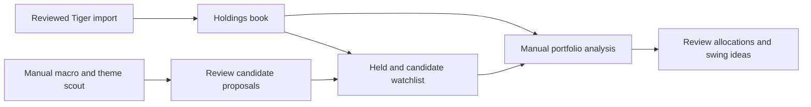
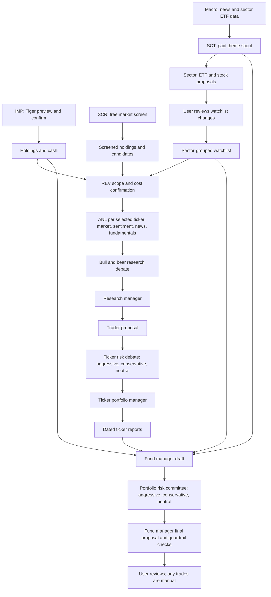

Diagrams: a mermaid block for a flow or design, then a table with columns Component and Description.

## Brief

Build a manually triggered, end-to-end decision-support flow from a reviewed Tiger stock snapshot to swing-trade and ETF portfolio analysis, sector ideas and reviewable watchlist candidates. Do not treat template per-stock weights as the owner's targets. Keep proposed allocations and watchlist changes visible for approval; no automatic trades. Include a separately agreed, bounded paid test. Off-VM backup and restore, cron, Docker and PostgreSQL are out of scope for this plan.

## Discovery

Researcher: opmentix-researcher; repository inspection only. Read the project guide and the closed deployment plan. Tiger stock-only import and a free snapshot were user-tested; a temporary 21-file restore rehearsal passed, but no off-VM backup is configured. No paid call or live broker access was made during discovery.

- `run_analysis.py` copies `addons/fund_manager/targets.json` into user data if absent. The template contains fixed ticker weights; `addons/fund_manager/fund_manager.py` uses them in drift and prompts, and `server.py` surfaces them. They cannot be assumed to be user mandates. Cash, risk and budget policy need separate treatment rather than indiscriminate deletion.
- Tiger preview/apply replaces `my_book.json`, but does not update the shared `watchlist.json`. Argus owns watchlist editing and TradingAgents consumes that file as candidates; holdings already enter the fund manager through the book. Derive an automatically included held section in the watchlist view from the book, preserving saved candidates separately, with deduplication and clear provenance.
- The theme scout assesses macro, sectors and ETF relative strength and can propose adds/drops; its existing shadow period eventually permits automatic watchlist mutation. Require review of scout changes, protect held names, and make sector/ETF/stock ideas and reasons visible. Trace its exact inputs, output and behavior before changing it.
- Core TradingAgents ticker runs include market, sentiment, news and fundamentals analysts and downstream research, trader, risk and portfolio roles; portfolio context comes from the book. Fund manager aggregates holdings and candidates, quantitative risk, draft, three risk voices and final proposal, with cash/post-trade checks. Its output is decision support. No broker order submission was found in the inspected Argus flow; preserve that boundary and test it.
- Dashboard confirmation and per-stage ledger checks exist. Default estimates include $2 per native ticker and $1.50 for the fund manager; the default fund-manager sequence is five calls including a conservative Opus risk voice. Ledger checks are estimates, not a provider-enforced ceiling. Scout is a separate paid call. Actual cost depends on models, tokens, prices and selected scope; verify current configuration and prices before quoting a test cost. Do not start paid analysis until the user agrees to its exact scope and cost.
- BRK.B is Berkshire Hathaway Class B common stock, not an ETF. Tiger's dot spelling maps to `BRK-B` for downstream data. Preserve its stock classification; diversification of its underlying businesses does not make it a fund.

Open decisions: explicit paid test scope and ceiling after the model/pricing inventory, and investor constraints needed for useful proposals. Do not invent an investment mandate, silently overwrite existing targets, or expose holdings or credentials in plan evidence. Off-VM backup remains an unaddressed follow-up, deferred by the user.

## Plan

Planner review, 2026-11-09: completed implementation tasks are checked below; live result quality and remaining execution safeguards are tracked separately. The user prefers checking the actual price after one call, so independently researching current prices for every model is no longer a prerequisite. Estimates are not hard spending limits. Agree the exact first-call scope before spending.

| Component | Description |
| --- | --- |
| Reviewed Tiger import | Confirmed stock snapshot, with existing validation. |
| Holdings book | Authoritative imported positions, not hypothetical trades. |
| Held and candidate watchlist | Automatically shows holdings alongside independently saved candidates. |
| Manual macro and theme scout | Generates sector, ETF and stock ideas. |
| Review candidate proposals | User selects and confirms watchlist changes. |
| Manual portfolio analysis | Uses current holdings, policy, evidence and selected candidates. |
| Review allocations and swing ideas | Shows recommendations and risks without executing orders. |

Proposed manual operating routine (design to validate, not a claim that these exact buttons already exist):

| Function | Suggested cadence | Work and cost | Next decision |
| --- | --- | --- | --- |
| Import Tiger | After holdings change, or before review when stale | Preview and confirm a stock snapshot; no model calls. Automatically show held symbols in monitoring. | Review snapshot and confirm import. |
| Daily screen and snapshot | Trading days when monitoring | Refresh available market data, rank holdings and candidates and calculate portfolio risk; no LLM. Data can be stale or unavailable. | Inspect exceptions and select names needing deeper work. |
| Weekly macro/theme scout | Weekly or after a major regime change | Gather macro, news and relative strength; optional paid scout model call generates sector, ETF and stock proposals. | Review proposed watchlist changes; no automatic apply. |
| Selected ticker deep dive | Only for specific holdings or candidates needing decisions | Paid core TradingAgents pipeline per selected ticker, scaling with count; reports are dated. | Review analysis or include it in a portfolio review. |
| Portfolio review | Weekly, after material holdings/news changes, or after selected deep dives | Paid fund-manager draft, risk committee and final; identify reused or stale reports. | Review allocations, risk dissent and swing conditions; no orders. |

Five conceptual manual functions, not five mandatory daily triggers. Import and optional watchlist-apply each have a separate confirmation; each paid run has a scope/cost confirmation. A paid portfolio run may optionally bundle explicitly selected ticker analyses in one confirmed run; show all stages and estimated total before starting, then execute in order. Scout remains separately triggered, with a review boundary before its ideas affect the watchlist. No automatic paid cascade. Implementation should avoid inventing new buttons where existing controls can clearly express these functions. User review and any broker trading are separate actions. The free screen and snapshot may be presented together if their actual behavior and failures stay clear.

Proposed consistent user-facing names and codes: IMP — Import Holdings; SCR — Market Screen; SCT — Sector Scout; ANL — Ticker Analysis; REV — Portfolio Review. Use the same labels in controls, run history, reports and cost manifests; preserve existing API compatibility where needed. Initial discovery scope: up to five chosen sectors, up to ten watchlist stocks per sector, and up to five selected stocks per sector for fresh ANL (up to 25 before deduplication). These are maxima, not quotas. Selected stocks can include holdings; identify and deduplicate overlaps so each ticker is analyzed once. All holdings and cash remain in the portfolio review, including holdings outside selected sectors or not selected for fresh ANL; clearly show report freshness and gaps. Identify ETFs separately, with unknown/multiple sectors visible. Do not silently discard existing candidates or holdings to enforce discovery limits. Show exact selected scope, unique ticker count, stages and cumulative estimate before confirmation. A narrower REV may use selected or existing reports; no scope is authorized merely by selecting it.

Detailed proposed full-review flow (current agent sequence shown; integration of scout report and explicit review boundaries requires implementation):

| Component | Description |
| --- | --- |
| IMP: Tiger preview and confirm | Imports a reviewed stock snapshot with no model calls. |
| Holdings and cash | Current authoritative portfolio input. |
| SCR: free market screen | Ranks names using market data without LLM calls. |
| Screened holdings and candidates | Helps select research scope. |
| Macro, news and sector ETF data | Evidence for the scout. |
| SCT: paid theme scout | One scout model stage; separate manual trigger and cost confirmation. |
| Sector, ETF and stock proposals | Dated ideas and rationale, not applied changes. |
| User reviews watchlist changes | Explicit selection and confirmation. |
| Sector-grouped watchlist | Held names and approved candidates with provenance. |
| REV scope and cost confirmation | Select all or a subset and see cost, freshness and stages. |
| ANL per selected ticker: market, sentiment, news, fundamentals | Four analyst roles gather and analyze evidence, with potentially multiple model/tool calls per role. |
| Bull and bear research debate | Researchers challenge each other's case. |
| Research manager | Synthesizes the investment debate. |
| Trader proposal | Develops an individual ticker recommendation. |
| Ticker risk debate: aggressive, conservative, neutral | Challenges the ticker proposal; distinct from the portfolio committee. |
| Ticker portfolio manager | Synthesizes the individual ticker risk debate. |
| Dated ticker reports | Capture freshness and missing or failed analysis. |
| Fund manager draft | Uses reports, holdings, watchlist, macro and proposed explicit scout context. |
| Portfolio risk committee: aggressive, conservative, neutral | Challenges the overall portfolio draft. |
| Fund manager final proposal and guardrail checks | Produces reviewed allocations, cash effects, dissent and checks. |
| User reviews; any trades are manual | No broker orders are submitted. |

The ticker graph can also use memory context when enabled; it is not a guaranteed extra call on every run. Debate rounds, model calls and actual prices require runtime verification. If an individual ticker fails or the budget gate stops the run, surface partial results and require an explicit decision before proceeding with missing or stale evidence; do not silently present a full review as complete.

Planner scope review: count up to ten unique active stock names in each selected sector, including held names; assign a primary sector for counting while displaying additional exposures. List ETFs separately from stock slots. Holdings and saved candidates outside the active bounds remain visible and all holdings remain in portfolio context. This is the proposed counting rule for implementation review, not a reason to delete positions or force a sector classification. A single explicit paid manifest may authorize selected ANL stages plus REV together; SCT spending and any subsequent watchlist changes each require their own confirmation. Approving SCT does not approve a watchlist edit or downstream paid run.

- [x] T1: Gate allocation targets on explicit approval and preserve legacy data without treating example weights as owner mandates.
  - `run_analysis.py`, `server.py`, `static/app.js`, `TradingAgents/addons/fund_manager/fund_manager.py` and `targets.json`: stop seeding example targets; display and use explicitly approved targets only. Offline checks cover legacy and partial targets. Review of the owner's actual policy remains in T8.
- [x] T2: Derive held monitoring rows and merge independently saved candidates with provenance.
  - `server.py`, `static/app.js`, `run_analysis.py`: retain saved candidate metadata, deduplicate overlaps and reflect sales. Offline checks cover overlap, sales and BRK-B mapping.
- [x] T3: Display factual stock, ETF, ETN and unknown identity separately from investment role.
  - `server.py`, `static/app.js`: show instrument classification and unknowns; dashboard classification checks pass. Downstream ETN handling remains in T7.
- [x] T4: Generate scout proposals without automatic watchlist edits and support review and application.
  - `TradingAgents/addons/theme_scout/theme_scout.py`, `server.py`, `static/app.js`: selected proposals use content/version checks, held protection, locking, recovery, history and undo; enforce discovery limits. Offline scout and dashboard checks pass.
- [x] T5: Supply dated portfolio and scout evidence and allocation/cash checks to report generation.
  - `TradingAgents/addons/fund_manager/fund_manager.py`: include holdings, candidates, approved targets and dated scout/ticker context; flag missing or stale evidence. Offline context and reconciliation checks pass. Quality of an actual generated proposal remains in T8.
- [x] T6: Bind paid execution to the confirmed scope and configuration at execution time.
  - `server.py`, `run_analysis.py`, `static/app.js`: ensure the runner checks the confirmed complete book, policy, watchlist, selected tickers and model configuration under its run lock before paid stages; reject changed inputs. Give the scout an equivalent clear confirmation of its model, token limit and selected scope. Keep the solution local and test changed-input rejection and actual executed stages offline.
  - Existing manifest previews, ANL/REV modes and estimated ledger checks are implemented and offline-tested. Estimates are not provider-enforced caps; provider-wide price research is not a prerequisite to the first agreed call.
- [x] T7: Finish the downstream classification and focused review.
  - `TradingAgents/addons/fund_manager/fund_manager.py`: correct ETN treatment so it is not classified as an ETF in the fund manager; add a focused check. Obtain independent review of T6 and this correction; retain the existing review history.
- [x] T8: Agree and run one controlled paid experiment, inspect actual usage and decide the next test.
  - First prepare a concrete one-call proposal with selected sector, configured model and output-token limit, no automatic retries, no watchlist application and no downstream paid stages. The current scout retry behavior must be constrained for a true one-call test. Obtain agreement to the exact scope and charge uncertainty; no call is authorized yet.
  - After that call, inspect provider usage/billing and output. Assess evidence freshness, instrument/holdings accuracy and usefulness; decide whether a broader portfolio review is justified. A five-call risk committee is a separate later scope. Review the owner's real policy before treating any inherited settings as approved mandates. No trades or automatic watchlist changes.
  - 2026-11-09: User approved one XLK scout request, `openai/gpt-6.1-sol`, output limit 6000, zero retries. Run `20261109_053145_2d7ef7` succeeded once: provider usage returned 9856 input and 3830 output tokens and $0.0629385 upstream inference cost. Report has no ranking errors; no watchlist edits or downstream calls. Macro data includes stale sources and Alpha Vantage returned a rate-limit/premium-endpoint message. Provider invoice has not been independently reconciled. The next-test decision and review of owner policy remain open.
  - The user approved flexible owner policy and later authorized the broader run. NEE was rerun after an initial framework error; the five-call portfolio review completed in run `20261109_140526_5b3086`, producing `portfolio_report.md` and JSON. Provider-recorded manager cost was $2.65720725; missing ledger records were restored under T20. On 2026-11-09 the user said they were satisfied and requested closure. Actual market decisions remain the user's; historical $500-influenced report reasoning and source freshness remain visible limitations.
- [x] T9: Apply the user's approved portfolio guidance to the fund-manager review.
  - Fund-manager policy, prompts and relevant dashboard views: preserve existing user data; express 10% cash, 30% long-term and 60% swing as flexible whole-account guidelines, not hard targets or forced trades. Cash below 10%, including zero, is not a breach. Explain recommended deviations, concentration, market risk and opportunity cost; keep roles separate from instrument type and suggest swing horizons, entry, invalidation, sizing and exits for manual review. Test that existing safeguards do not contradict the approved policy.
  - No new paid run is authorized by this approval. Keep the user's existing holdings and watchlist unchanged.
- [x] T10: Distinguish watchlist monitoring ideas from buy recommendations in the scout.
  - `TradingAgents/addons/theme_scout/theme_scout.py`: trace scout prompt and proposal filters, and let it propose stocks and ETFs worth monitoring without treating an addition as a recommendation to buy. Preserve evidence, no forced adds, symbol checks and explicit approval. Verify offline; no paid call.
- [x] T11: Fix five-sector scout output exhaustion and report actual usage.
  - `TradingAgents/addons/theme_scout/theme_scout.py`, associated configuration and tests: preserve the selected discovery scope, address the 6,000-output-token limit exhausted by reasoning, identify incomplete model output explicitly and retain usage evidence. The user wants to evaluate actual costs; distinguish the model output-token limit from the weekly spending check and respect the user's spending-control choice. No automatic paid retries.
- [x] T12: Temporarily disable the weekly spending check at the user's request.
  - `TradingAgents/addons/cost_ledger.py`, `server.py`, `static/app.js`: support a clear, reversible disabled budget for all paid runs, while retaining provider usage/cost records, paid confirmations and existing behavior for configured numeric budgets. Activate only after focused checks and independent review. The user chose all paid runs until they turn the check back on.
- [x] T13: Remove inherited AI-exposure gating from watchlist monitoring and audit existing rules.
  - `TradingAgents/addons/theme_scout/theme_scout.py`: do not block monitoring candidates based on an inherited portfolio AI cap or label unclassified candidates as fully AI exposed. Preserve validity checks and review/confirmation. Audit remaining watchlist and portfolio limits with the user; do not silently change unapproved hard rules or saved live proposals.
  - Scout and fund-manager checks passed; independent re-review clean. Existing stored proposals are unchanged. Inherited scout weekly add/drop, cooldown, list-size rules and previously selected sector/analysis scope limits remain for discussion. Portfolio numeric indicators are advisory, not owner-imposed allocation mandates; affordability/no-short/no-margin constraints remain.
- [x] T14: Make agreed discovery, watchlist and spending rules usable and transparent.
  - `server.py`, `static/`, `TradingAgents/addons/theme_scout/`, `TradingAgents/addons/fund_manager/`, and cost ledger: remove inherited numerical portfolio concentration thresholds as owner policy; keep factual exposure and trade affordability. Support all eight currently available sector choices. Use a 14-day scout cooldown, remove inherited weekly addition/removal limits and 30/50-name trimming. Provide editable total/per-sector watchlist limits and weekly budget toggle/amount; preserve existing user data and require explicit confirmation for changes. Stock/ETF only, no shorting, margin or automatic trades. Verify persistence, validation, all-sector scout scope, safe handling of existing names and existing budget checks offline; no paid calls.
  - User selected initial limits of 100 saved non-held candidates overall and 10 per sector; holdings remain visible even when a limit is reached. Existing over-limit names must never be silently deleted.
  - Implemented settings UI/API, all eight available scout choices, 14-day cooldown and removal of weekly proposal caps and 30/50 list trimming. Removed unapproved concentration thresholds from fund-manager policy/prompt/warnings, retaining measurements and affordability. Independent re-review was clean; Argus, runner-budget, fund-manager and scout offline checks passed. Activated 100/10 with spending check still disabled and preserved prior policy backup. Restarted dashboard and verified live settings. Eight-sector paid output has not been tested.
- [x] T15: Handle incomplete scout rankings without inventing results.
  - `TradingAgents/addons/theme_scout/` and relevant consumers: real eight-sector run returned 33 rows for 166 names with one duplicate despite normal finish, spending $0.0795535. Show valid findings and missing coverage honestly, preserve holdings and candidate visibility, avoid fabricated rankings or unsafe watchlist changes, and test duplicate/partial/unknown output offline. Retain output-token failure reporting and cost evidence. No paid retry without confirmation.
  - Implemented explicit partial coverage, non-actionable conflicts, coverage shown in proposal review and full returned ranking in fund-manager context. Independent re-review clean; scout, fund-manager and Argus offline checks pass. The earlier failed result has not been regenerated or live re-tested.
- [x] T16: Expand model choices to verified available popular provider models.
  - `TradingAgents/addons/openrouter_models.json` and model settings as appropriate: check the current public provider catalog for latest DeepSeek, Kimi, Gemini and requested GPT models, preserve existing choices, avoid inventing unavailable IDs or costs, and verify selection and capability handling offline. No paid calls or automatic model change.
  - Added six verified provider models; unavailable prices show as unavailable, and portfolio-stage ledger figures are labeled generic placeholders. Independent re-review clean; model payload, pricing formatter, Argus and cost-ledger checks pass. Dashboard restarted; no selected model changed.
- [x] T17: Remove the unintended five-fresh-analyses-per-sector limit.
  - `server.py`, `static/app.js`, `check_offline.py`: allow all selected eligible tickers in the run manifest regardless of sector, with deduplication and accurate stage/cost previews. Keep watchlist-size settings, selection eligibility and explicit paid confirmation. User wants a single full run; no paid run without confirmed scope.
  - Removed the server and browser per-sector checks. Paid manifest preview still validates selected ticker eligibility, deduplicates tickers, and builds per-ticker stages and cost estimates. Offline coverage confirms six eligible same-sector stocks are accepted and a duplicate selection becomes one stage each. `.venv/bin/python check_offline.py` passed; no paid run was started.
  - Independent review was clean; runner-budget check passed and current live preview matches 26 unique tickers. Dashboard restarted. Any earlier references to a five-per-sector fresh-analysis cap are historical and superseded by this task.
- [x] T18: Fix native analysis concurrency failure and prepare safe continuation.
  - `run_analysis.py`, `TradingAgents` runtime/config and focused tests as needed: diagnose NEE failure in run `20261109_122217_049d09` (Pydantic/LangChain serialization `dictionary changed size during iteration`), prevent recurrence without losing reports, and explain how to reuse 25 successful ticker reports with only NEE retried. No additional paid call without explicit user confirmation.
  - Prewarmed shared and custom chat-model serialization before parallel graph use; independent review clean. Graph-construction offline regression passed using a lightweight test harness because pytest is absent. Live preview confirms fresh analysis NEE only and 26-name portfolio context with 25 current reports and NEE missing. No paid retry has been made.
- [x] T19: Remove the inherited $500 minimum-trade rule.
  - `TradingAgents/addons/fund_manager/` and any actual native prompt owners: remove the unapproved rule without weakening affordability or share reconciliation; prove offline that small trade sizing does not receive a fictitious minimum warning or instruction. Preserve historical reports.
  - Removed active minimum; affordable sub-$500 trade and overspending coverage pass. Independent review clean. Existing report retains its original $500-influenced reasoning and needs reassessment.
- [x] T20: Repair fund-manager cost ledger recording and reconcile the observed run safely.
  - `TradingAgents/addons/cost_ledger.py` and tests: fix slash-bearing model-call labels causing failed cost-file writes, preserve labels and compatibility, and test weekly aggregation without double counting. Investigate safe, idempotent recovery of the five provider usage records saved in report `090921_e85558`. No paid calls.
  - Slash-bearing labels are safely encoded in flat filenames and preserved in records; offline checks and independent review passed. Restored five missing provider-usage records totaling $2.65720725 from the saved report with stable per-call IDs, original UTC timestamp and idempotency test under the data lock. Dashboard now reports weekly recorded spend $4.485878; invoice reconciliation remains separate. No paid calls made.
- [x] T21: Add easy routine-run buttons with purpose and paid/free context.
  - `static/index.html`, `static/app.js` and styles/tests as needed: table for free snapshot and screen, paid portfolio review, sector scout and selected ticker analysis; reuse exact existing scope/manifest/confirmation flows and require selection when applicable. Preserve advanced controls, keyboard access, mobile layout and clear cost/freshness limits. Exercise button-to-manifest behavior offline; no paid calls.
  - Added six routine rows, including selected analysis plus review. Independent review and verifier passed; `node check_run_scenarios_offline.js` checks real button handlers, scopes and confirmation, and `check_offline.py` passes. Browser/mobile visual and keyboard interaction were not independently tested. No paid calls.

## Implementation

<!-- Host: integrate opmentix-developer changes/tests and each independent opmentix-reviewer round under Review details preserved from the completed rounds: Dashboard-managed input and scout confirmation fixes reviewed; external manual edits and separately generated reports do not honor the dashboard run lock. Paid experiment remains pending separate scope agreement. Round 8 scope: approved-policy and scout review. Initial findings about ETF swing restrictions, policy-value attribution, and ranked monitoring additions were fixed and independently re-reviewed. Round 9 scope: scout exhaustion and budget review. Fixed initial findings on stale same-day proposals, source diversity, momentum fields, truncated-output messages, manifest budget CLI and disabled-status disclosure. No paid retry has been made. Round 10 scope: settings and all-sector review. Fixed initial findings on the scout entry-point five-sector limit and held-name handling at candidate limits. No paid run made. Round 11 scope: partial-ranking and model-catalog review. Addressed incomplete proposal coverage, conflicting actions, fund-manager truncation, unsupported price fallbacks and null-as-zero formatting. No live provider retry made. Round 12 scope: fresh-analysis scope review. Confirmed server/UI cap removed, watchlist limits retained, and current 26-ticker manifest matches runner scope. Round 13 scope: native serialization fix review. Shared and custom model clients prewarmed before graph execution; offline graph-construction regression passed without provider calls. Pytest is unavailable in the runtime environment. Round 14 scope: report minimum and ledger review. Confirmed no active $500 minimum, affordability preserved and slash-bearing cost labels safely stored. Historical backfill was independently checked for source records and uses stable IDs. Round 15 scope: routine-button review. Fixed selection-clearing and stale-date/default macro issues. Independent verifier confirmed button-to-manifest scopes and confirmation; browser/mobile visual interaction not tested.

### Review loop. Preserve unresolved findings and blockers. -->

Implementation across Argus and the sibling TradingAgents checkout includes explicit approved targets, derived holdings, reviewable scout proposals, watchlist recovery, dated evidence and a paid-run manifest. Confirmed dashboard-managed inputs are fingerprinted and rechecked under the run lock; the scout confirmation names sectors, model, token limit, dynamic discovery and single-call mode. The fund manager no longer treats ETNs as ETFs. Independent review is clean after the fixes; manual external edits and reports remain outside the dashboard lock. Argus dashboard, runner budget, theme scout and fund manager offline checks pass. The user-approved one-call scout test succeeded on 2026-11-09; usage and limitations are recorded under T8.

The user approved 10/30/60 as flexible whole-account guidance. Fund-manager code recognizes the approved policy, permits 0–100% cash without a cash-guideline breach, separates investment role from instrument type, and requests evidence-based swing conditions. Activated `portfolio_guidance` in the existing user targets file under the shared lock, retaining other fields and a timestamped backup. The scout now treats additions as monitoring ideas rather than buy recommendations and derives reviewable additions from validated rankings. Independent review found and prompted fixes to policy prompts and ranking-to-proposal consistency, and its re-review was clean. Both add-on offline checks passed; no paid call or watchlist edit was made.

After the 110-name five-sector scout exhausted its 6,000 output tokens, compacted duplicate model context without removing names, preserved key signals and source status, and made truncated responses and outdated proposals explicit. Scout configuration is now low reasoning and 12,000 maximum output tokens; no live retry has been made. Per user instruction, the weekly spending check is disabled for all paid runs via `budget.enabled: false`, preserving the saved allowance and usage records; restore by setting it to true or removing the flag. Dashboard restarted. Independent re-review was clean; cost-ledger, scout, Argus and runner-budget offline checks passed.

Removed the unintended five-fresh-analyses-per-sector rejection in the API and run UI. Eligible selected tickers continue into the manifest, which deduplicates them and previews stages and estimated costs before explicit confirmation. `check_offline.py` confirms six same-sector candidates are accepted and duplicates are analyzed once. Independent review was clean.

### Review loop

- round 1
  - reviewer: opmentix-reviewer
  - result: findings
  - tests: passed
  - findings: Unapproved policy assumptions, missing proposal review, scout context and paid manifest; scout execution and scope-count regressions.
- round 2
  - reviewer: opmentix-reviewer
  - result: findings
  - tests: passed
  - findings: Discovery excluded new stocks; confirmation not bound to proposal contents; watchlist history not crash-safe; sector scope and legacy policy issues.
- round 3
  - reviewer: opmentix-reviewer
  - result: findings
  - tests: passed
  - findings: Recovery and undo could lose edits; incompatible watchlist wrappers; SMH query error and free-snapshot UI limit.
- round 4
  - reviewer: opmentix-reviewer
  - result: findings
  - tests: passed
  - findings: Remaining wrapper inconsistencies across consumers and scout token limit override.
- round 5
  - reviewer: opmentix-reviewer
  - result: findings
  - tests: passed
  - findings: Missing approved targets rendered as zero; ETFs absent from new scout additions; ETNs classified as ETFs; paid manifest remains incomplete. Fixes to the first three have focused passing checks and require independent review.
- round 6
  - reviewer: opmentix-reviewer
  - result: blocked
  - tests: passed
  - findings: Confirmed paid manifest does not bind complete book and policy data and is checked before the runner acquires its lock; inputs, models or selected tickers can change before execution. Scout confirmation has no bound model/token manifest and uses an unverified cost estimate.
  - blocker: Independent review still has findings after five rounds; the harness review-loop bound requires stopping. Revalidate a complete immutable manifest under the runner lock and bind scout authorization, then obtain a clean independent review before any advance. Provider prices and separate paid-test agreement also remain outstanding.
- round 7
  - reviewer: opmentix-reviewer
  - result: clean
  - tests: passed
  - findings: none
- round 8
  - reviewer: opmentix-reviewer
  - result: clean
  - tests: passed
  - findings: none
- round 9
  - reviewer: opmentix-reviewer
  - result: clean
  - tests: passed
  - findings: none
- round 10
  - reviewer: opmentix-reviewer
  - result: clean
  - tests: passed
  - findings: none
- round 11
  - reviewer: opmentix-reviewer
  - result: clean
  - tests: passed
  - findings: none
- round 12
  - reviewer: opmentix-reviewer
  - result: clean
  - tests: passed
  - findings: none
- round 13
  - reviewer: opmentix-reviewer
  - result: clean
  - tests: passed
  - findings: none
- round 14
  - reviewer: opmentix-reviewer
  - result: clean
  - tests: passed
  - findings: none
- round 15
  - reviewer: opmentix-reviewer
  - result: clean
  - tests: passed
  - findings: none

## Review

<!-- Host: integrate independent reviewer evidence, then advance to Acceptance. -->

Independent `opmentix-reviewer` reviews and clean follow-ups are recorded in the implementation review loop. These covered portfolio guidance, watchlist/sector protections, paid-scope confirmation, partial scout output, model pricing disclosure, runner concurrency, cost recording and routine buttons. Focused offline tests passed; the final routine-button re-review found no material issues. Historical report data and unknown current provider pricing remain appropriately qualified.

## Acceptance

<!-- Host: integrate opmentix-verifier results for each criterion from a session independent of the developer. Before closure, record opmentix-curator updates or a reason no durable update is needed. -->

Independent `opmentix-verifier` confirmed:

- All T1–T21 implementation tasks are complete, and the user requested closure after reviewing the live portfolio result.
- Argus `check_offline.py`, `check_runner_offline.py`, `check_runner_budget_offline.py`, `check_tiger_offline.py`, `check_tiger_ui_offline.js`, `check_money_formatter_offline.js`, and `check_run_scenarios_offline.js` passed; TradingAgents theme-scout, fund-manager, and cost-ledger offline checks passed. No additional paid calls were made during verification.
- User-authorized one-call scout `20261109_053145_2d7ef7` completed with zero retries. User-authorized NEE continuation and portfolio review `20261109_140526_5b3086` succeeded; all 26 ticker report inputs were present, five portfolio model calls were recorded in the report, and the $2.65720725 provider-usage total was recovered into the ledger. No breach was reported by its arithmetic checks.
- Limitations remain explicit: the historical report retains $500-minimum-influenced reasoning despite the subsequent rule removal; current quotes, company facts and any trade decisions need independent review. Some macro inputs were stale or unavailable, costs have not been reconciled to the provider invoice, and the run's staged NVDA fill was modeled as filled. The disabled weekly spending check is the user's current preference, not a hard spending ceiling.
- `opmentix-curator` updated `.opmentix/harness/knowledge/project-guide.md` with durable run, policy, watchlist, budget and verification guidance, without personal holdings or secrets.

## Logs

- 2026-11-09 16:48 UTC — Recorded independent acceptance verification, live run evidence, known report limitations and curator project-guide update.
- 2026-11-09 16:44 UTC — Recorded independent review evidence at the Review stage.
- 2026-11-09 16:43 UTC — Normalized recorded independent review rounds for the harness while preserving their details.
- 2026-11-09 16:42 UTC — Marked controlled paid testing complete after user accepted the live portfolio review and requested plan closure; began acceptance reconciliation.
- 2026-11-09 15:05 UTC — Completed T21 routine table; independently reviewed and verified button scope and confirmation offline, no paid runs.
- 2026-11-09 14:52 UTC — Added T21 for user-requested routine buttons with clear purpose and paid/free context.
- 2026-11-09 14:44 UTC — Removed inherited $500 minimum, fixed cost filenames, recovered five historical provider cost records without duplicate counting and verified dashboard spend.
- 2026-11-09 14:28 UTC — Added T19/T20 at user request: remove inherited $500 trade minimum and fix missing five fund-manager cost records.
- 2026-11-09 13:52 UTC — Fixed and independently reviewed native serialization race; verified preview for NEE-only analysis plus full portfolio review, without a paid retry.
- 2026-11-09 13:34 UTC — Full 26-ticker run saved 25 reports; NEE failed due to concurrent model serialization, so fund manager was not started. Added T18; recorded ticker costs total $1.335192.
- 2026-11-09 11:30 UTC — Independently reviewed T17, restarted dashboard and verified 26-ticker preview; no paid run started.
- 2026-11-09 11:27 UTC — Removed the five-stock-per-sector fresh-analysis gate and verified a six-stock same-sector manifest with duplicate deduplication; no paid call made.
- 2026-11-09 11:24 UTC — User objected to the leftover five-fresh-analyses-per-sector limit; added T17 to remove it.
- 2026-11-09 11:10 UTC — Completed T15 and T16, recorded clean independent reviews, and restarted dashboard; no paid retry or model switch.
- 2026-11-09 10:40 UTC — User requested additional current model choices; added provider-catalog verification and model-selection task T16.
- 2026-11-09 10:39 UTC — Recorded failed eight-sector scout with normal finish but incomplete and duplicate ranking; investigating safe partial-output handling.
- 2026-11-09 10:22 UTC — Completed T14, activated 100/10 settings, restarted dashboard, and recorded clean independent review; no live paid eight-sector test.
- 2026-11-09 09:53 UTC — User chose editable initial watchlist limits of 100 total saved candidates and 10 per sector.
- 2026-11-09 09:52 UTC — User requested two-week cooldown, no weekly watchlist action caps, all available sectors and editable watchlist/spending settings; added T14.
- 2026-11-09 09:42 UTC — Completed AI-rule audit and watchlist gate fix; fund-manager prompts now identify inherited limits as advisory, not mandates. Remaining watchlist and scope limits need user discussion.
- 2026-11-09 08:27 UTC — User objected to AI-exposure restrictions and requested a review of all rules; added T13.
- 2026-11-09 08:13 UTC — Fixed five-sector output exhaustion path, activated user's disabled weekly budget preference, restarted dashboard, and recorded clean independent review; paid retry not yet run.
- 2026-11-09 07:55 UTC — User chose to disable the weekly spending check for all paid runs until re-enabled; cost recording and model token limits remain.
- 2026-11-09 07:54 UTC — Recorded failed 110-name scout: 6,000 output tokens used for reasoning, no ranking, provider-reported cost $0.1435235; investigating output limits and user's preferred spending-control scope.
- 2026-11-09 06:18 UTC — Activated approved flexible 10/30/60 guidance, fixed scout monitoring proposals and recorded clean independent re-review and offline checks.
- 2026-11-09 06:02 UTC — Added T10 after tracing why the scout's buy-oriented add criterion may omit useful monitoring candidates.
- 2026-11-09 06:01 UTC — User approved flexible 10/30/60 fund-manager policy; added T9 and began implementation, with paid full review deferred.
- 2026-11-09 05:34 UTC — Recorded one authorized XLK scout call, provider-reported usage cost and evidence limitations; next-test decision remains open.
- 2026-11-09 04:44 UTC — Completed T6 and T7, added single-call preparation and recorded clean independent review; paid experiment remains open.
- 2026-11-09 04:19 UTC — Reconciled completed work and remaining tasks after gpt-6-astra planner review; recorded user preference to check actual price after one agreed call.
- 2026-11-08 19:04 UTC — Recorded sixth independent review and stopped the bounded review loop with paid-run authorization findings unresolved.
- 2026-11-08 18:50 UTC — Recorded implementation progress, five independent review rounds, and outstanding paid manifest and authorization.
- 2026-11-08 17:26 UTC — Integrated planner scope review: counting rule, independent and bundled run boundaries, failure handling and explicit acceptance checks.
- 2026-11-08 17:23 UTC — Recorded user-selected scope: up to five sectors, ten watchlist stocks and five fresh analyses per sector; retain all holdings in portfolio context and deduplicate overlaps.
- 2026-11-08 17:16 UTC — Added full agent flow, sector-grouped watchlist, optional all-candidate review and consistent proposed function names and codes.
- 2026-11-08 17:05 UTC — Added proposed manual operating routine, cadence, paid boundaries and trigger count for review.
- 2026-11-08 17:00 UTC — Deferred off-VM backup at user request and clarified separation of template allocation, policy defaults and spending controls.
- 2026-11-08 16:51 UTC — Added planner's sequenced tasks, acceptance checks, reviewed proposal flow and separate paid-run authorization gate.
- 2026-11-08 16:51 UTC — Created plan and recorded discovery from the closed plan and repository trace; paid execution remains gated.
