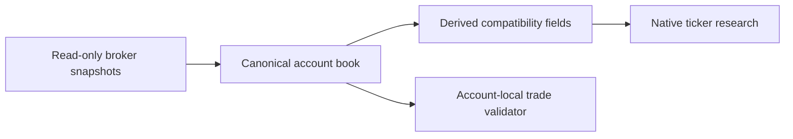

## Brief

Implement fee-aware trade recommendations, meaningful entry sizes and full-exit handling; support Tiger plus Moomoo Singapore with account-specific costs/cash; remove hardcoded AI subthemes and obsolete owned JSON properties. Reuse TradingAgents native research and `--portfolio` context. Application changes span Argus and the sibling TradingAgents add-ons; no native package change is needed.

This is a **normal implementation plan**. Discovery has produced the decisions and file-level tasks below. Complete code, migration, offline checks, independent review and independent verification before final acceptance. No order submission, automatic trading, paid model runs, FX conversion, new taxonomy, or rewrite of historical reports is included. Existing flexible 10% cash / 30% long-term / 60% swing guidance stays intact.

Supersedes the [original research record](../20261114042231-trade-sizing-transaction-fees-exit-rules/plan.md). This document is the implementation source of truth; research is supporting evidence, not a terminal deliverable.

## Discovery

Research: [research.md](./research.md)

Discovery completed by `opmentix-researcher` (`research_scope`, `moomoo_discovery`) and `opmentix-planner` (`research_plan_tasks`), with host inspection and independently calculated economic examples. Native capability, config consumers, Moomoo documentation, import/data contracts and validator/display paths were inspected. User credentials, live broker data and paid models were not used.

Findings driving implementation:

- Native `PortfolioContext` supports cash/holdings/average costs and is already passed by Argus. Sizing is advisory; native code has no fee/minimum/residual/account contract. The native portfolio manager decides one instrument, rather than allocating the whole account. Keep the package and its outcome-evaluation horizon unchanged.
- Current add-on validation truncates quantities, accepts model price fallback and merely warns on overspending. It ignores fees. Argus can resurrect raw trades through `check.trades or decision.trades` when validation is empty. Both layers must use validated results.
- Tiger currently replaces the entire single book. Same-stock quantities and cost must be retained per account and consolidated only for equivalent USD instruments. Cost averages must be quantity-weighted; diluted cost is a distinct broker metric.
- Official Moomoo SDK defines Singapore firm `FUTUSG`, US trading context, account/position/cash queries and cost fields. Use the documented SDK/OpenD route. The currency parameter is ignored for some securities accounts and per-currency cash fields are futures-only; `cash`, withdrawal funds and buying power cannot establish spendable USD. Import position/cost data with cash explicitly unknown unless its USD denomination is verified. Actual account authorization/live responses remain deployment verification, separate from completed API research.
- AI subthemes span UI/API, fund manager, scout, required output schemas and code fallbacks. Removing only JSON entries restores them. General themes/buckets and AI look-through weighting are separate, active analytics; retain them.

### Policy defaults proposed for plan approval

These are implementation decisions to approve with the plan, not assertions about broker tariffs or guaranteed returns.

| Decision | Implemented behaviour |
| --- | --- |
| Fee estimate | `trade_policy.fee_per_order_usd = 3`; one fee per accepted nonzero buy/sell order. No fee on HOLD/rejection. Show this as an estimate; do not invent historic fees or tax. |
| Entry size | `trade_policy.min_buy_notional_usd = 1000`, excluding fees, per order in the selected account. Applies to new buys and top-ups for both swing and long-term roles. Reject smaller/unaffordable proposals; never increase risk/quantity to meet the floor. |
| Exit/remainder | `trade_policy.min_residual_notional_usd = 1000`. Explicit `exit` recommends closing that account's available holding. A partial trim leaving a positive value under $1,000 at the code-supplied quote becomes a clearly labelled full-exit recommendation where availability permits. Exactly $1,000 may remain. Existing small holdings are not automatically liquidated. |
| Risk reductions | A valid sale below $1,000 is allowed. Frozen/unavailable shares cannot be sold; remaining units stay visible and cannot be described as a completed exit. Full liquidation can include an existing fractional balance in the recommendation; buys and ordinary trims require whole shares. No broker order is sent. |
| Account scope | Limits, fees, cash and sellable quantity apply per account/order. Two $600 holdings remain visible as $1,200 combined exposure; neither account gets a spending or sell entitlement from the other. |
| Accounting | Validate sells before buys, preserving order within each group; explain the assumed execution sequence. Debit/credit net fees only to the same account. Recompute equity, cash percentages, weights and stress denominators after fees when their inputs are known. Unknown account cash rejects that account's actionable trades; never substitute zero. Do not validate a proposal with negative ending account cash. |
| Invalid proposals | Reject unknown account/instrument/action, inconsistent action/decision, invalid quantity, unavailable code-supplied price, duplicate account/instrument rows and staged orders without concrete single-order quantities. No model-estimate price fallback or silent integer truncation. |
| Result contract | Every row carries account, status (`accepted`, `adjusted`, `rejected`, `hold`), requested/effective quantity, gross notional, estimated fee, cash delta and reason. Rejected rows have zero effects. Preserve original proposals as history; actionable projections/rendering use validation only. |
| Holding count | No arbitrary fixed stock count or dollar profit target. Report fragmentation relative to available capital and the $1,000 guide; position risk and cash still decide whether to buy. Batched long-term purchases avoid repeated fees. |

Policy has one source in active `data/targets.json.trade_policy`, parsed by the shared validator with the documented defaults. Add a read-only effective-policy summary to reports/dashboard; no new settings hierarchy or fee-provider service. Whole-account cash guidance remains soft.

Absent policy fields use the documented defaults. Present invalid/nonfinite values, negative fees, or nonpositive thresholds fail run preflight/manifest validation before any paid call; do not silently repair owner configuration. Known cash with unknown broker availability permits a labelled hypothetical recommendation, not an executable-order claim. A verified available-cash/sellable limit always constrains it; unknown USD cash rejects actionable rows entirely.

### Account and import contract

| Component | Description |
| --- | --- |
| Read-only broker snapshots | Previewed Tiger or Moomoo positions, cost provenance and verified cash where available. |
| Canonical account book | `accounts[]` in one versioned, atomically written `my_book.json`, normalized by the shared helper. |
| Derived compatibility fields | Top-level cash/positions in that same file; nullable cash stays unknown. |
| Native ticker research | Existing `--portfolio` contract; one research run per equivalent instrument. |
| Account-local trade validator | Custom fee, cash, sellable-quantity and minimum/remainder rules using canonical accounts. |

- Add `schema_version: 2` and canonical `accounts[]` to the existing `data/my_book.json`. Each account has stable opaque `account_id`, broker/label, scope/currency, actual USD cash, optional verified available cash, fetched timestamp and positions. Positions retain instrument identity, quantity, optional sellable quantity, optional `average_price`, cost-method provenance and separate diluted cost when supplied.
- Keep derived top-level `cash`, `currency: USD` and consolidated `positions` in the **same atomically written file** for existing native/scout consumers. Shared `addons/portfolio_book.py` owns validation, legacy reading, consolidation and account replacement; never maintain two competing canonical books. Native analysis receives the derived aggregate; account-aware fund-manager checks use canonical accounts. Native `PortfolioContext` already accepts null cash; no native schema change is required.
- Account cash and the projected total are nullable: any unknown account cash makes consolidated cash, total equity, allocation/cash percentages and whole-book risk metrics unavailable. Keep priced holdings value and known-cash subtotal visible with explicit partial labels, not fabricated full-account totals. Per-account known-cash validation remains possible; unverified accounts only receive qualitative advice and rejected actionable rows with the reason. Audit fund-manager stats/log/Markdown formatting and scout `exposure_summary` to prevent null-to-zero coercion or crashes.
- Consolidate only mapped US stocks/ETFs in USD. Quantity and marked value sum; acquisition cost sums only when all constituent costs use compatible average-cost definitions. Otherwise combined acquisition average/P&L remain null, with per-account detail retained. Do not infer realized P/L or tax lots from snapshots.
- Scope is explicitly the tracked US-stock/USD portfolio, not the entire global broker account. Non-stock/other-market assets and non-USD balances must be disclosed as excluded; never convert or quietly include them in USD totals. Unsupported or incomplete rows inside the selected scope block application. Preserve Tiger's existing strict mixed-currency behaviour unless a separate reviewed scope change is required.
- Read legacy books without writing. On first reviewed write, back up and wrap the old book as one `legacy` account while preserving unrelated metadata. First broker import offers explicit `replace legacy` versus `add separate account`; never assume the legacy book is another account and double-count the same Tiger position. Require explicit confirmation for binding/replacement.
- Account refresh replaces only that account, recalculates the compatibility projection and uses existing shared data lock, book-version conflict check, preview expiry, empty-scope confirmation, backup and atomic replacement. Store stable account identity server-side, expose aliases to UI. Repeated snapshots are idempotent. Failed/incomplete refresh preserves the previous good snapshot and shows its timestamp/error.
- No automatic cash transfers or order routing. Available-cash/sellable limits, where verified, constrain proposals; absent broker availability stays explicitly unknown and must not be advertised as executable buying power. A negative cash/debt account cannot fund new buys. For Moomoo securities, default cash is null: no use of `accinfo_query(currency=USD).cash`, `us_cash` (documented futures-only), `available_funds`, `power` or `usd_net_cash_power` as a USD cash substitute. Position `average_cost` is accepted only when finite and positive; `cost_price_valid` validates a different diluted-cost field and does not prove acquisition-average validity.

### Configuration cleanup decision

| Remove | Keep and rationale |
| --- | --- |
| `themes.json.subthemes`, `subtheme_labels`; current persisted `sub_theme` tags after consumer removal | General `themes`, `buckets` still drive concentration/look-through; sector discovery remains. |
| Live/template `weights_pct`, `is_guidance` | `approved_targets_pct` if present and all `portfolio_guidance`/`cash_policy` fields; legacy unapproved weights are intentionally ignored. |
| Saved `watchlist_curator.cooldown_days`, `max_adds_per_week`, `max_drops_per_week`, `shadow`, `shadow_until`; their no-op settings inputs/writes | Fixed 14-day cooldown/unlimited weekly caps remain behaviour, not misleading configurable fields. Keep `max_candidates`, `max_stocks_per_sector`. |
| No other unproven keys | Keep `_note`, AI weights/cap/provenance, all active budget fields and the weekly-budget compatibility alias. Budget precedence is in use; preserve disabled-spending-check preference and model selections. |

The subtheme cards disappear. Retain AI look-through warning information as part of the existing portfolio risk summary, clearly separate from subthemes. Saved reports and watchlist event history remain readable and are not rewritten. Current config/watchlist cleanup is backed up and repeatable; config edits invalidate reviewed run manifests through existing fingerprints.

## Plan

All paths below are relative to Argus; `../TradingAgents/` denotes the sibling repository. **New** means a proposed file. File lists include each task's implementation and focused checks. Shared files such as `server.py` and `static/app.js` must have one owner at a time; serialize their edits. Do not revert unrelated existing workspace changes.

Order: completed discovery → T12 account contract → T11 trade validation and T13 Moomoo integration → T14 subtheme removal → T15 migration → T16 review/verification → T7 documentation/acceptance. T14 can be developed independently in add-on files, but overlapping UI/backend edits are integrated serially.

- [x] T12: Implement canonical account book, consolidated projection and safe account refresh.
  - `../TradingAgents/addons/portfolio_book.py`: **New** pure schema validation, legacy wrapper, instrument/currency identity, quantity-weighted consolidation, cost provenance, derived compatibility view and selected-account merge.
  - `portfolio_import.py`: **New** shared preview records, account identity, version/expiry/empty checks, locked atomic application and backup; reuse existing Tiger safeguards for both brokers.
  - `tiger_import.py`: adapt Tiger normalization to account snapshots and available fields; delegate shared apply/version logic without weakening stock/currency/completeness checks.
  - `server.py`: return account detail plus consolidated portfolio; account-scoped Tiger previews/apply, explicit legacy binding and freshness/error state. Remove zero-cost assumptions when average is missing.
  - `run_analysis.py`: normalize/validate v2 book before launching consumers, parse trade policy during preflight before paid calls, deduplicate ticker research and retain native `--portfolio` aggregate input. No broker mutation during runs.
  - `../TradingAgents/addons/fund_manager/fund_manager.py`: Also changes `../TradingAgents/addons/theme_scout/theme_scout.py` — read the shared book contract; value quantities once, expose account context and preserve unknown cash/cost through stats, risk/exposure summaries, logs and report rendering. Omit unavailable whole-book metrics instead of dividing by a partial total.
  - `run_inputs.py`: fingerprint the shared book helper alongside the existing whole book/config inputs, so account/projection code changes invalidate prior reviewed scope; do not create a second data source.
  - `static/index.html`: Also changes `static/app.js`, `static/tiger-preview-guard.js` — account breakdown/filter, consolidated totals, scope/cost/freshness notices and account-replacement wording/confirmations.
  - `../TradingAgents/addons/check_portfolio_book.py`: **New** ; update `check_tiger_offline.py`, `check_offline.py`, `check_runner_offline.py`, `check_tiger_ui_offline.js` — consolidation, legacy binding, account isolation, null costs and repeated/conflicting/incomplete refresh fixtures.

  - `check_portfolio_import_offline.py`: New credential-free proof of first import, explicit legacy binding, per-account refresh and version conflict behaviour.

- [x] T11: Implement fee-aware entry/exit validation and consistent display.
  - `../TradingAgents/addons/fund_manager/trade_validation.py`: **New** sole policy parser and deterministic account-local cash/fee/quantity validator; rejected/adjusted rows and post-fee state, with no SDK/model dependency.
  - `../TradingAgents/addons/fund_manager/fund_manager.py`: add account identity and change `TRADE_ITEM.shares` from integer to number; validator still requires whole buys/trims and allows decimals only for complete available-position exits. Remove integer truncation in validation/diffs/rendering, cover each account holding in prompts, integrate post-fee metrics and effective-row JSON/Markdown.
  - `server.py`: validate effective policy during run-manifest preparation before paid work; expose validated rows/fees/account totals; preserve an explicitly empty validated list instead of falling back to raw model trades. Legacy fallback only when validation fields are absent.
  - `static/index.html`: Also changes `static/app.js` — effective policy summary, account/status, proposed versus effective quantities, fees/net cash and rejection/adjustment reasons; keep historical report rendering compatible.
  - `static/fund-trade-render.js`: New shared escaped trade-table renderer exercised directly by the UI fixtures, avoiding tests of duplicated rendering logic.
  - `static/formatters.js`: New shared null-safe money and exact fractional-quantity formatting used by the app and tested renderers.
  - `static/portfolio-holdings-render.js`: New shared escaped consolidated/per-account holdings renderer and filter support, exercised with overlapping broker positions and unknown values.
  - `../TradingAgents/addons/fund_manager/check_trade_validation.py`: **New** Also changes **new** `check_fund_manager_ui_offline.js`; update `../TradingAgents/addons/fund_manager/check_offline.py`, `check_offline.py` — fee/minimum boundaries, fractional full exits, constrained/unknown availability, empty validation, post-fee equity and UI escaping.

- [x] T13: Implement read-only Moomoo Singapore preview/apply.
  - `moomoo_import.py`: **New** lazy optional SDK import, local OpenD connectivity, `OpenSecTradeContext(filter_trdmarket=TrdMarket.US, security_firm=FUTUSG)`, authorized real US-account listing and refreshed position/cash queries; normalize snapshots without order/unlock methods.
  - `moomoo-requirements.txt`: **New** pin official `moomoo-api==10.12.7208` in Argus' optional broker environment and document compatible OpenD installation; base requirements stay unchanged.
  - `server.py`: `/api/moomoo/accounts`, `/api/moomoo/preview`, `/api/moomoo/apply`, reusing shared import guard and response contracts; no raw account IDs or credentials in browser/error output.
  - `static/index.html`: Also changes `static/app.js` — broker selection and Moomoo connection/account preview using the existing import flow; show USD-only scope, excluded balances, invalid cost and selected-account replacement.
  - `check_moomoo_offline.py`: **New** Also changes **new** `check_broker_import_ui_offline.js` — SDK fakes, account filtering, valid/invalid acquisition costs, null cash, currency-parameter/buying-power traps, excluded scope, missing SDK/OpenD, failures, retry and one-account-only application.

- [x] T14: Remove hardcoded AI subthemes across producers and consumers.
  - `server.py`: remove fixed taxonomy, labels/index/aggregation, watchlist input/validation and newly emitted subtheme fields. Accept/ignore legacy saved fields on read without retaining a live feature.
  - `static/index.html`: Also changes `static/app.js` — remove portfolio/watchlist subtheme cards, columns, selector and request fields; preserve sector, instrument and investment-role presentation.
  - `../TradingAgents/addons/fund_manager/fund_manager.py`: remove fallback categories and subtheme stats/prompt/report sections; keep general themes and AI look-through.
  - `../TradingAgents/addons/theme_scout/theme_scout.py`: remove subtheme field from proposal schema, normalization/context, output and version hashing; remove subtheme relative-strength groups while retaining sector groups and discovery.
  - `../TradingAgents/addons/fund_manager/themes.json`: remove only `subthemes` and `subtheme_labels` after consumers are fixed.
  - `check_offline.py`: Also changes `../TradingAgents/addons/fund_manager/check_offline.py`, `../TradingAgents/addons/theme_scout/check_offline.py`, `check_run_scenarios_offline.js` — absent/missing legacy taxonomy, old saved data, proposal freshness and sector regression coverage.

- [x] T15: Apply backed-up, repeatable config/tag migration after consumer changes.
  - `../TradingAgents/addons/config_cleanup.py`: **New** pure keep/remove transformation plus dry-run/apply CLI using the existing `.argus-run.lock`, expected hashes, backups and atomic writes. Report changed key paths only; never print holdings/credentials. Prevalidate all files; on multi-file failure restore completed replacements from backups and record failure.
  - `../TradingAgents/data/targets.json`: remove only the audited obsolete keys, add the three `trade_policy` defaults, preserve effective cash/watchlist/budget/model preferences. This is local user data, not a public commit payload.
  - `../TradingAgents/addons/fund_manager/targets.json`: clean bundled example and document trade-policy defaults without inventing approved allocations.
  - `../TradingAgents/data/watchlist.json`: strip current `sub_theme` tags, preserving container shape, other fields/order and candidates. Do not alter `watchlist_log.jsonl` or historical reports.
  - `server.py`: Also changes `static/app.js` — stop accepting/persisting no-op weekly add/drop settings; retain current limits/cooldown status as read-only effective behaviour. Settings saves cannot recreate removed keys.
  - `../TradingAgents/addons/check_config_cleanup.py`: **New** ; update `check_offline.py`, `../TradingAgents/addons/check_cost_ledger.py`, `../TradingAgents/addons/theme_scout/check_offline.py` — idempotence, unrelated metadata, effective budget precedence, disabled budget, rollback, lock/version conflicts and old manifests invalidation.

- [x] T16: Run focused integration checks and independent review/acceptance.
  - `check_offline.py`: All focused check files listed under T11–T15 — execute offline with isolated temporary data; repair test fixtures for the new contracts rather than mirror implementation details.
  - `check_runner_budget_offline.py`: Also changes `check_money_formatter_offline.js`, `check_run_scenarios_offline.js` — retain no-LLM/paid-scope/spending gates, decimal display and reviewed-run behaviour after book/config changes.
  - `plan.md`: This record test commands/results, separate reviewer rounds, accepted fixes/rejections and independent verifier criterion results. No stage advance from Implementation until tests pass and an actual independent review is clean.

- [x] T7: Document shipped behaviour, curate durable knowledge and request acceptance.
  - `README.md`: user-facing fee/minimum/exit guidance, account scope, import/migration/restore, Moomoo/OpenD setup and live-test limits.
  - `../TradingAgents/addons/fund_manager/README.md`: Also changes `../TradingAgents/addons/theme_scout/README.md` — native/custom responsibilities, account contract, validator semantics and removed taxonomy/settings.
  - `.opmentix/harness/knowledge/project-guide.md`: Also changes a focused knowledge entry if warranted, this `plan.md` and `research.md` — curator records decisions, commands, source versions, test evidence and deployment limits; no research-only closure.

### Completed discovery tasks (stable IDs)

- [x] T10: Native capability assessment — supporting `research.md` matrix and native reuse boundary complete.
  - `research.md`: Completed source evidence, findings and implementation decisions for this discovery task.
- [x] T1: Trace existing validator/import/display/runner paths — source evidence and defects documented above and in `research.md`.
  - `research.md`: Completed source evidence, findings and implementation decisions for this discovery task.
- [x] T2: Economic sizing comparison — $500/$1,000/$2,000 scenarios, fee drag, risk and batching recommendations calculated in `research.md`.
  - `research.md`: Completed source evidence, findings and implementation decisions for this discovery task.
- [x] T3: Exit behaviour and exceptions — account-local full exit, residual guideline and availability/fractional handling specified above.
  - `research.md`: Completed source evidence, findings and implementation decisions for this discovery task.
- [x] T4: Moomoo feasibility — official SDK/OpenD/SG/field documentation verified; live account access is a later verification item, not claimed completed.
  - `research.md`: Completed source evidence, findings and implementation decisions for this discovery task.
- [x] T5: Account/cost/import design — single-file versioned account contract, compatible projection, cost provenance and legacy-binding behaviour specified.
  - `research.md`: Completed source evidence, findings and implementation decisions for this discovery task.
- [x] T8: Subtheme dependency map — producer-to-display removal and historical compatibility file list established.
  - `research.md`: Completed source evidence, findings and implementation decisions for this discovery task.
- [x] T9: Config audit — exact removal list, active controls to preserve and fallback/manifest traps established.
  - `research.md`: Completed source evidence, findings and implementation decisions for this discovery task.
- [x] T6: Compile implementation decisions/tasks — concrete defaults, interfaces, file changes, ordering and acceptance below; defaults remain subject to plan approval.
  - `research.md`: Completed source evidence, findings and implementation decisions for this discovery task.

- [x] T17: Repair environment-wrapper script imports and verify the real no-paid snapshot path.
  - `exec_ta.py`: Match direct Python script import-path semantics when running a nested TradingAgents entry point through runpy, preserving root-boundary checks, argv and environment precedence.
  - `check_exec_ta_offline.py`: New isolated sibling/root import, argv, dummy environment and outside-root rejection checks without credentials or provider calls.
  - `check_runner_offline.py`: Exercise the wrapper path using a dummy environment file and a real sibling validator import instead of relying only on direct-script fake stages.
  - This `plan.md`: Record the failed production free snapshot, independent fix review, successful rerun and protected-data hash proof; Moomoo connection stays on hold.

- [x] T18: Repair cached preview-helper compatibility and verify successful preview rendering.
  - static/index.html: version the renamed preview guard asset so older cached Tiger-only helpers are refreshed.
  - check_broker_import_ui_offline.js: exercise actual preview fetch/render and existing confirmation/stale-response safeguards.
  - Acceptance: cached old guard reproduces stuck Fetching; current page invalidates it; focused checks and independent review/verification pass.

## Implementation

Implementation approved in the harness on 2026-11-14 and delivered. Development ownership: `implement_tradingagents` owns TradingAgents shared book, validation, fund manager/scout and related checks/docs; `implement_argus_backend` owns Argus Python/import/runner/API and backend checks; `implement_argus_ui` owns static UI, JS checks and Argus README; host owns config-cleanup module/check, live migration, integration and plan evidence. Shared files are not edited by multiple delegates. Preserve pre-existing README/server/start-script changes. Native package remains unchanged. Independent review round 3 and acceptance verification are complete with passing evidence below. Real config cleanup was applied with backups, Argus was reloaded and health/portfolio/renderer assets verified. A follow-up real snapshot exposed a wrapper import defect; T17 is implemented, independently reviewed and verified through a successful production zero-paid snapshot; final human closure is pending.

Independent review session: `/root/independent_review`. Supplemental round evidence:

- round 1: assessment: all are valid in-scope defects. Host fixed backup mode preservation and its 0600 fixture passes. Backend/UI owners are fixing remaining findings. This preliminary round covered completed portions while integration continued; full stable-tree independent review is required after fixes and complete focused checks.

- round 2: session: /root/independent_review

- round 2: assessment: all valid in scope and fixed by the responsible owners, with realistic SDK, strict-JSON, full-report, API/UI and paid-scout regressions. The integrated offline suite passed after source freeze. Requested round 3 independent review; no clean result or stage advance claimed yet.

- round 3: session: /root/independent_review

- round 3: evidence: Full stable-tree independent source inspection and rerun of API/runner-budget/Tiger/Moomoo/account-import/UI plus TradingAgents fund-manager/scout/validator checks passed. Both repos pass diff checks. All prior actionable findings fixed. Live Moomoo/OpenD connectivity and SG authorization remain untested.

### Review loop

- round 1
  - reviewer: opmentix-reviewer
  - result: findings
  - tests: not-run
  - findings: v2 legacy account detection and preview-bound replacement choice (server.py); missing per-account holdings detail; duplicate null formatter and fractional quantity rounding (static/app.js); backup mode widening (addons/config_cleanup.py).

- round 2
  - reviewer: opmentix-reviewer
  - result: findings
  - tests: not-run
  - findings: pinned SDK quote constructor, returned classification, short directions and out-of-scope ordering (moomoo_import.py); no-legacy preview/apply null-versus-false mismatch, finite quote guards, partial subtotals and scoped warning text (Argus backend); null ending_cash, malformed requested quantities/diffs, unknown-cash correlation NaN and legacy fabricated availability (TradingAgents); effective policy propagation and paid scout preflight (cross-layer).

- round 3
  - reviewer: opmentix-reviewer
  - result: clean
  - tests: passed
  - findings: none

- round 4
  - reviewer: opmentix-reviewer
  - result: clean
  - tests: passed
  - findings: none

- round 5
  - reviewer: opmentix-reviewer
  - result: clean
  - tests: passed
  - findings: none

## Review

T18 independent review (`/root/preview_review`, opmentix-reviewer) is clean with no actionable findings. Reviewer reran broker UI/Tiger UI/formatter checks, diff check and cached-helper browser reproduction successfully. Browser reproduction using cached committed Tiger-only helper produced `globalThis.argusBrokerPreviewIsCurrent is not a function` and remained Fetching after mocked 200. The same reproduction with versioned helper URL renders 13 fixture holdings and cash. Fresh live read-only Tiger preview also rendered successfully before the cache fix; no apply was performed.

Follow-up round 4 (`independent_review`) independently inspected T17 launcher and runner fixture changes; clean with no actionable findings. Bridge, runner, budget and diff checks passed. The resolved inside-root guard, argv and dotenv precedence remain intact; nested sibling imports now match direct script execution. Production zero-paid snapshot rerun succeeded and independent post-fix verification passed.

Independent full code review is complete: round 3 by `opmentix-reviewer` / `independent_review` is clean with passed checks and no actionable findings. Scope covered both repositories, accounts/imports, cash/cost/quote semantics, validator/report/policy, UI formatting and migration safeguards. Prior rounds and fixes are recorded in Implementation. Source/fixture verification does not establish live broker authorization.

## Acceptance

T18 complete (2026-11-15): owner-reported stuck Fetching reproduced in Chromium by supplying the cached committed Tiger-only helper to the old unversioned URL. Current app calls the renamed Broker guard in both try and catch, producing `argusBrokerPreviewIsCurrent is not a function` despite HTTP 200. `static/index.html` now versions that helper URL. The same stale-cache browser reproduction now renders all 13 fixture holdings and cash with no pageerror. Fresh real read-only Tiger preview also rendered successfully; no account snapshot was applied.

Independent verifier `/root/preview_verify` passed broker UI/Tiger UI/formatter checks, scoped diff check and cached-helper browser reproduction. Actual-handler VM regression asserts successful ticker/cash rendering, stored preview and Apply disabled until stock-only acknowledgement; existing guard fixtures reject stale/account-mismatched/closed responses. Independent reviewer `/root/preview_review` is clean (round 5). Verifier browser response was mocked; no live Moomoo connection or portfolio apply. Reloading the page loads the corrected helper URL. Independent curator `/root/preview_curate` updated the project guide with the durable shared-script URL versioning rule; guide diff check passed.

Completed follow-up (2026-11-15): the owner has put the Moomoo connection on hold and requested verification of everything else. The gateway is stopped and installed files retained. Fresh 16 non-Moomoo checks and isolated runtime/preflight passed; existing Tiger read-only account listing returned 200. A real zero-paid-stage snapshot (`20261115_022314_d632d8`) then failed before calculations because `exec_ta.py` did not add the nested script directory for a sibling `trade_validation` import. T17 repaired that launch-path gap. Independent review round 4 is clean; independent verifier reran bridge, runner and budget checks successfully. Production snapshot `20261115_023139_cc4737` succeeded with exit 0 at 02:32:26 UTC. Manifest has only unpaid SCR/REV-SNAPSHOT stages, no LLM/macro/agent work and zero estimated cost. All four protected data hashes (my_book, targets, watchlist and watchlist_log) match before/after; API health and run history return 200. No listener remains on port 11111. The new live issue is resolved.

Independent acceptance verification completed by `opmentix-verifier` (`/root/acceptance_verification`) on 2026-11-15. **Pass for offline criteria; no failures.** The verifier was independent of developers and code reviewer and made no source/data changes. The first attempt was interrupted by provider usage limits; the resumed verification completed normally.

| Criterion group | Result | Independent evidence |
| --- | --- | --- |
| Entry economics, fees, residual/full/fractional exits and quantities | Pass offline | Trade-validator fixtures cover $999 rejection, $1,003 funding, per-role/new/top-up floor, $600 sale, fractional and constrained exits, $997 proceeds, sequential account cash and fee effects. |
| Account isolation, costs, legacy binding and scoped refresh | Pass offline | Account-book and import fixtures cover consolidation, unknown/incompatible cost and cash, explicit binding, repeated/idempotent refresh and conflict protection. |
| Policy, malformed model data, quotes and report surfaces | Pass offline | Fund-manager strict-JSON/full-render/diff and nondefault-policy fixtures; API/UI checks cover validated-empty results, reasons/statuses, old reports and safe unavailable values. |
| Moomoo API/type/side/currency scope and cash boundaries | Pass offline; live not run | Real-shaped SDK fixtures pass; source scan found no submit/order/unlock methods. No buying-power-to-cash inference. |
| Paid-run preflight, no-LLM and spending behaviour | Pass offline | Runner and budget fixtures pass, including malformed policy before paid scout and no-LLM overriding a conflicting scout flag. |
| Subtheme removal and compatibility | Pass offline | API, broker/fund-manager UI and scout checks pass; retained general theme/sector/AI look-through functions and readable legacy data/history. |
| Actual owned-config migration | Pass | Verifier transformed the timestamped targets/watchlist backups and reproduced current JSON exactly; preserved wrapper/order/non-subtheme content and file modes; fresh cleanup preview has zero changes. |
| Running deployment | Pass read-only smoke | Independent GET health/portfolio returned 200. Host additionally verified all three actual `/static/` renderer/formatter assets returned 200; the verifier's optional nonexistent `/api/assets` 404 is not used as asset evidence. |
| Independent code review and curation | Pass | Round 3 reviewer clean with passed checks; curator updated the durable project guide and corrected port/SDK setup facts. |

Independent commands all passed (17 focused scripts):

- Argus Python: `check_offline.py`, `check_runner_offline.py`, `check_runner_budget_offline.py`, `check_tiger_offline.py`, `check_portfolio_import_offline.py`, `check_moomoo_offline.py` using Argus `.venv`.
- Argus Node: `check_money_formatter_offline.js`, `check_tiger_ui_offline.js`, `check_run_scenarios_offline.js`, `check_fund_manager_ui_offline.js`, `check_broker_import_ui_offline.js`.
- TradingAgents `.venv`: `addons/check_cost_ledger.py`, `addons/check_portfolio_book.py`, `addons/check_config_cleanup.py`, `addons/fund_manager/check_trade_validation.py`, `addons/fund_manager/check_offline.py`, `addons/theme_scout/check_offline.py`.

Follow-up limits: the latest saved AI decision remains a legacy report without a trade-policy object; the successful free refresh does not regenerate paid AI advice. Browser interaction was not automated; UI checks used runtime fixtures and served assets, and the owner confirmed the frontend changes were visible.

Limits: no live Moomoo/OpenD connection or SG account authorization was exercised; no paid analysis or broker orders were run. Verification uses focused fixtures plus source-backed coverage, not every example manually exercised through every report surface. Moomoo unknown-cash restrictions remain intentional and documented. Both repository diff checks pass; changes remain in the shared working trees without an unsolicited commit.

Curation handoff: `opmentix-curator` (`curate_delivery`) updated only `.opmentix/harness/knowledge/project-guide.md`, including final port 8788, pinned SDK `OpenSecTradeContext`/US/FUTUSG setup, account/cash semantics, migration safeguards and check commands. Final pass logged 2026-11-15 01:36 UTC; no duplicate knowledge entry was needed. Documentation points to this plan for acceptance evidence.

Follow-up curation: `curate_delivery` updated the guide at 02:32 UTC with the launcher import-order invariant, bridge regression command and explicit Moomoo hold. Guide-only diff check passed. T7/T16/T17 are complete; closure remains a human action.

Original checkable acceptance criteria retained below:

- **Economics/entries:** $999 buy rejected; $1,000 needs $1,003 cash in that account. This applies to swing/long-term/new/top-up. A 10% illustrative gain nets $44/$94/$194 on $500/$1,000/$2,000 after $6 round-trip fees; no profit forecast implied.
- **Exits:** at $100/share, trim 10 of 15 adjusts to 15-share exit; trim five leaves exactly $1,000 and remains five. Full exit closes available fractional remainder too; locked/unavailable units remain visible as incomplete. Valid $600 risk sale is permitted. Existing small holdings are unchanged absent an explicit proposal.
- **Validation/cash:** invalid quantities, unknown account/instrument, missing quote, duplicates and staged rows have zero state/fee effect. Selling $1,000 from zero cash yields $997, insufficient for a $1,000 buy plus fee. Two accepted orders reduce $10,000 unchanged-mark equity to $9,994. Other-account cash never funds a trade.
- **Policy/availability:** absent fields resolve to the documented defaults; invalid supplied policy blocks manifest/preflight before paid work. Known cash plus unknown availability is labelled simulated; verified tighter availability limits constrain proposals. Fractional complete exits survive schema, validation, diff, Markdown/API and UI without truncation.
- **Display/history:** rejected/adjusted status and quantities/fees/reasons agree in JSON, Markdown, API and UI. An explicitly empty validated list remains empty. Older reports lacking the new fields remain readable; user-supplied text is escaped/sanitized.
- **Costs/accounts:** 10 shares at $100 plus five at $120 produce 15 shares, $1,600 cost and $106.67 average; at $130 mark value is $1,950/P&L $350 before extra fees. Separate account rows reconcile; missing/incompatible cost gives unavailable consolidated cost/P&L, never zero or diluted replacement. $600+$600 exposure does not bypass per-order minimum.
- **Imports/migration:** first legacy binding is explicit, repeated snapshots do not duplicate holdings, Tiger/Moomoo refresh cannot erase the other, and incomplete/expired/conflicting previews preserve good data. One-file atomic book update has backup/restore evidence. Out-of-scope currencies/markets are disclosed; totals contain no hidden FX conversion.
- **Moomoo:** offline SDK/OpenD/account/cost/cash/error fixtures pass; no order/unlock methods exist in the adapter. Record live connectivity/SG authorization as passed, failed or not run. Without access, shipped offline integration is evidenced and live status remains explicitly unverified.
- **Unknown cash:** a Moomoo holdings snapshot with verified quantities/cost and unknown USD cash can be imported and consolidated by instrument. Cash/equity/allocation percentages and cash-dependent whole-book risk are unavailable, while priced holdings and partial known balances remain labelled. That account cannot fund validated buys or produce a supposedly validated exit. `currency=USD`, buying power or a futures-only field cannot change this status; native/scout/free-snapshot/report paths must remain runnable.
- **Cleanup:** newly produced API/UI/model/report output has no subtheme feature and missing JSON cannot restore it. Sector/general-theme/AI look-through analytics remain. Audited obsolete properties/tags are removed repeatably; unknown metadata, budget-disabled/model choices and portfolio guidance survive. Demonstrate rollback on temporary fixtures and reviewed-manifest invalidation.
- **Delivery:** focused checks pass; independent review is clean; verifier results and curator handoff are recorded. No implementation task marked complete from planning evidence alone.

### User-authorized live Moomoo setup follow-up

On 2026-11-15 the owner requested actual installation on the same Linux host, offering to handle authentication. Installed `moomoo-api==10.12.7208` into Argus `.venv`; import, US trading context/FUTUSG availability and `pip check` pass. Downloaded the matching Moomoo-branded official Ubuntu archive from `softwaredownload.futustatic.com` over HTTPS; local archive SHA-256 is `3ef44baf08f894a3d46c23ed784c7134d963e0d063c674f4384f7a8f99f58642` (recorded local integrity value, not a vendor signature). Extracted under `/home/dev/.local/share/moomoo-opend/10.12.7208`, verified x86-64 ELF and resolved libraries, and observed successful startup on Ubuntu 24.04.

Historical setup status before the user paused connection work: gateway ran in the local user's persistent `tmux` session `moomoo-opend`, launched by `/home/dev/.local/bin/moomoo-opend`, with private installation directory and restrictive runtime umask. Listener confirmed only on `127.0.0.1:11111`. It is waiting for the owner to enter account/password directly in the terminal. No credentials have been supplied through chat or saved in the installation manifest. The pre-login SDK handshake timed out and its diagnostic process was stopped; authenticated API access remains unverified. No portfolio replacement, unlock or order action was performed.

**On hold at the owner's request:** the gateway is now stopped, and the following authentication instructions must not be resumed unless requested. Earlier owner authentication handoff: from Windows PowerShell run `ssh -t dev@192.168.1.115 "tmux attach -t moomoo-opend"`, or in the Linux user's terminal run `tmux attach -t moomoo-opend`. Complete the OpenD login/verification there and detach with Ctrl+B then D to leave it running. After the owner confirms login, continue with authenticated, read-only account/position and preview validation before any reviewed apply. Earlier offline acceptance does not establish this live authentication step.

## Logs

- 2026-11-15 02:50 UTC — T18 curation complete: recorded shared-script API/cache-version invariant in the project guide. Refreshed closure evidence; human final acceptance remains pending.

- 2026-11-15 02:49 UTC — Independent T18 acceptance verification passed cached-helper browser reproduction, actual-handler/confirmation regression, focused UI checks and diff check; T18 complete.

- 2026-11-15 02:49 UTC — T18 versioned helper and actual Fetch/render/confirmation regression passed focused checks and independent clean review round 5; independent acceptance verification and curation finishing.

- 2026-11-15 02:47 UTC — Confirmed exact cached-helper failure in Chromium and successful post-fix rendering; versioned guard repair implemented, actual-handler regression and independent review/verification in progress.

- 2026-11-15 02:45 UTC — Added T18 for owner-reported stuck broker preview; traced cache-sensitive helper rename and delegated minimal repair plus runtime regression. Final closure evidence requires follow-up review/verification.

- 2026-11-15 02:33 UTC — Curator completed durable launcher/hold guidance; all tasks complete with independent review and verification. Refreshed final acceptance evidence for human closure.

- 2026-11-15 02:33 UTC — Real free snapshot 20261115_023139_cc4737 succeeded after T17; independent verifier passed bridge/runner/budget checks, protected hashes, API health and stopped OpenD proof. No paid run, broker order or account import.

- 2026-11-15 02:32 UTC — T17 wrapper fix and real-path regressions passed independent clean review round 4. Started zero-paid-stage production snapshot 20261115_023139_cc4737; verification ongoing, no Moomoo connection work.

- 2026-11-15 02:26 UTC — Put Moomoo connection on hold as requested. Fresh non-Moomoo checks passed; real free snapshot exposed missing nested-script path in exec_ta bridge. Added T17 and reopened final verification/curation, delegated minimal fix and real-path regression.

- 2026-11-15 02:02 UTC — Installed SDK and matching official Linux OpenD, verified compatibility/startup and local listener, prepared persistent terminal session; waiting only for owner authentication before live read-only testing.

- 2026-11-15 01:50 UTC — User confirmed frontend changes are visible at the deployed address; no cache/source fix needed. Expanded Moomoo README into a same-Linux OpenD setup and staged preview-before-apply runbook using verified official CLI docs. Current optional SDK and OpenD listener are not yet installed/running; no live broker test or account modification performed.

- 2026-11-15 01:40 UTC — Requested Acceptance → Close for human final acceptance; all 16 tasks complete, clean review and independent verification recorded. Source work complete; harness closure pending human action.

- 2026-11-15 01:39 UTC — Resumed Acceptance after interrupted verifier; independent verifier passed all 17 offline scripts and actual migration preservation checks. Final curator pass complete; service/API/assets healthy. Live Moomoo authorization remains explicitly untested.

- 2026-11-14 16:51 UTC — Normalized review-loop markdown to the harness parser fields while preserving supplementary findings/fix/test evidence outside the parsed block.

- 2026-11-14 16:51 UTC — Independent round 3 clean. Applied real targets/watchlist cleanup with timestamped backups, verified active preferences preserved, holdings/event history unchanged and repeat preview empty; T15 complete.

- 2026-11-14 16:47 UTC — Source frozen after round 2 fixes; integrated API/import/runner/UI/fund-manager/scout checks passed. Completed T11–T14 code/check scope, requested independent round 3. Real config migration, final verification and acceptance remain open.

- 2026-11-14 16:38 UTC — Recorded full review round 2 findings and delegated fixes; expanded real-shaped SDK, unknown-cash report and paid-scout preflight coverage. Still in Implementation; no live import or paid call.

- 2026-11-14 16:31 UTC — Round 1 fixes completed; requested full-tree independent round 2. Added actual UI helper file notes and corrected pinned Moomoo SDK constructor from inspected distribution. Curator updated project guide.

- 2026-11-14 16:22 UTC — Recorded independent preliminary review findings; fixed backup permission preservation with passing regression, delegated preview/legacy/UI precision fixes. No stage advance.

- 2026-11-14 16:20 UTC — Validator and cleanup fixture checks passed; UI owner completed runtime renderer/import checks. Added exact new renderer/import-check file notes; independent review started on completed code while cross-repository integration finishes.

- 2026-11-14 16:05 UTC — Harness implementation approval confirmed; claimed plan, delegated three exclusive code ownership areas and started host-owned backed-up config cleanup.

- 2026-11-14 15:59 UTC — Discovery approval confirmed; normalized per-task file notes to the harness-required file: description syntax before requesting implementation entry.

- 2026-11-14 14:22 UTC — Requested Discovery → Plan after completed discovery and file-level planning; harness pending human approval, with delivery tasks still open.
- 2026-11-14 14:20 UTC — Incorporated planner sanity findings on nullable cash/availability, fractional exits and pre-paid policy validation; verified normal plan kind, section structure and task/file coverage. Discovery complete; code remains unimplemented.
- 2026-11-14 14:12 UTC — Completed source/API/economic/config discovery; compiled file-level tasks and incorporated verified Moomoo cash limitations with explicit unknown propagation and trade restrictions. Application code unchanged.

- 2026-11-14 13:59 UTC — Created actual normal-kind replacement; carried over evidence and stable task IDs, with code-delivery tasks presented explicitly before discovery prerequisites.

- 2026-11-14 12:10 UTC — Corrected scope to end-to-end code delivery at owner request; integrated planner dependencies, added T11–T16 implementation/verification tasks, and required full lifecycle rather than research-only closure.
- 2026-11-14 11:47 UTC — Prioritized native-first assessment, integrated researcher capability matrix and confirmed existing Argus portfolio wiring; T10 complete by static inspection, other study tasks remain open.
- 2026-11-14 10:59 UTC — Added owner-requested AI subtheme removal and usage-based configuration cleanup to research scope as T8/T9; documented cross-repository defaults and preservation criteria.
- 2026-11-14 04:24 UTC — Integrated planner handoff and concrete accumulation, exit and consolidated-account acceptance examples; retained study tasks as open.
- 2026-11-14 04:23 UTC — Created and claimed research plan; integrated preliminary researcher evidence, bounded study tasks and observable acceptance criteria. Full research remains open.
