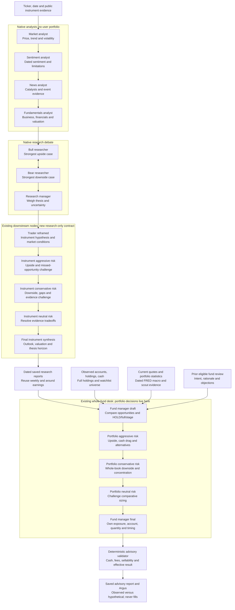
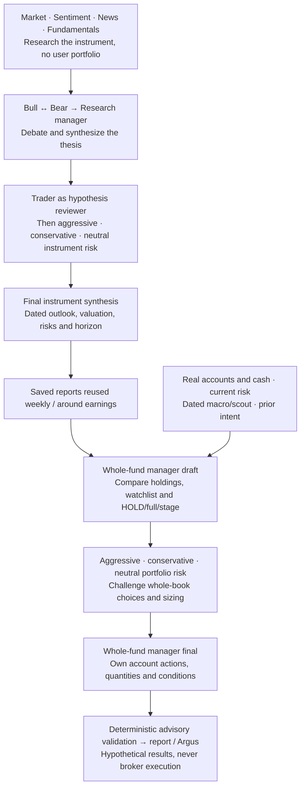

## Brief

Separate instrument research from portfolio allocation while fixing unexplained successive small adjustments. Reuse installed TradingAgents native agents, tools, debates, report storage and controls first; extend only demonstrated gaps. Individual-stock agents receive no user holdings, cash, costs or portfolio instructions and produce dated investment/risk research. The existing whole-fund manager alone compares all holdings and watchlist candidates, chooses exposure, account-specific recommendations and quantities, and explains continued or revised intent between reviews.

Preserve justified valuation targets/ranges, thesis horizons and conditional price levels as research; leave unsupported values explicitly unknown. Preserve weekly/earnings stock refreshes, discretionary allocation and existing account safeguards. No fixed cooldowns, forced allocations, daily paid refreshes, new paid agent stages, automatic brokerage actions or execution ledger.

Requested planner: **gpt-6.1-sol, high reasoning**. The planner authored the consolidated tasks and both Mermaid workflows below. The user approved implementation and the harness implementation gate is open. Source changes within this plan are authorized; paid analyses, live portfolio/configuration edits, broker connections and order execution remain outside validation scope. Scope spans Argus and the sibling TradingAgents installed fork. Native-first means verified local capabilities, not an unverified claim about latest canonical upstream.

## Discovery

Research: [research.md](./research.md)

Completed evidence discovery by `opmentix-researcher` (`trade_research`), quantitative interpretation/design by `opmentix-planner` (`fund_manager_planner`, gpt-6.1-sol/high), and durable curation by `opmentix-curator`. Host independently checked cash/fee arithmetic, source paths and document structure. Source documents, competing explanations, counterfactual limits and the native capability matrix remain in research.md; the consolidated Plan supersedes the earlier provisional six-task backlog while preserving its IDs.

### Findings that determine the design

- Compare **November 14 versus latest November 17 only**. NVDA observed35→25 then proposes another6-share sale; XLP observed0→12 then another12-share buy; XLV remains23 and moves from HOLD/conditional+6 to BUY8. Snapshot deltas do not prove fills. NVDA event risk and XLV pullback offer plausible reasons; XLP's earlier draft25→final12 restriction is not reconciled before the later24-share exposure.
- Selected quantities passed validation unchanged. The minimum buy is a floor, not an instruction to keep buying. Dated instrument theses can remain useful while earlier-cash starter rules and undefined standard-allocation sizing are inappropriate current portfolio instructions.
- Latest saved AMD also knows account cash/holdings and proposes0%/standard-allocation fractions even though optional target/horizon are absent. The report is not already portfolio-blind; Argus does not hide those missing fields.
- Native optional `--portfolio` removes direct book input, but downstream native prompt bodies/schemas still demand sizing. No complete native research-only switch exists. Existing add-on role overrides alone cannot alter the full contract. Reuse the graph with a compact research profile rather than build another agent framework.
- Native memory path and checkpoint controls exist. Isolate new research reflections, preserve old archives, and prevent old portfolio-aware prompt/output reuse. Both maintained Linux and PowerShell launchers currently pass the book and need the same boundary.
- Existing whole-fund manager already sees all consolidated holdings and non-held watchlist by default, plus quantitative, macro and dated scout inputs. Selected paid ticker refreshes do not narrow its universe. Make actual assessment coverage explicit and replace sizing-heavy report inputs with research briefs.
- Clean stock research alone does not fix daily local reoptimization. The fund manager must compare HOLD/full/staged adjustments, revisit prior objections and distinguish proposed exposure, immediate action and future conditions.

### Confirmed limits and handoff

No inference of optimal share counts, executions, intervening prices or profitable discretionary choices follows from the two reports. A latest daily bar labeled same-day last close before regular-session close has unresolved source-time ambiguity; do not assert a trigger completed from that label. Tests should prove input/output boundaries, chronology, arithmetic, coverage and honest presentation, rather than prescribe model judgments.

Durable facts: [fund-manager-decision-continuity.md](../../knowledge/fund-manager-decision-continuity.md). This entry describes current behavior and labels design proposals unimplemented. The completed planner handoff is incorporated below; no implementation or independent implementation review has begun.

## Plan

Deliver an account-blind instrument research workflow feeding the existing whole-fund manager. Preserve native agents, debates, tools, saving mechanisms and the weekly/earnings refresh cadence. The fund manager alone owns portfolio exposure, account-specific actions and quantities. Its portfolio risk committee challenges those decisions; the deterministic validator checks advisory mechanics.

This plan consolidates the completed study, including the latest AMD report. That report legitimately leaves an unsupported price target/horizon unknown, but also knows cash and holdings and proposes allocation fractions. Research-only output must remove the latter while retaining justified valuation targets/ranges and thesis horizons. Implementation requires the normal human-approved stage gate; this document performs no implementation or stage action.

### Native-first decisions and boundaries

| Capability | Decision |
| --- | --- |
| Native instrument research/debate graph | Reuse its four analysts, bull/bear debate, research manager, trader, three risk seats and final per-instrument arbiter. Reframe downstream duties through a small research-only profile; add no agents or parallel graph. |
| Optional native `--portfolio` | Omit it on both maintained launch paths. Absence means no account context, not a known-flat portfolio. Research mode also rejects accidental portfolio input. |
| Native prompts and schemas | A verified gap requires code: omission and add-on role overrides do not remove sizing instructions in task bodies/schema descriptions. Add one explicit `--research-only` selection, represented in effective native configuration, and coherent profile-specific instructions/output schemas. Keep ordinary portfolio-aware native mode supported. |
| Native memory/checkpoints | Reuse `TRADINGAGENTS_MEMORY_LOG_PATH` with a separate research-only path; preserve old logs. Pass existing `--no-checkpoint` during this workflow. No new memory store, destructive reset or checkpoint service. |
| Existing custom whole-fund manager | Reuse its full-book analytics, candidate inputs, macro/scout context, draft, portfolio risk debate and final decision. Extend the research boundary, comparative coverage and cross-review discipline. |
| Existing account validator and Argus | Preserve account cash isolation, unknown values, fees, sellability and historical display. Extend current/deferred advice and show producer-owned intent/provenance. No broker orders. |

These decisions describe the installed TradingAgents fork; canonical-upstream parity was not verified. Do not upgrade or replace native features speculatively.

### New workflow: agents and duties

The map shows logical native stage order, not a new parallel scheduler. Existing analyst ordering, debate routers and configured rounds remain in charge. Instrument research runs only when selected for refresh; saved reports are reused between weekly/earnings reviews.

| Component | Description |
| --- | --- |
| A | Native analyst group without portfolio input. |
| B | Native research debate group. |
| C | Native downstream instrument group. |
| F | Existing whole-fund desk. |
| PUB | Public instrument inputs; no book, account context or book-based ranking. |
| MA | Existing native market analyst. |
| SA | Existing native sentiment analyst; sentiment stays dated. |
| NA | Existing native news analyst. |
| FA | Existing native fundamentals analyst. |
| BU | Existing native bullish researcher. |
| BE | Existing native bearish researcher; native debate rounds remain intact. |
| RM | Existing research manager; synthesize investment evidence without allocations. |
| TR | Existing trader node, reframed as an instrument hypothesis rather than an order proposer. |
| IA | Existing instrument aggressive risk seat. |
| IC | Existing instrument conservative risk seat. |
| IN | Existing instrument neutral risk seat; native debate routing remains intact. |
| IS | Existing per-instrument Portfolio Manager node, presented as instrument synthesis in this profile. It is not the whole-fund allocator. |
| BR | Existing report storage with a compact research contract and mode/source provenance. |
| BOOK | Portfolio/account data and eligible universe enter only the whole-fund side. |
| DATA | Reuse existing quantitative, macro and scout inputs with their timestamps and coverage. |
| PRIOR | Saved prior advice and observed snapshots, never assumed fills. |
| FD | Existing whole-fund manager draft. |
| PA | Existing portfolio aggressive risk seat. |
| PC | Existing portfolio conservative risk seat. |
| PN | Existing portfolio neutral risk seat; current rotating speaking order/rounds remain intact. |
| FF | Existing whole-fund manager final; sole owner of published portfolio actions. |
| VAL | Existing custom account validator, extended for deferred advice. |
| OUT | Existing saved reports and dashboard; no execution path. |

The book, quantitative context and prior review shown entering the draft remain available to the existing whole-fund committee and final manager. The schematic omits repeated context arrows for readability.

### Output and decision contracts

**Instrument research:** instrument/date, source timestamps and profile version; attractive/neutral/avoid-style outlook; thesis and counter-thesis; valuation method/assumptions and justified target or range; thesis horizon; catalysts; dated news/sentiment; event/downside scenarios; conditional market levels; confidence and missing evidence. Unknown targets/horizons require honest uncertainty, not invented values. Thesis horizon differs from the fund manager's actual holding/review decision. No shares, account orders, holdings, cost basis, portfolio/cash fractions, standard-allocation recipes or user-specific trade instructions. Profile-specific schemas and body text must establish this boundary, not merely hide fields in Argus. Preserve the original action/rating schemas in ordinary native mode; the new profile does not force research into a transaction enum. Adapt native rendering, outcome-rating handling and reflection compatibility coherently without another extraction/model call.

**Whole-fund decision:** cover all actual holdings and active watchlist candidates, distinguishing eligible universe from selected paid refreshes. Show concise dispositions and missing/dated research; discuss material contenders and rejected alternatives in detail. Combine current account/risk inputs with dated research, macro and sentiment without presenting them as all live. Choose proposed exposure through a meaningful review horizon, compare HOLD versus the full supported adjustment versus deliberate staging, and explain marginal benefit, downside/upside participation, uncertainty, fees and opportunity cost. No invented expected returns, mandatory utility threshold, fixed allocation quotas or rule that reused research requires HOLD.

Separate observed position, proposed total exposure, recommendation now and future conditional intent. Preserve discretion to revise the destination; explain revisions and earlier objections. Unknown historical intent stays unknown: an immediate hypothetical post-order quantity is not proof of a strategic target. Snapshots establish recorded quantities, not which trades executed. A target/history field alone is insufficient to cure repeated local sizing.

### Implementation tasks

Dependency order: **T7 → T8 → T9 → T1 → T2 → T3 → T5 → T4 → T6**. T1 may proceed alongside T9 after input/provenance contracts are fixed. IDs remain stable; every task is currently open.

- [x] T7: Add a coherent research-only profile to the existing native workflow.
  - ../TradingAgents/cli/main.py: TradingAgents `cli/main.py`, `tradingagents/default_config.py`, `tradingagents/graph/trading_graph.py`, `tradingagents/graph/setup.py`: select/propagate the explicit mode through the same graph and effective run metadata; reject portfolio input in research-only mode.
  - ../TradingAgents/tradingagents/agents/context.py: `tradingagents/agents/context.py`, `agents/schemas.py`, `agents/managers/research_manager.py`, `agents/trader/trader.py`, `agents/risk_mgmt/{aggressive,conservative,neutral}_debator.py`, `agents/managers/portfolio_manager.py`: profile-specific task bodies and structured outputs remove allocation/transaction instructions while retaining evidence and debate duties. Audit researcher/analyst instructions for the same boundary.
  - ../TradingAgents/tradingagents/reporting.py: `tradingagents/reporting.py`, native report renderers and graph memory/outcome integration: save the compact instrument conclusion and provenance using the existing final call; render research labels without a required BUY/SELL transaction. Keep ordinary native behavior and old report formats supported.
  Outcome/acceptance: constructed requests for every stock-stage agent contain no sizing directives or user book. A supported valuation range and thesis horizon survive; unsupported values stay unknown. Native graph topology/call count is unchanged. Existing portfolio-aware mode remains functional. Depends on agreed contracts above.

- [x] T8: Isolate research inputs and persistence on both launch paths.
  - ../TradingAgents/addons/agent_config.py: preserve configured seat models/effort while ensuring old role overrides cannot inject portfolio-aware sizing instructions into research-profile prompts; wrapper owner may extend this existing integration as needed.
  - run_analysis.py: Argus `run_analysis.py`; TradingAgents `addons/fund_manager/run_portfolio.ps1`, `addons/fund_manager/run_native.py`: select research-only mode, omit `--portfolio`, use a separate existing memory-log path and pass `--no-checkpoint`. Preserve old artifacts; do not pass an empty book.
  - ../TradingAgents/run_native.py: `run_native.py`: reject the optional untyped `ARGUS_MACRO_CONTEXT_FILE` injection in research-only mode; retain its ordinary-mode behavior. Research still receives public data through existing native tools. Whole-book scout rankings belong only to the fund manager.
  - run_inputs.py: Argus `run_inputs.py` and existing reviewed-run manifest/config plumbing: fingerprint the research profile and relevant prompt/schema/wrapper inputs so a reviewed run cannot silently change mode.
  Outcome/acceptance: sentinel book values cannot enter stock prompts via launch flags, state, custom prompt material, memory, checkpoints or auxiliary context. The real book still reaches the fund manager. Paths work on Linux and maintained PowerShell; selecting fewer refresh tickers does not narrow fund coverage. Depends on T7.

- [x] T9: Supply safe research briefs and explicit whole-universe coverage.
  - ../TradingAgents/addons/fund_manager/fund_manager.py: TradingAgents `addons/fund_manager/fund_manager.py` report discovery, `parse_report()`, `build_context()` and schemas: consume the versioned research conclusion and preserve source IDs, evidence dates, valuation/horizon and sentiment/risk summaries. Stop forwarding trader sizing or old allocation narratives as authority; revise follows-agent/rating semantics for instrument outlook.
  A focused adapter within `addons/fund_manager/` if needed: retain legacy readability; distinguish research-only, portfolio-aware legacy and unknown provenance. Reuse genuine instrument evidence from saved analyst/research files where safe; omit unsafe sizing prose, mark incomplete coverage, and never certify legacy reports as blind research. No generative redaction or new summarizer call.
  Existing macro/scout/quant context: preserve full holdings/watchlist union and concise candidate dispositions, including missing research/history. Identify future/unknown/stale sources and truncation. Missing reports can remain evidence gaps without forcing paid refresh or arbitrary smaller trades.
  Outcome/acceptance: all eligible holdings/candidates appear in coverage once, including missing/legacy research; excluded watchlist mode is explicit. Existing refreshed macro and dated sentiment are distinguished. Source sizing is absent from allocator instructions; no silent top-N scope reduction. Depends on T7–T8.

- [x] T1: Supply trustworthy previous-review context.
  - ../TradingAgents/addons/fund_manager/decision_continuity.py: TradingAgents `addons/fund_manager/decision_continuity.py` (focused new helper), `fund_manager.py`: select an eligible prior completed review and compare observed account quantities/timestamps, earlier validated recommendations, intent, rationale, objections and evidence changes.
  Preserve account/instrument identity and explicit unavailable/incomparable states. Exclude future/incomplete/snapshot/raw/recovery artifacts; support same-day chronology without modification-time inference. Prior validation status remains visible, including rejected/adjusted advice.
  Outcome/acceptance: never use simulated `accounts_after` as observed holdings, infer fills, invent legacy destinations or treat repeated advice as cumulative executions. Partial progress and account changes remain explainable. Depends on provenance contract in T9; can implement independently of its adapter.

- [x] T2: Make the fund manager own total exposure and comparative sizing.
  - ../TradingAgents/addons/fund_manager/fund_manager.py: TradingAgents `addons/fund_manager/fund_manager.py` shared context/tasks, draft/final schemas and portfolio committee instructions: add proposed review-horizon exposure, sizing rationale, current versus deferred intent, staging condition and change explanation. Keep essential contract in shared construction alongside configurable role prompts.
  Require HOLD/full-adjustment/stage assessment for material changes and reconciliation of relevant prior objections. Compare selected opportunities with retained holdings and serious alternatives; the minimum buy is an economic floor, not desired order size.
  Outcome/acceptance: no recursive haircut from undefined standard allocation or restart of an old cash-based starter recipe. Revisions, risk overrides and reconsideration remain permitted with reasons; exposure is a proposal, not an owner mandate. Unknown cash/valuation limits do not become invented totals or percentages. Depends on T9 and T1.

- [x] T3: Keep future conditions outside current advisory cash simulation.
  - ../TradingAgents/addons/fund_manager/trade_validation.py: TradingAgents `addons/fund_manager/trade_validation.py`, `fund_manager.py`: explicit deferred/current intent; deferred rows have zero effective shares, fees and cash movement. Only concrete current recommendations enter existing account validation. A future closing-price condition is not presumed satisfied by an ambiguous live bar.
  Compute observed quantity, effective hypothetical after-quantity and remaining exposure gap when defined. Show validator adjustments/conflicts without silently changing the manager's destination.
  Outcome/acceptance: deferred sells fund nothing; deferred buys spend nothing. Preserve current quote authority, fees, whole-share/full-exit rules, available quantities, account isolation and unknown-cash behavior. No trigger-monitoring, pending-order or execution service. Depends on T2.

- [x] T5: Preserve versioned schemas, legacy reports and response recovery.
  - ../TradingAgents/addons/fund_manager/fund_manager.py: TradingAgents `addons/fund_manager/fund_manager.py`, `reprocess_response.py`, `check_response_recovery.py`: version changed fund contracts, select the saved/registered schema version with an explicit legacy fallback, and retain strict validation. Old valid responses remain recoverable without a model.
  Native reporting/schema readers and FM research adapter: support ordinary native and new research-profile artifacts without relabeling old history. Recovery outputs remain separate from canonical decisions and cannot become continuity baselines automatically.
  Outcome/acceptance: historical and new fixtures parse/recover under the correct contract; source artifacts, journals, latest pointers and legacy memory remain unchanged. Depends on T7, T9 and final T2–T3 contracts.

- [x] T4: Present the research/allocation boundary and advisory results clearly.
  - ../TradingAgents/addons/fund_manager/fund_manager.py: TradingAgents `addons/fund_manager/fund_manager.py`: render coverage, source/profile provenance, proposed exposure, previous-review change and immediate/deferred intent. Require recommendation language rather than claims of execution.
  - server.py: Argus `server.py`, `static/fund-trade-render.js`, `static/app.js`, `static/index.html`: expose/display persisted fields for the selected history entry; version changed scripts. Distinguish instrument outlook/valuation/thesis horizon from portfolio action/quantity.
  Outcome/acceptance: observed versus hypothetical results, unknowns and deferred statuses are clear. Preserve sanitization, incomplete/unvalidated warnings, legacy selected-history behavior and PDF export of the displayed Markdown. Depends on T3 and T5.

- [x] T6: Verify the complete boundary and consecutive-review behavior independently.
  - ../TradingAgents/tests/test_portfolio_context.py: Native `tests/test_portfolio_context.py`, reporting/memory/checkpoint tests and focused research-profile tests: capture constructed model requests with sentinel account values; cover every native stage, custom overrides, auxiliary input rejection and legacy persistence isolation. Use stubs; no paid models, settlement providers or broker access.
  - ../TradingAgents/addons/fund_manager/check_offline.py: TradingAgents `addons/fund_manager/check_offline.py`, `check_trade_validation.py`, `check_response_recovery.py`, focused adapter/continuity checks; Argus `check_runner_offline.py`, `check_runner_budget_offline.py`, `check_offline.py`, `check_fund_manager_ui_offline.js`, `check_watchlist_export_ui_offline.js`: contract, arithmetic, scope, compatibility and UI checks using temporary fixtures.
  Outcome/acceptance: implementer checks pass, then independent reviewer covers the complete cross-repository change and accepted fixes; independent verifier reports every acceptance criterion below. Host records the required clean review loop and curation before closure. Depends on all delivery tasks; focused checks accompany their implementation.

### End-to-end acceptance

1. Every stock-stage request is account-blind, including loaded memory and auxiliary input paths. New structured research has no user allocation/order fields or imperative account-sizing contract. Valuation ranges, assumptions, uncertainty and thesis horizons remain useful and optional. Native ordinary mode is not broken.
2. Both maintained launch paths select the same isolated profile. Full holdings/watchlist coverage survives selected refresh scope; no paid daily refresh or full-watchlist rerun is introduced. Macro/sentiment/scout dates, gaps and source-time uncertainty remain visible.
3. Use sanitized **November 14 → latest November 17 only** fixtures: NVDA observed35→25 then proposed19 requires continued/revised event-risk reasoning; XLP observed0→12 then proposed24 must revisit the earlier25→12 restraint and entry conditions; XLV HOLD/conditional+6→BUY8 must explain trigger evidence and revised size. Do not invent historical intent, intervening closes or fills. Test contracts/context/arithmetic, not prescribed LLM answers or profitability.
4. Include HOLD at an adequate exposure, legitimate changed targets/risk overrides, partial progress, unchanged/stale/incomparable snapshots, same ticker in multiple accounts, missing/legacy research, rejected/adjusted orders and unknown cash. Deferred advice changes no current cash/fees/quantities; mechanical safeguards remain intact.
5. Legacy/new report and recovery fixtures retain their source versions and selected-history provenance. Raw or incomplete model outputs never become validated trades or continuity authorities. Native persistence cannot import old portfolio-aware context into research-only runs.
6. Appropriate native/Argus/TradingAgents offline checks pass; independent review and verification supply concrete evidence. The implementation introduces no extra paid agent stage, optimizer, broker action, fixed allocation quota or trading-frequency constraint.

### Rollout, rollback and limitations

Introduce and test the native profile without changing ordinary native defaults, then connect both maintained launchers and the compatible research adapter. Existing reports remain usable during transition; provenance and missing evidence are explicit. The first real research-profile run occurs only within an already authorized normal weekly/earnings or selected-analysis run, not an automatic paid migration. Update the project guide/add-on documentation with actual flags, memory path, contracts and tested limits during curation.

Use existing source/config backups and version control for rollback; retain original native mode, historical reports, journals and memory. Stop new runs and use saved advisory reports if the new boundary fails. Do not silently restore portfolio-aware stock inputs or merge legacy reflections into the isolated research path. No irreversible data migration is required.

Schema and prompt changes can improve accountability without proving economically optimal sizes. Snapshots do not establish order fills; historical bars may not establish completed-session triggers. Preserve that uncertainty rather than fabricate model confidence. Large watchlists may require compact briefs with visible coverage/truncation, not silent omissions or a new orchestration service. Research-only mode and old native mode must stay distinguishable throughout prompts, persistence, reports and recovery.

### Compact workflow for the user-facing reply

This is a condensed view of the same existing agents, not another workflow to implement.

| Component | Description |
| --- | --- |
| A | Four existing instrument analysts. |
| B | Existing bull/bear debate and research manager. |
| C | Existing trader and three instrument risk seats, reframed without allocation authority. |
| D | Existing per-instrument final arbiter with the new research contract. |
| R | Existing saved-report reuse; no daily paid refresh. |
| F | Existing whole-fund manager draft. |
| P | Portfolio information is confined to the whole-fund side. |
| K | Existing three-seat portfolio committee. |
| M | Existing final fund manager owns discretionary portfolio decisions. |
| V | Existing deterministic account validation and report/dashboard delivery. |

## Implementation

Human approved entry into implementation. Harness state confirmed `implementation`; host claimed the plan. All code work below follows the approved native-first T1–T9 scope. No paid analyses, live market fetches, broker connections or live portfolio/configuration changes are authorized for validation.

Pre-existing sibling modifications were recorded in `/tmp/tradingagents-research-profile-baseline.patch` and `/tmp/argus-research-profile-baseline.json`; preserve them. Exclusive implementation ownership:

- `native_research_implementation` (`opmentix-developer`): TradingAgents native `cli/`, `tradingagents/` and native `tests/` only; T7.
- `fund_manager_implementation` (`opmentix-developer`): fund-manager producer, validation, recovery, helpers and add-on checks; T9/T1/T2/T3/T5.
- `argus_workflow_implementation` (`opmentix-developer`): Argus runner/API/UI/checks and TradingAgents `run_native.py`/`run_portfolio.ps1` wrappers; T8 and Argus portions T4/T6.

Host owns this plan and integration; independent review and verification follow implementation. Baseline sibling modifications in live configs/scout/docs are not owned by these tasks and must be preserved.

### Developer evidence

- Native developer completed T7 code: `--research-only`, graph/profile prompts/schemas, versioned research artifact, safe free-text fallback and portfolio-memory bypass; ordinary mode remains supported. Cross-owner prompt override isolation and final global review remain pending.
  - Command: TradingAgents `.venv/bin/python -m pytest -q tests/test_research_only_profile.py tests/test_structured_agent_prompts.py tests/test_structured_agents.py tests/test_reporting.py tests/test_portfolio_context.py tests/test_cli_commands.py tests/test_graph_end_to_end.py`.
  - Result: 133 passed. Native `compileall` and whitespace checks passed. Fixed unset-attribute test-fixture compatibility and unchanged no-args CLI contract before clean rerun.
- Argus developer preliminary checks passed: runner, runner-budget, bridge, API, fund-manager UI and watchlist/export fixtures. Final custom-prompt isolation/integration still pending. PowerShell runtime unavailable; no claim of Windows execution.
- Pre-existing live-model override makes the existing `check_agent_config.py` locked-model expectation fail; do not alter user configuration to satisfy the fixture. Isolated configuration proof is pending.

### Combined checks and review loop

Host combined offline rerun passed: TradingAgents trade validation, decision contract, legacy/v2 response recovery, fund-manager offline and direct run_native research guard; Argus runner, budget/scopes, bridge, API, fund-manager UI and watchlist/export. Expected fixture messages about provider rejection/disk-full recovery are simulated failures, not live requests. No paid/model/market/broker calls.

### Review assessments and integration evidence

Round 1 — Assessment: accepted all five in scope. P1 fixed by keyword-only captures and full argument forwarding with installed-seat construction regressions; P2 coverage fixed and actual context-to-validator fixtures pass. FM developer repaired history shape/chronology/zero-baseline handling with malformed-history, timestamp and new-position/full-exit regressions. All five round1 findings were independently confirmed fixed during round2. Original findings retain source references in the independent reviewer handoff. A subsequent independent round is required; no advance yet.

Round 2 — Assessment: accepted. All five round1 fixes independently checked; round2 checks passed (36 native profile/portfolio tests plus decision/config/recovery/validator/Argus offline). FM developer assigned consistent NY decision-date and full-instant current-run boundary handling with after-midnight/future fixtures. No stage advance.

Round 2 — Host integration check also added missing `cli/run.py`, `graph/propagation.py` and `agents/rating.py` to the research-profile fingerprint. Actual manifest tampering with cli/run.py now rejects confirmation; API/runner-budget checks pass.

Round 3 — Evidence: independently inspected full UTC current-run boundary wiring, passed evening-after-UTC-midnight fixture, decision/offline/recovery checks and diff checks; round1 fixes remained intact.

Round 3 — Before advancing, the developer self-audit identified a related DST repeated-local-hour issue in local run-ID eligibility/selection. Host accepted a small T1 correction to prefer precise UTC instants when available, with local path fallback only for unknown provenance. A fourth independent review is required for that subsequent revision; round3 clean applies to the revision it inspected.

Round 4 — Assessment: accepted; remove the obsolete unconditional gate, retain full-instant eligibility and add a sole-first-fold regression. All changes remain within T1. Fifth independent review required after repair; no advance.

Round 5 — Evidence: independently verified obsolete local gate removal, sole-first-fold retention, latest completion across both repeated hours, actual future exclusion, selection provenance and all earlier fixes. Independent decision-contract and installed-seat/config checks, standalone DST reproductions and diff checks passed. No live calls or edits.

Round 5 — All planned source work is complete. T6 remains open for independent acceptance verification and final evidence. Native regression:133 passed; prior independent native subset:36 passed; combined TradingAgents/Argus checks and repaired integration regressions passed. No paid/model/market/broker calls. PowerShell was statically checked only because no runtime is installed.

### Review loop

- round 1
  - reviewer: independent_implementation_review (opmentix-reviewer)
  - result: findings
  - tests: passed
  - findings: five accepted defects: P1 managed native factory argument clobbered closure `_orig` and broke graph construction; P2 required coverage metadata supplied profile instead of freshness; P2 malformed nested prior history could crash context construction; P2 older/unknown account snapshot chronology was treated as comparable progress; P2 absent instrument in a complete prior account lost its known-zero new-position baseline.

- round 2
  - reviewer: independent_implementation_review (opmentix-reviewer)
  - result: findings
  - tests: passed
  - findings: P2 T1 `decision_continuity.py` compares a UTC generation calendar date against the New York analysis date, excluding valid evening same-day reviews after UTC midnight.

- round 3
  - reviewer: independent_implementation_review (opmentix-reviewer)
  - result: clean
  - tests: passed
  - findings: none

- round 4
  - reviewer: independent_implementation_review (opmentix-reviewer)
  - result: findings
  - tests: failed
  - findings: P2 T1 DST refinement retained the old unconditional same-day local-ID gate before the new timestamp-aware gate. A sole prior01:30 EDT/05:30Z review was still excluded for current01:20 EST/06:20Z. Mixed-fold developer fixture missed the excluded candidate because another expected candidate remained eligible.

- round 5
  - reviewer: independent_implementation_review (opmentix-reviewer)
  - result: clean
  - tests: passed
  - findings: none

## Review

Independent `opmentix-reviewer` session `/root/independent_implementation_review` inspected the complete cross-repository implementation and issued an actual clean fifth-round result after all accepted findings and integration regressions were fixed. The original five findings, the NY/UTC correction and the final obsolete DST gate removal remain recorded under Implementation.

Latest independent evidence: decision contract and installed-seat/config checks, standalone DST/selection reproductions and whitespace checks pass. Earlier independent passes include36 native profile/portfolio tests, recovery, trade validation and Argus API/manifest checks; developer native regression includes133 passes. No source edits were made by the reviewer, and no live model/provider/broker calls occurred.

No unresolved code-review findings. Known validation limits remain PowerShell runtime unavailable and no paid/live model behavior test. Ready for independent behavioral verification against all end-to-end criteria, not a claim of completed Acceptance.

## Acceptance

Independent verifier `/root/independent_acceptance_verification` (opmentix-verifier), separate from implementers/reviewer, completed source and offline behavioral verification. All six criteria pass within the explicit environment/economic-evidence limits below. No production source was edited during verification.

| Criterion | Result | Independent evidence |
| --- | --- | --- |
| 1. Account-blind research and native compatibility | PASS | Native research/profile/structured/reporting/portfolio/CLI/graph suite133 passed; native profile forbids portfolio input, bypasses portfolio memory and preserves optional justified valuation/horizon. Direct wrapper macro guard and installed-seat custom-prompt/model-isolation fixtures pass. |
| 2. Refresh scope and dated whole-book evidence | PASS; Windows execution untested | Runner, budget/scopes and bridge checks pass. Linux and PowerShell sources select the same profile/no-book/no-checkpoint/isolation contract; full fund universe remains distinct from selected paid refreshes. PowerShell is statically inspected only. |
| 3. November14 → latest November17 transitions | PASS for context/contract/arithmetic | Independent addendum directly runs `_check_nov14_to_latest_nov17()` and the full decision-contract check. Legacy v1 prior has unknown strategic targets; preserves XLP draft25→final12 restraint, XLV conditional+6 and NVDA rationale. Observed NVDA35→25, XLV23→23, XLP0→12 feed current SELL6→19, BUY8→31, BUY12→24 through actual context, schema, v2 contract and trade simulation. Prior hypothetical after-books are excluded from observed context; no fills or model judgments asserted. |
| 4. Advice, quantities, cash and continuity safeguards | PASS | Current/deferred buy/sell, zero deferred quantity/fees/cash, HOLD/add/trim, account isolation, fees/fractions/exits/order sequencing, older/equal/unknown/newer timestamps, known-zero/incomplete/missing accounts, history eligibility and UTC/DST selection fixtures pass. |
| 5. History/recovery/UI provenance and safety | PASS | Legacy/v2 response recovery, source immutability, brief allowlist/legacy sizing exclusion, malformed/incomplete/raw/snapshot/future history checks pass. UI/API fixtures cover selected-history fields, legacy/null cases, escaping/raw sanitization and displayed-Markdown PDF handoff. Local HTTP smoke loads current reviewed files and new API keys with preserved legacy report. |
| 6. Complete proof and appropriate architecture | PASS | Native133 tests; six TradingAgents checks (trade, contract, recovery, offline, wrapper guard, isolated config); six Argus checks (runner, budget, bridge, API, FM UI, export); both diff checks. Independent final code review clean. No additional paid agent, optimizer, fixed quota/cooldown or brokerage execution added. |

### Exact principal check commands

- TradingAgents: `.venv/bin/python -m pytest -q tests/test_research_only_profile.py tests/test_structured_agent_prompts.py tests/test_structured_agents.py tests/test_reporting.py tests/test_portfolio_context.py tests/test_cli_commands.py tests/test_graph_end_to_end.py` —133 passed.
- TradingAgents `.venv/bin/python` scripts: `addons/fund_manager/check_trade_validation.py`, `check_decision_contract.py`, `check_response_recovery.py`, `check_offline.py`; `addons/check_run_native_research_guard.py`; `ARGUS_AGENT_CONFIG=/tmp/argus-agent-config-empty-for-check.json .venv/bin/python addons/check_agent_config.py` using an isolated/nonexistent path.
- Argus `.venv/bin/python`: `check_runner_offline.py`, `check_runner_budget_offline.py`, `check_exec_ta_offline.py`, `check_offline.py`; Node: `check_fund_manager_ui_offline.js`, `check_watchlist_export_ui_offline.js`.
- Python compile checks and both repositories' `git diff --check` pass. Expected provider-rejection and disk-full messages are fixture simulations.

### Evidence limits

No paid/live model, live market-provider or broker test was performed. Tests establish data boundaries, schemas, chronology, context and hypothetical arithmetic, not profitable judgment or guaranteed future model choices. PowerShell execution is unavailable locally and remains explicitly unverified. Snapshot changes never prove fills. Existing saved reports were preserved, not regenerated; the next authorized selected refresh uses the new research profile, and manager-only review reuses saved evidence.

### Operational smoke and data preservation

Host safely restarted the existing user `argus.service` while holding the shared TradingAgents data run lock after confirming no queued/starting/running metadata. No active analyses were interrupted. Read-only local HTTP proof passed: served index bytes match reviewed source, served trade-renderer hash matches source, and the existing legacy-report API includes the new persisted contract/context/coverage/position-result fields. Service PID changed and the current code is loaded. No paid analysis, live provider/broker call or portfolio/configuration write occurred.

Final baseline proof: six pre-existing config/scout diffs match the saved pre-implementation patch exactly. Both repositories pass `git diff --check`. PowerShell runtime remains unavailable; no claim of Windows execution or live-model economic behavior.

### Curation

Independent curator updated Argus project-guide and fund-manager-decision-continuity knowledge, plus the sibling fund-manager README while preserving its pre-existing edits. Documents describe actual implemented research-profile, legacy handoff, memory/prompt isolation, UTC-aware continuity, v2 intent/deferred semantics, commands and limits; ephemeral review-status prose points back to this plan. Documentation checks passed. Final follow-up completed after actual clean fifth review; no further durable update needed unless verification changes behavior.

## Logs

- 2026-11-18 16:37 UTC — Completed independent Acceptance including exact three-stock legacy fixture addendum; all T1–T9 done, curation/smoke recorded and ready for final human closure.

- 2026-11-18 16:19 UTC — Recorded safe service reload/HTTP smoke, unchanged pre-existing configuration proof and final independent curation; behavioral Acceptance remains pending verifier handoff.

- 2026-11-18 16:16 UTC — Entered public Review after clean independent loop; recorded complete review evidence and remaining test-environment limits.

- 2026-11-18 16:15 UTC — Retained all review assessments and normalized the five-round evidence to the harness review-loop format after the actual clean final review.

- 2026-11-18 16:14 UTC — Recorded actual clean independent round5, completed T1–T5/T7–T9 source work; proceeding to public Review and independent Acceptance.

- 2026-11-18 16:11 UTC — Recorded independent round4 incomplete DST correction and exact sole-first-fold reproduction; obsolete-gate removal/regression assigned before final bounded rereview.

- 2026-11-18 16:07 UTC — Recorded clean independent round3; accepted final T1 UTC-ordering refinement for repeated DST hour before advancing.

- 2026-11-18 15:59 UTC — Recorded round2 verification of five fixes and remaining NY/UTC history chronology defect; repair underway before third independent review.

- 2026-11-18 15:49 UTC — Recorded complete independent round1 (five accepted findings), first two repaired with regressions; history safeguards being corrected before rereview.

- 2026-11-18 15:43 UTC — Recorded combined offline passes and accepted independent round1 P1 factory-wrapper integration defect; repair/regression underway, no stage advance.

- 2026-11-18 15:31 UTC — Recorded native developer handoff (133 passing focused regressions) and preliminary Argus checks; global review remains pending.

- 2026-11-18 15:10 UTC — Included existing per-seat prompt integration in T8 ownership to enforce the approved research boundary without changing live agent configuration.

- 2026-11-18 15:09 UTC — Assigned three exclusive developer responsibilities and recorded agreed versioned research/portfolio handoff; preparing offline native test dependencies.

- 2026-11-18 15:05 UTC — Confirmed human-approved implementation state, claimed plan and recorded pre-existing work before assigning exclusive implementation ownership.

- 2026-11-18 14:59 UTC — Recorded user approval and normalized task file/change notes for the harness implementation gate; pre-existing sibling edits will be preserved.

- 2026-11-18 13:52 UTC — Checked nine stable open tasks and both Mermaid maps; added group descriptions so every diagram node/group has an immediate table entry.

- 2026-11-18 13:51 UTC — Integrated gpt-6.1-sol/high full plan and agent-level Mermaid workflows; replaced parked backlog with stable T1–T9 tasks, dependencies, acceptance and safe rollout/rollback. Planning only.

- 2026-11-18 12:39 UTC — Recorded latest AMD report check and distinction between optional research target/horizon and existing portfolio-aware sizing.

- 2026-11-18 12:36 UTC — Recorded user-directed native-first research/allocation separation and verified capability gaps; no implementation stage request.

- 2026-11-18 10:41 UTC — Recorded independent follow-up curation and completed research-document checks; no implementation or further stage request.

- 2026-11-18 10:40 UTC — Completed deeper research and recorded causal limits, quantitative evidence and compact managerial-discipline recommendation; implementation backlog remains parked.

- 2026-11-18 10:33 UTC — Began substantive follow-up research by user request; parked premature implementation backlog and delegated quantitative evidence and competing design assessment.

- 2026-11-18 10:27 UTC — Recorded corrected gpt-6.1-sol/high planner handoff; T1/T2 distinguish strategic destination from immediate result and require whole-adjustment versus tranche justification.

- 2026-11-18 10:27 UTC — Corrected study scope per user: latest November 17 versus November 14; removed intraday duplicate framing and prioritized successive allocation/staging economics in tasks and acceptance.

- 2026-11-17 15:46 UTC — Recorded independent curation; study complete and proposed implementation remains unstarted.

- 2026-11-17 15:46 UTC — Integrated independent research and gpt-6.1-sol/high planner output; documented six proposed tasks, acceptance criteria and design limits.

- 2026-11-17 15:40 UTC — Created and claimed research plan; recorded user requirements and delegated evidence discovery and requested planner assessment.
