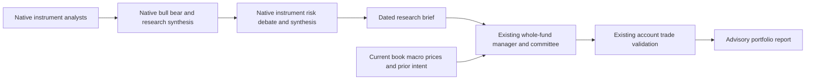
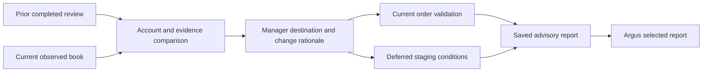

# Repeated fund-manager trade recommendations

## Question

Why does the portfolio fund manager repeatedly recommend small NVDA reductions and XLV/XLP purchases? Is this deliberate staged allocation, reused stock analysis, or a missing decision process? What would make it behave coherently for a user while preserving judgment and weekly/earnings-based stock research?

## Findings

### Corrected comparison: separate review days only

User clarification on November 18: use only the latest November 17 fund-manager report, comparing it with the latest report from the preceding day that had a fund-manager run. The saved archive shows that preceding review day is November 14. The earlier November 17 run is excluded from this study's evidence and conclusions.

TradingAgents data lives at `/home/dev/projects/trading/TradingAgents/data/fund_manager/`. Compare each selected run's `portfolio_report.json`, `portfolio_stats.json`, `portfolio_report.md` and `prompt.md`. Archive dates identify review days, not execution times.

| Review archive | Observed NVDA / XLV / XLP shares | Final NVDA | Final XLV | Final XLP |
| --- | --- | --- | --- | --- |
| `2026-11-14/234931_c35218` | 35 / 23 / absent | SELL 10, leaving 25 | HOLD; conditional +6 near 10EMA $186.75 | BUY 12, new position |
| `2026-11-17/100544_8d6a35` (latest November 17) | 25 / 23 / 12 | SELL 6, leaving 19 | BUY 8, reaching 31 | BUY 12, reaching 24 |

This is successive allocation after observed portfolio changes, not evidence of duplicate proposals against an unchanged same-day snapshot. NVDA decreased by 10 and XLP increased by 12, consistent with prior advice being reflected. Snapshots alone do not establish particular fills or execution times. XLV remained at 23; the November 14 report was HOLD with a conditional potential add, not an immediate buy.

### What the later report actually justifies

- **NVDA:** the November 14 reduction was before earnings; the November 17 report treats earnings-day risk as a reason for another reduction. It acknowledges that attribution of the earlier 35→25 trim is unverified. The new immediate hypothetical result is 19 shares; neither that result nor the earlier immediate result of 25 proves an intended longer-term destination. Study whether the incremental risk reduction is justified, and why the earlier advice did not state the total intended reduction or contingent second step; do not assume all successive reductions are redundant.
- **XLP:** the clearest successive allocation example. The later report sees 12 shares and explicitly proposes adding to 24, increasing weight approximately 1.6%→3.2%. This is a deliberate additional recommendation in its text, not merely an outstanding BUY 12 being repeated. The unanswered question is why 24 (or a broader destination) was not proposed earlier, or why the remaining purchase depended on a later condition.
- **XLV:** the earlier report proposed no immediate order and a conditional six-share add. The later report sees a pullback and judges stabilization sufficient for an eight-share add, increasing weight approximately 6.3%→8.4%. This may be sensible conditional progression. The study must compare the actual trigger, changed size and timing, rather than describe it as the same buy repeated.

November 17 reuses November 14 ticker analyses, reported age three days, within the intended weekly schedule. Current holdings, price/market statistics and earnings context are refreshed. Unchanged ticker research does not invalidate a new portfolio decision. There are concrete rationales and follow-up levels in the later report; the gap is lack of a structured cross-day destination/staging comparison and economic explanation of the marginal adjustment. The artifacts cannot prove that every additional trade is unnecessary or caused by the $1,000 floor.

### Deeper investigation: what produced the increments?

This section supersedes the earlier provisional diagnosis that missing history alone explains the behavior. Independent researcher inspected only the two selected reviews, including draft, debate, final, accepted checks, supplied prompts and stock-report sizing. Requested planner gpt-6.1-sol/high assessed competing explanations. Host independently recomputed the cash/minimum/fee arithmetic from the saved artifacts without a model or live-data call.

#### Effective prompts, models and validation

The two saved manager-system prompts are whitespace-normalized identical (5,322 characters) and match the current FM_SYSTEM. Both saved runs used the same manager/risk-seat model roster. Current configured manager overrides affect model/effort, not the system text. No changed manager model or hidden system override explains this comparison. Neither saved prompt contains a previous fund-manager review.

The validator accepted all selected proposals at the requested quantities, with no resizing. At November 17 quotes, XLV's minimum eligible buy is `ceil(1000 / 186.15) = 6` shares; the manager chose 8. XLP's minimum is `ceil(1000 / 92.29) = 11`; it chose 12. NVDA's 6-share sale is $930.06 and is allowed because the entry floor does not apply to sells. Thus the floor influences the feasible set but does not mechanically generate these increments. A psychological anchoring effect cannot be established from two saved reviews.

#### Stock theses versus dated sizing recipes

- **NVDA:** the source trading/PM reports say exposure should be “75% of standard allocation,” say an exact sale cannot be calculated without that standard and portfolio context, and advise no additional reduction if already at/below the target. No standard allocation is defined. November 14 presents its 35→25 reduction as implementing this guidance; November 17 again invokes a roughly quarter-position reduction, 25→19. This is consistent with a possible level-versus-increment interpretation error: repeatedly applying a haircut to current shares instead of establishing a reference exposure. Both finals acknowledge undefined allocation, and genuine earnings risk also drives the decision, so recursive reuse is a credible mechanism, not a proven exclusive cause.
- **XLP:** the source PM's initial 12-share size comes from a cap of 10% of the earlier available cash (about $1,173.66), while the stock team lacked total portfolio NAV. It also says build gradually toward standard exposure and gives pullback/breakout conditions. Reusing the bullish thesis three days later is reasonable; reusing the same old-cash starter recipe for an existing holding does not independently justify another 12 shares.
- **XLV:** the source PM says allocation and risk budget are needed before sizing an add. Those are whole-portfolio decisions owned by the fund manager. Its conditional six-share idea was not a durable eight-share entitlement.

The missing distinction is not simply fresh versus stale research. It is **reusable instrument research versus portfolio-dependent sizing assumptions that must be interpreted against current whole-book exposure**. Daily paid ticker reruns are unnecessary to correct that ownership.

#### NVDA: plausible event adjustment, unclear cumulative exposure

| Evidence | November 14 | Latest November 17 |
| --- | --- | --- |
| Observed shares / quote | 35 / $162.85 | 25 / $155.01 |
| Weight / modeled risk contribution | 8.19% / 15.8% | 5.67% / 11.3% |
| Annualized volatility / beta 1y | 38.8% / 1.78 | 38.9% / 1.78 |
| Event timing | November 17 earnings in 3 calendar days | Earnings still upcoming that evening |
| Immediate final proposal | SELL 10, leaving 25 | SELL 6, leaving 19 |

The latest run was generated 15:13Z, before the explicitly timestamped earnings event at 21:00Z. It is not a post-results decision. The earlier conditional post-earnings downside level was $147.48; latest quoted $155.01 is above it, so this is not evidence that that particular condition fired.

Latest draft HOLDs 25, conservative risk proposes selling 8, and final sells 6 to reduce the gap risk while retaining rebound participation. At the recorded price, removing 6 shares reduces a hypothetical 20% downward gap by `6 × 155.01 × 20% = $186.01`, at a $3 estimated order fee. It also gives up approximately the same $186 upside in a symmetric 20% rebound. This is scenario arithmetic, not a predicted probability or expected return.

A new earnings-day decision is plausible. What remains unresolved is why the earlier pre-earnings reduction did not already express appropriate exposure through the same event, whether another six shares reflects a changed risk judgment or recycled relative sizing, and why 19 is preferable to retaining 25 or selling a different amount. Being oversold supports retaining some upside; it does not uniquely determine six shares.

#### XLP: strongest case for insufficiently reconciled successive allocation

The November 14 draft already proposed BUY 25, around 3.3% of NAV. The final cut it to BUY 12 because of defensive crowding and the source PM's 10%-of-cash starter cap. The risk debate corrected a statistical interpretation: a 3% cash-funded addition estimated a **0.04 percentage-point** volatility reduction, while the **0.41-point** improvement concerned replacing SPY, a different transaction. These figures must not be conflated.

Latest November 17 sees 12 shares and proposes another 12, reaching 24 and roughly 3.2% exposure—almost the earlier draft's size. Both current reviewers' addition arguments and the final discuss low beta/diversification, but do not explicitly revisit the earlier sizing restraint. (All three current risk seats support an XLP addition; XLV has a dissenting conservative seat.)

The quote changes only $92.35→$92.29. The latter is outside the earlier $89.49–$90.77 pullback zone and below the $93.40 breakout reference. These snapshots do not establish intervening closes or a touched entry; they also do not establish that neither occurred. The final can revise the entry thesis, but should say so instead of implying a demonstrated continuation trigger.

Latest XLP beta is approximately -0.05/0.16 over 1y/2y, volatility 15.7%, XLP/XLV correlation +0.51, and its existing modeled risk contribution is -0.1%. These support a historically defensive instrument; they do not quantify the marginal benefit of doubling this actual holding. Low-beta buying with cash can still add exposure compared with remaining in cash. XLP is the clearest example where the report needs to explain why the earlier starter is now insufficient.

#### XLV: strongest case for rational conditional progression

November 14 quote $188.85 was near highs and about 8% above SMA50; the review HOLDs and considers adding six after stabilization near the quoted 10EMA $186.75. Latest quote $186.15 is 1.43% lower and near that reference, making a pullback entry plausible. A single quote does not prove stabilization or the full daily trajectory.

Latest buys 8, taking 23→31 shares and approximately 6.3%→8.4% weight. Aggressive and neutral support it; conservative wants HOLD because of existing exposure and +0.51 correlation with XLP. The manager rejects that objection, emphasizing low beta (~0.31) and diversification relative to AI exposure. The draft already buys 8; validation does not create or resize that order.

The unresolved issue is the move from conditional six to eight and the marginal portfolio value of 8.4% exposure. No incremental whole-book risk estimate for this add is shown. Across days XLV's modeled risk contribution rises 1.7%→2.5%; the whole book's volatility falls 12.9%→11.3%, but many quantities, prices and cash balances changed, so the volatility change cannot be credited to XLV alone.

#### Whole-book changes and costs

| Recorded statistic | November 14 | Latest November 17 |
| --- | --- | --- |
| NAV | $69,615.23 | $68,397.94 |
| Observed cash / share of NAV | $11,736.59 / 16.9% | $13,487.41 / 19.7% |
| Portfolio vol / beta 1y | 12.9% / 0.87 | 11.3% / 0.74 |
| VaR95 | $884 | $766 |
| VIX snapshot | 19.3 (November 13 print) | 22.69 |
| SPY versus SMA50 | -1.3% | -3.3% |
| Final recommended sell / buy gross | $6,988.04 / $2,302.33 | $4,089.32 / $2,596.68 |
| Accepted active orders / fees | 9 / $27 | 6 / $18 |
| Hypothetical ending cash / target cash | $16,395.30 (23.6%) / 23% | $14,962.05 (21.9%) / 20% |

Market conditions are more cautious while observed portfolio exposure/risk is already lower. That supports reviewing the book; it does not automatically dictate adding the same defensive quantities. The November 14 hypothetical ending cash differs from November 17 observed cash: simulations are not execution records.

**Larger earlier adjustment feasibility:** use the November 14 validator snapshot prices, retain all seven proposed sales, and charge every order fee. Buying XLP24 and XLV8 gives:

`11,736.59 + 6,988.04 - 21 sell fees - (24 × 92.35) - (8 × 188.85) - 6 buy fees = $14,970.43 cash` (**21.50% of original NAV**).

Retaining the original XOM buy as well subtracts $1,194.13 plus a $3 fee, leaving **$13,773.30 / 19.78%**, about 3.22 percentage points below the earlier 23% cash target. Both are cash-feasible. This is a deliberately simple counterfactual, not a proposal: buying XLV earlier would bypass its prior pullback condition, and additional exposure would change risk/cash preferences. Affordability alone does not establish that all these buys should have happened earlier. Snapshot-price calculations are not executable quotes, fills or a full risk simulation.

The two actual XLP recommendations have total notional $2,215.68 with two $3 entry fees. Combining them into one order would save approximately $3, **0.1354%** of this total notional; price differences would also matter. Small fees do not justify arbitrary repeat trades, but a real staging advantage can easily outweigh that fee difference.

#### Source-time and interpretation limits

The latest run was generated before the US regular close but labels the latest daily prices “last close 2026-11-17.” The downloader labels its latest daily bar a close without documenting completed-session status. This is source-time ambiguity: it does not establish that the values were final closing prices, genuinely future information, or an execution opportunity. Verify provider/session timestamps before claiming an exact trigger fired. No live data was fetched to resolve it.

### Behavior and ownership

- `fund_manager.py` `build_context()` supplies current book, portfolio statistics, latest dated stock reports, macro and scout evidence. It does not supply prior fund-manager recommendations, their implied destination or the previous observed snapshot.
- `FM_SYSTEM` asks for a decision on every holding and a newly justified cash target each run. Its missing-report guidance explicitly encourages smaller/staged candidate buys. The prompt does not require a persistent total desired position or next-tranche condition tied to prior advice.
- Trade schemas express incremental shares and timing. `changes_vs_draft` compares the current debate only. There is no cross-run destination/change explanation contract.
- `trade_validation.py` starts fresh advisory account simulation each run. The $1,000 minimum buy is an economic floor, not an order-size target or mandate to buy daily. Minimum-sized repetition could reflect model anchoring, but these artifacts cannot establish causation.
- The prompt/schema permits `order_type: staged`; the validator rejects it because fees need a concrete order. Conditional limit-order prose may still be accepted in immediate hypothetical simulation. Future conditional intent and current actionable advice need a clear distinction.
- The later report says “Today's executed trades” despite the documented absence of an order-submission path. This is misleading advisory language, not evidence of a brokerage action.
- Argus consumes the producer's saved reports. Continuity belongs in TradingAgents, with Argus displaying persisted comparisons rather than inventing execution status.
- Response recovery currently imports current draft/final schemas; expanding required fields must preserve historical replay compatibility. Saved journal schema information can be reused.

### User-directed design: portfolio-blind instrument research, portfolio-owned allocation

The user proposes that individual-stock agents know nothing of their holdings, cash or portfolio sizing, and that the whole-fund manager alone chooses which holdings/watchlist opportunities to buy/sell and in what quantity. This becomes the preferred ownership direction. The earlier continuity recommendation complements this boundary; it is not a substitute for fixing it.

#### Native capability audit (installed checkout)

This audit concerns the installed TradingAgents fork at `/home/dev/projects/trading/TradingAgents`, not verified parity with current canonical upstream. No network lookup or upgrade was performed. The researcher traced native CLI/graph/context/schema/memory and existing integration; requested gpt-6.1-sol/high planner traced whole-book report coverage and proposed the architecture.

| Requirement | Existing facility | Remaining work / limit |
| --- | --- | --- |
| Do not disclose user's portfolio to stock agents | Native CLI `--portfolio` defaults to None; loads a book only when explicitly supplied. No book env/autoload path found. | Argus Linux launcher and maintained PowerShell wrapper currently supply it; stop supplying it for this workflow. Do not pass an empty book, which means known flat and differs from unknown. |
| Retain stock research and debate | Native market, sentiment, news, fundamentals, bull/bear, research synthesis, trader hypothesis, risk debate and final per-instrument synthesis already exist. | Native `--analysts` chooses first-stage analyst coverage only. There is no complete research-only graph/profile switch. Do not create a parallel replacement agent framework. |
| Eliminate stock-level allocation instructions | Per-seat prompts can be customized through existing `addons/agent_config` settings. | This is an existing add-on feature, not a native core research-only mode. Overrides replace role anchors, not all prompt-body/schema instructions. Native absent-portfolio text still requests sizing; ResearchPlan requires standard-allocation guidance, TraderProposal includes sizing, and final PM summary asks for sizing. A small coherent research-profile prompt/output adjustment is needed in the existing nodes; omission or consumer filtering alone does not fulfill the requirement. |
| Reuse memory safely | Native `TRADINGAGENTS_MEMORY_LOG_PATH` chooses settled-reflection storage. | No native enable_memory switch was found. Use a separate research-only memory path, preserving the old portfolio-aware history. Never let old sizing reflections enter a supposedly blind research run. |
| Avoid reuse of portfolio-aware checkpoints | Native checkpointing defaults off; existing `--no-checkpoint` can make the choice explicit. Native signatures distinguish absent, flat and held portfolio contexts. | Existing add-on prompt overrides are not all in the native config fingerprint. Start this workflow without checkpoints or ensure profile/prompt fingerprints before reuse. Preserve old artifacts; no destructive reset is needed. |
| Compare holdings and all watchlist opportunities | Existing custom FM loads consolidated holdings plus deduplicated non-held watchlist and their latest reports/quant snapshots. Selected tickers constrain paid refresh only. | `--no-watchlist` excludes candidates. Default input coverage is not proof of explicit comparison: currently every holding must have a decision, but candidate dispositions are optional. Expose which names were assessed/passed/missing evidence, using concise coverage and detailed rationale for serious alternatives. No requirement to buy each candidate or refresh every report. |
| Reuse macro, sentiment and specialist research | Existing native saved reports contain market/sentiment/news/fundamentals and bull/bear/research/risk evidence. Existing FM has price/regime stats, vintage-pinned FRED macro and dated scout macro/headlines/rankings. | FM currently passes PM prose, research-manager prose, trader sizing and optionally risk debate; it does not directly supply all raw analyst reports. Build a compact research handoff from existing evidence, including dated sentiment/catalysts. Do not label weekly sentiment as live daily analysis. |
| Decide and size whole-book trades | Existing FM manager→portfolio risk committee→final and deterministic account validator already own this function. | Reframe input as research, remove deference to stock sizing, retain prior decision/objections and compare marginal HOLD/full/stage alternatives. No new paid allocator, optimizer or order/fill service is required. |

#### Proposed complete flow

| Component | Description |
| --- | --- |
| Native instrument analysts | Existing market, news, sentiment and fundamentals; receive ticker/date/public evidence, never user cash or holdings. |
| Native bull bear and research synthesis | Existing investment debate and thesis assessment; no account allocation or order recipe. |
| Native instrument risk debate and synthesis | Retain existing risk arguments and final per-instrument synthesis with a research output contract. The native node named portfolio manager is a per-instrument arbiter, not the overall fund allocator. |
| Dated research brief | Thesis, valuation, catalysts, scenario risks, evidence strength, sentiment, horizon and conditional market levels, with provenance and unknowns. No shares, cash fractions or standard-allocation multiples. |
| Existing whole-fund manager and committee | Compare held and watchlisted instruments, macro, actual exposures and alternatives; sole owner of account-specific buy/sell/HOLD and sizing. |
| Current book macro prices and prior intent | Holdings/cash/accounts/fees, fresh quantitative risk/regime, dated macro/scout and previous portfolio decision, confined to the whole-fund layer. |
| Existing account trade validation | Cash isolation, unknown-cash semantics, fees, sellability and quantities; advisory simulation remains distinct from observed execution. |
| Advisory portfolio report | Show assessed universe, chosen exposures, immediate versus deferred adjustment, alternatives and changed rationale. |

#### Research handoff and decision ownership

The stock desk should answer: “What is the investment case? At what valuation/market conditions is it attractive? What could invalidate the thesis? What event, downside/upside scenarios and uncertainty matter? How strong/current is the evidence?” It may give numeric valuation ranges and risk/technical levels; those are instrument research. It must not answer how much of this user's money to invest, whether to reduce their current holding by a percentage, or whether to use their cash.

Use existing native structured research/report fields wherever they fit, with the smallest additional handoff only for missing boundaries. Do not add another summarizing model call merely to turn already-produced research into a brief. Reuse the native final synthesis call for any required structured research fields. Omit old `trader_position_sizing` as allocation authority; do not merely hide it in the UI while passing it to the fund manager.

The whole-fund desk answers: “Given everything we own, available account cash, market conditions and the opportunity set, is an adjustment worth making? Which alternative deserves capital? What exposure makes sense through the review horizon? Why this size now, and why not HOLD or the complete adjustment?” Keep its existing risk committee. Have it consider earlier decisions and objections so removing stock sizing does not simply move independent daily nibbling into the allocator.

Opportunity assessment should make coverage visible without verbose reports on every candidate: held, serious contender, passed, missing/aged evidence, with detailed comparative reasons where capital allocation changes. Avoid requiring every name to have a new paid report or creating an arbitrary hard score/sector/turnover quota.

#### Native-first change boundary and compatibility

1. **Use existing controls:** omit optional portfolio input; choose native analyst coverage/debate settings; reuse existing per-seat settings where adequate; isolate memory with its existing path control and leave checkpoints off during transition. Preserve weekly/earnings refresh.
2. **Close the native gap locally and coherently:** existing prompt/schema text still demands orders/sizing, so a small research-oriented profile/contract in the existing stock nodes is required for the requested semantics. A prompt-only setting is insufficient to claim strict no-sizing behavior. Keep public research/risk numeric fields and the existing graph, tools, models and saving mechanisms. Decide exact profile/config surface during implementation planning rather than adding speculative extension points now.
3. **Extend the existing custom owner:** the current add-on FM remains the portfolio allocator. It consumes the research brief plus actual whole-book data, tracks prior intent, compares candidates and emits its existing validated advisory trades. Argus renders that result.

Keep the ordinary native portfolio-aware mode and its tests supported; add proof for the research profile rather than globally breaking existing portfolio features. Keep legacy reports readable. Mark their research mode/provenance as legacy or unknown; do not present them as newly generated portfolio-blind briefs. Reuse genuinely instrument-only analyst evidence where safe; never pass old trader/PM sizing instructions back as current allocation mandates. A future paid stock refresh follows the user's existing explicit run approval; this design does not authorize a full watchlist rerun. Historical response schemas/recovery and selected-history rendering must remain compatible if output contracts change.

#### Minimum proof before calling this delivered

- Capture all stock-stage model requests, including memory and checkpoint paths, with a sentinel portfolio fixture: no account cash, held quantities, cost basis, portfolio weights or private book instructions reach the stock desk. Omitted context is not claimed flat.
- Auxiliary inputs such as the existing optional `ARGUS_MACRO_CONTEXT_FILE` must also remain instrument/macro-only; the native wrapper can append that file to instrument context, even though current Argus code does not set it.
- Stock outputs follow the research contract without shares, portfolio/cash fractions, standard-allocation recipes or imperative account orders; numeric valuation and risk levels remain supported. Test prompt-body and schema instructions as well as configurable role text.
- Whole-fund context still receives the full real book and eligible watchlist, research dates/coverage, current risk/macro and prior intent, including both Linux and maintained PowerShell launch paths.
- Stock selection for refresh does not silently narrow the manager's opportunity universe. Missing/dated evidence is visible without forced daily refresh.
- Legacy archives remain readable, cannot be mislabeled as blind research, and cannot contaminate new stock memory/checkpoints. Account validator safeguards and historical response recovery remain unchanged or explicitly covered.
- Consecutive-review fixtures establish that source thesis reuse does not restart old sizing recipes and that the allocator explains continued/revised/deferred exposure. This proves boundary and decision contracts, not profitable judgment or identical LLM outputs.

No implementation is authorized or performed in this design study. The required separation is supported partly by native controls and partly by existing integrations; the missing no-sizing research semantics require a small code change rather than pretending a complete native feature exists.

### Latest AMD report: missing target/horizon does not mean portfolio-blind research

Checked the latest saved AMD folder, `data/logs/reports/AMD_20261114_234852`, on the user's follow-up. Its `5_portfolio/decision.md` explicitly renders **Price Target: not provided** and **Time Horizon: not provided**. Native `PortfolioDecision` makes both fields optional (`price_target: float | None`, `time_horizon: str | None`), so their absence is permitted rather than proof of a research-only mode.

The same PM report is explicitly portfolio-aware: it says AMD is not held, references exact available cash of $11,736.59, mentions existing NVDA/technology holdings, recommends 0% current AMD allocation and a future 0.25× starter potentially rising to 0.75× standard allocation. Trader sizing likewise says 0% now and 0.75× standard allocation later. Research-manager strategic actions target 0.75×, propose tranches and tie restoration/reduction to reporting. Thus the current individual report mixes genuine company research with portfolio sizing instructions; it is not already the proposed separated design.

The report explicitly says a defensible price target and calendar holding period cannot be established from supplied data. Not inventing those is appropriate, but its sentence also conflates portfolio-value/standard-allocation requirements with research targets. Company valuation ranges and the horizon over which a thesis plays out are instrument research and need not depend on the owner's cash or allocation. The manager should decide the fund's actual holding/review horizon and size using that research. Future research-only output should allow justified valuation targets/ranges and thesis horizons while requiring uncertainty when unsupported; do not remove those fields or force arbitrary targets to enforce the no-sizing boundary.

FM `parse_report()` reads the AMD PM target/horizon, trader sizing, PM narrative and research-manager plan; `build_context()` explicitly appends trader sizing and full PM/research-manager prose. Missing target/horizon does not keep the sizing narratives out of the whole-fund decision.

Sources: AMD `5_portfolio/decision.md` lines3–9, `3_trading/trader.md`, `2_research/manager.md`; native `agents/schemas.py` `PortfolioDecision` fields and `render_pm_decision()`; FM `parse_report()` around175–205 and `build_context()` around1315–1326. Source report folders are under **TradingAgents/data/logs/reports**, correcting the omitted `data/` prefix in earlier evidence paths.

## Sources

Read-only discovery by `opmentix-researcher` (`trade_research`), product/architecture assessment by `opmentix-planner` (`fund_manager_planner`, **gpt-6.1-sol/high**), November 17–18, 2026. Separate-day scope corrected and rechecked November 18.

- Actual archive roots: `/home/dev/projects/trading/TradingAgents/data/fund_manager/2026-11-14/234931_c35218/`, `/home/dev/projects/trading/TradingAgents/data/fund_manager/2026-11-17/100544_8d6a35/` (files listed above).
- `/home/dev/projects/trading/TradingAgents/addons/fund_manager/fund_manager.py`: FM_SYSTEM around line 1140, trade/plan schemas around 1230, build_context around 1277, report/run assembly.
- `/home/dev/projects/trading/TradingAgents/addons/fund_manager/trade_validation.py`: fresh simulation around lines 78–90; staged-order rejection around line 156; account/fee/sellability checks.
- `/home/dev/projects/trading/TradingAgents/addons/fund_manager/README.md`: advisory validation/no execution boundary, around lines 20 and 27–35.
- `/home/dev/projects/trading/TradingAgents/addons/fund_manager/reprocess_response.py`: schema selection and separate response recovery.
- `/home/dev/projects/trading/argus/server.py`: saved fund-manager report endpoints; `static/app.js` and `static/fund-trade-render.js`: validated-trade display.
- Native-first audit sources: `cli/main.py:50–93`; `tradingagents/graph/setup.py:132–180`; `agents/context.py:204–218`; `agents/schemas.py:95–127,146–260`; `agents/trader/trader.py` (trader prompt); `agents/managers/portfolio_manager.py:35–74`; `tradingagents/graph/trading_graph.py:152–177,305–348`; `default_config.py:86,128`; `tests/test_portfolio_context.py:156–242`.
- Integration sources: Argus `run_analysis.py:391–403`; TradingAgents `addons/fund_manager/run_portfolio.ps1:168–169`; `addons/agent_config.py:520–530`; `addons/fund_manager/run_native.py:185–208`; FM `parse_report()`/`build_context()` and report discovery.
- Saved JSON field paths used for numeric findings: `stats.account`, `stats.positions`, `stats.watchlist`, `stats.risk`, `stats.regime`, `stats.correlation_matrix`, `stats.report_sources`, `reports.<ticker>.trader_position_sizing`, `draft.trades`, `debate[].parsed`, `final.trades`, `final.changes_vs_draft`, `final_check.trades`, `final_check.ending_cash`, `final_check.fees_usd` and `final_check.execution_assumption`.
- `/home/dev/projects/trading/TradingAgents/data/logs/reports/NVDA_20261114_223043/3_trading/trader.md` and `5_portfolio/decision.md`: undefined standard-allocation sizing and exact-units limitation.
- `/home/dev/projects/trading/TradingAgents/data/logs/reports/XLP_20261114_233604/5_portfolio/decision.md`: earlier-cash starter cap and entry conditions.
- `fund_manager.py` price downloader around lines 321–383 and earnings extraction around 526–601: daily-bar labeling versus explicitly timestamped event.
- Completed prior policy: [native-first portfolio improvements](../20261114135901-native-first-portfolio-improvements/plan.md). Earlier trade-sizing research is preliminary; do not use its historical missing-fee/minimum statements as current behavior.

## Conclusion

### Direct answers to the user's concerns

**The daily nibbling is not established as an intentional overall strategy.** Some steps are individually defensible, particularly waiting for XLV's pullback and reviewing NVDA as earnings approaches. XLP's repeated starter is the weakest reconciled case. The two reports do not prove all serial trades are wrong, but they do show that cumulative sizing is insufficiently connected to prior decisions.

**Buying the whole supported adjustment earlier was financially possible, but not necessarily preferable.** Cash, risk and entry conditions must be considered. The earlier XLP draft already considered a larger holding; the final deliberately reduced it. The next review should address why that objection no longer governs. XLV's earlier wait is meaningful, and should not be erased merely to reduce trade count.

**Weekly/earnings research is appropriate.** The problem is reusing old portfolio-dependent sizing guidance without a defined current reference. Reuse the instrument thesis, event context and technical evidence with dates. The whole-book manager must independently own today's desired risk/exposure instead of recursively applying “75% of standard” to the current holding or restarting a cash-based starter recipe.

**The $1,000 floor does not mechanically cause the quantities.** Both ETF orders exceeded the minimum and passed unchanged. Fees alone are too small here to establish an economic defect. The process issue is failure to justify the marginal portfolio change against keeping the current book and the earlier decision.

### Recommended managerial discipline

1. Choose proposed exposure for an understandable review horizon, such as through an imminent earnings event, using current whole-book risk and conviction. A proposed exposure can be revised; it is not a permanent allocation mandate.
2. Compare HOLD, the complete supported adjustment now, and deliberate staging. State why one is preferable given downside/upside scenarios, uncertainty, cash, fees and opportunity cost. Do not invent unsupported precise expected returns or mandatory numerical utility thresholds.
3. Separate intended total exposure, immediate adjustment and any deferred adjustment. Where historical reports lack a strategic destination, say unknown; do not infer one from an order's hypothetical result or fabricate an earlier staged plan.
4. Supply the previous completed review's observed book, final recommendation, rationale and relevant debate objections. Compare observed progress and explain continuing versus revising earlier intent. Do not treat snapshots as fill confirmations.
5. If staging, identify what it buys: event uncertainty resolved, a demonstrated price condition, available cash, or another concrete reason. If earlier objections and conditions are unchanged, explicitly defend another increment rather than repeat the bullish thesis.
6. Keep future conditional advice outside immediate hypothetical cash movements and use honest advisory language. No order or monitoring service is needed.

### Options and tradeoffs

| Option | Benefit | Limitation |
| --- | --- | --- |
| Prompt instructions alone | Clarify sizing ownership and require HOLD/full/stage comparison. | Cannot reconcile a prior decision the manager never receives. |
| Previous-review context plus decision discipline | Directly exposes earlier sizing restraint, objections and observed portfolio changes. | Prose can remain vague or rationalize a new increment after the fact. |
| Compact structured position intent plus prior context | Makes current exposure, proposed review-horizon exposure, immediate action, staging reason and revision reason visible/checkable. | Adds a small output contract; cannot prove the selected size is economically optimal. |

The planner recommends the **compact third option**, with economic comparison as its core. A target field or more history alone is insufficient. Reuse existing saved reports and validator; avoid elaborate continuity infrastructure, an execution ledger, forced allocation percentages, trade cooldowns, minimum adjustment frequency, or daily paid analysis. The earlier six-task backlog remains parked; it is not a decision to implement that breadth.

An everyday report should say: “We observe X shares; propose Y total through this review horizon; recommend Z now because…; defer any remainder until…; this continues/revises the earlier decision because…”. When Y is not meaningfully supportable, explain that uncertainty rather than pretend to know an exact permanent target.

### Boundaries of the research

No source behavior, configuration, portfolio, broker connection or paid analysis was changed. Offline arithmetic confirms quantities, cash feasibility and fee effects; it does not establish optimal share counts, investment performance, which orders filled, intervening prices or a causal model-variance rate. Source-time ambiguity remains unresolved. The conclusion is a demonstrated process weakness and a proportionate design direction, not a proof that all additional trades were bad.

The following diagram represents the candidate ownership direction only; it is unimplemented.

| Component | Description |
| --- | --- |
| Prior completed review | Eligible dated historical recommendation and observed snapshot; never raw/incomplete output. |
| Current observed book | Current account holdings and timestamps; snapshot deltas do not prove fills. |
| Account and evidence comparison | Producer-owned comparison with explicit unavailable or incomparable baseline. |
| Manager destination and change rationale | Discretionary total desired position with reasons for restatement, revision or staging. |
| Current order validation | Existing account cash, fees, quantities and sellability checks for current orders. |
| Deferred staging conditions | Future intent with no current effective order or cash movement. |
| Saved advisory report | Persist provenance, destination, validation outcome and hypothetical result. |
| Argus selected report | Display the selected run's persisted context and advisory status. |

## Logs

- 2026-11-18 12:39 UTC — Inspected latest AMD: target/horizon absent in source but explicit cash/holdings/allocation advice present; clarified research valuation/horizon versus fund-specific sizing and corrected source-report root paths.

- 2026-11-18 12:36 UTC — Integrated final native/planner handoffs, auxiliary-input boundary and preservation of ordinary native portfolio mode; design remains unimplemented.

- 2026-11-18 12:36 UTC — Added native-first portfolio-blind research architecture, capability audit, current FM coverage, native gap and minimal proof requirements per user design direction.

- 2026-11-18 10:40 UTC — Completed deeper two-day research: dated sizing recipes, draft/debate reversals, event/price evidence, unchanged validator sizes and independently corrected cash/fee counterfactual; recorded gpt-6.1-sol/high comparative recommendation.

- 2026-11-18 10:27 UTC — Integrated corrected planner assessment: immediate hypothetical after-quantity is not proof of a longer-term destination; retain unknown historical intent.

- 2026-11-18 10:27 UTC — Corrected to November 14 versus latest November 17 only; withdrew same-day duplicate inference and distinguished NVDA risk reduction, XLP successive allocation and XLV conditional progression.

- 2026-11-17 15:46 UTC — Recorded actual consecutive-report evidence and requested planner recommendation; runtime behavior unchanged.
