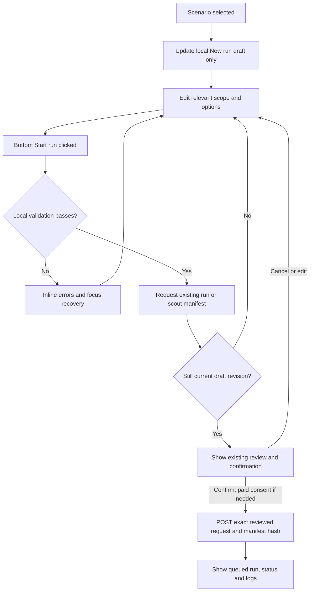

Diagrams: a mermaid block for a flow or design, then a table with columns Component and Description.

## Brief

Redesign the existing Runs tab so selecting any scenario only prepares the New run form below. Selection must never open confirmation, switch to Themes, submit a run or call a model. The user reviews/edits plain-language mode-specific settings, then intentionally presses the bottom Start run button; existing backend manifest, explicit paid consent, fingerprint validation and concurrency checks remain intact.

Explain each selector's effect, which evidence is refreshed or reused, outputs and paid/no-AI scope. Reflect the implemented stock research-only versus whole-portfolio review separation. Prefer a coherent purpose-first form over conflicting CLI-style booleans. Preserve existing backend run semantics, design tokens, saved reports, weekly/earnings cadence and the full fund-manager universe independently of selected stock refresh scope.

Requested design skill: UI/UX Pro Max (`/home/dev/.agents/skills/ui-ux-pro-max/SKILL.md`). Planner: existing opmentix-planner gpt-6.1-sol/high. Scope is the current vanilla HTML/CSS/JavaScript dashboard; no framework migration, global rebrand, paid analysis or live portfolio/config changes. Produce a concrete full plan and reviewable preview before the implementation gate.

## Discovery

Completed read-only researcher handoff (`trade_research`) and planner handoff (`fund_manager_planner`, gpt-6.1-sol/high). The planner authored the design, exact copy, workflow and inert preview. Host current-code audit corrected the ineffective include_risk UI control and checked backend option relevance. The four-task Plan below is concrete and reviewable; existing backend run profiles remain unchanged for this UI work.

Preview: [preview.html](./preview.html). It is a local design artifact with illustrative data, inline existing tokens, CSP connect-src none, no external resources/API calls and no job execution. Planner checks passed JavaScript syntax, unique IDs, six modes and diagram/table structure. Browser/rendering tools are not installed; responsive/visual behavior remains an implementation acceptance check, not a claimed result.

Research: [research.md](./research.md)

Read the project guide first. Delegated current scenario/UI/backend/safety tracing to `trade_research` (opmentix-researcher), and concrete information architecture, exact copy, preview and implementation tasks to `fund_manager_planner` (opmentix-planner). Host owns plan files/lock. Production code has not changed for this task.

Initial source evidence: `static/app.js` scenario handler currently calls `btnStartRun.click()` or switches to Themes and clicks screen/scout; `static/index.html` shows CLI-style toggles and a generic Since field. The six underlying workflows already exist. Skill source guidance verified in quick-reference sections1/2/8: semantic form labels, persistent helper text, grouped controls, progressive disclosure, inline errors, loading feedback, keyboard focus and reduced-motion handling. Targeted search returned Form Labels/Submit Feedback; exact progressive-disclosure search had no relevant match after retry, so that aspect follows the verified reference and user's explicit flow rather than claiming a database pattern match. No design system generated for this scoped existing-page change.

<!-- Host: integrate opmentix-researcher sources, findings, uncertainties, and optional research.md link. Before research-only closure, record the curator handoff. -->

## Plan

Human approved entry into Plan. The completed planner design and inert preview below are the proposed implementation scope: T1–T4, with unchanged backend execution profiles and explicit Start/manifest/consent boundaries. No production UI changes have begun. Implementation approval is a separate harness gate.

Planning proposal only. Scope is the existing Runs tab in Argus, using its current semantic tokens, type, components and vanilla HTML/CSS/JavaScript. No model settings, run profiles, backend execution stages, fees, spending policies or research workflow change. The six existing backend modes remain intact; their frontend selection and explanation change.

Clickable preview: [argus-run-ui-preview.html](./preview.html). It uses illustrative data and inline copies of existing Argus tokens, makes no requests, and cannot start jobs. The preview demonstrates selection, preserved draft fields, conditional controls, inline validation and confirmation after Start. It does not verify production API behavior.

### Design and information architecture

1. Keep the Runs page heading, weekly spend, and past-run/log area. Replace the scenario action table with a compact native radio-card group titled **Choose a run**. Its instruction is **“Choose a setup, adjust New run below, then click Start run.”** Selection updates local draft state only. No modal, manifest request, API write, tab change, automatic start, auto-scroll or focus jump.
2. **New run** below shows the chosen purpose, a short “What happens” summary, relevant scope fields, and **More options** for advanced controls. Remove user-facing combinations of Run agents first / ANL only / Snapshot only / hidden watchlist flags. A single mode derives those existing request fields.
3. End New run with a compact **Run summary**: refreshed data, reused reports, review scope, output and AI cost status. One visible bottom primary **Start run** button is the only initiation control on the Runs page. The subsequent confirmation may have **Confirm and start**; this preserves paid consent.
4. Retain the desktop New run / Past runs split. Scenario cards are three columns at wide widths, two at intermediate widths, one on mobile. New run precedes Past runs in mobile reading order. Keep existing colors, radii, spacing and font stacks; add only scoped Runs layout/control rules.

### Exact mode labels and copy

Initial draft is **Refresh prices & portfolio metrics**: the existing free snapshot behavior, with no implicit paid default. Cards display the explicit **No AI calls** or **Paid AI** text; color is supplementary.

| Scenario ID | Label and persistent description | New run fields and output |
| --- | --- | --- |
| snapshot | **Refresh prices & portfolio metrics** — “Update prices and calculated portfolio statistics from your saved holdings. No AI review or broker import.” | Market date and relevant data options. Scope is the existing saved portfolio/watchlist context, not ticker chips. Output: quantitative portfolio snapshot. No AI calls. |
| screen | **Screen the market** — “Refresh the market screen across selected discovery sectors. Your watchlist stays unchanged.” | Discovery sectors; date is read-only “Latest available market data.” Output: screen and relative-strength data in Themes. No AI calls. |
| scout | **Find watchlist ideas** — “Refresh the screen, then ask the scout for watchlist suggestions. Review and apply suggestions separately.” | Discovery sectors; date as screen. Output: dated scout report/proposal in Themes. Paid configured scout request; estimate and actual scope reviewed after Start. |
| analyze | **Research selected tickers** — “Create fresh research reports for the names you choose. Skip the portfolio review.” | Explicit ticker selection and market date. Output: ticker research reports. Paid AI for selected research only. |
| analyze-review | **Research + portfolio review** — “Refresh your selected ticker reports, then review the whole portfolio using fresh and saved research.” | Explicit ticker selection, market date, review-context statement and relevant options. Output: selected ticker reports plus whole-portfolio advisory review. Paid research and fund-manager stages. |
| fund | **Review portfolio** — “Ask the fund manager to review your holdings and saved watchlist using existing ticker reports. No fresh ticker research.” | Read-only whole-portfolio scope, market date and relevant options. Output: advisory portfolio review. Paid fund-manager stages. |

This retains current profiles rather than creating six different model configurations. Do not promise fixed call counts, named model seats, fixed durations or a historic dollar price in primary copy. Confirmation derives these from the current manifest. The screen/scout descriptions must not imply that user ticker chips control their discovery universe.

### Fields, defaults and preservation

**Ticker research scope** appears only for analyze/analyze-review. Helper: **“Only checked tickers get new research. Nothing selected means nothing will be researched.”** Group eligible names into **Holdings** and **Watchlist candidates** with readable labels and selected counts. Native checkboxes have persistent labels; resolve eligible research names from the existing authoritative scope metadata so saved non-held names are not silently lost through an unrelated origin filter. Bulk controls are explicit **Select all holdings**, **Select all candidates**, **Select all**, **Clear selection**; selection controls affect scope only, never mode or source flags. Bulk additions retain selections from the other group; Clear is the only clearing shortcut. Keep the existing ETF convenience filter only if labelled **Select sector ETFs** and its actual scope matches that label.

Require at least one eligible selected name for either research mode. Derive `run_agents` and `include_watchlist` from the selected held/candidate mix, and send the explicit selection. Never submit an empty selection into the backend's implicit-all behavior. All is an explicit selection of current eligible rows, not a hidden wildcard. If eligibility changes, show the affected names and require review rather than silently dropping or expanding them. Backend candidates and the current UI candidate-origin filter differ today; reconcile frontend eligibility with existing authoritative metadata and validate against the manifest. Do not introduce a new backend filter or watchlist schema redesign.

For fund/combined mode, show **Portfolio review scope: all saved holdings and watchlist candidates** and the helper **“Ticker selection limits new research only. The fund manager still reviews the whole portfolio.”** For fund mode, add **“Existing ticker reports are reused with their dates and gaps.”** For snapshot mode, state **“Uses your saved holdings; does not import broker positions.”** Hidden ticker selections remain in the draft and are ignored by these modes' serialized requests.

**Discovery sectors** appears only for screen/scout. Reuse the current eight supported choices, not a new taxonomy: Information Technology (XLK), Consumer Cyclical (XLY), Healthcare (XLV), Consumer Defensive (XLP), Utilities (XLU), Energy (XLE), Financial Services (XLF), Semiconductors (SMH). Default to the current sector selection when available, otherwise all eight. Require 1–8; show **“N of 8 selected.”** Helper: **“Sectors guide discovery. Holdings and saved candidates remain in context; the screen may discover additional names.”** Preserve screen/scout's shared sector draft while switching modes. No selectable ticker-research scope in these modes. Dynamic discovery names are unknown until screening; preserve that disclosure in confirmation.

**Market date** appears for snapshot/analyze/analyze-review/fund, with **Automatic** selected and the alternative **Choose a date** revealing a labelled date input. Helper: **“Automatic lets the market preflight choose the session date. A chosen date is an advanced override.”** Validate a chosen date before requesting a manifest; backend preflight remains authoritative. Screen/scout have no date request field: do not show an editable control that silently does nothing. Preserve an edited date when temporarily switching to these modes.

**More options** uses native `
` and relevant mode-specific fields:

**Include economic data**, checked initially, only where the existing fund-manager/snapshot stage uses it. “Include the FRED economic snapshot in this review.” This changes the fund-manager FRED fetch, not public tools used by stock researchers. Derives `no_macro` by inversion. Hide for research-only and screen/scout; do not silently transfer it into unrelated APIs.
Remove the current **Include risk notes** control. In the current research-profile implementation its legacy flag does not add manager input; relabelling it would falsely promise behavior. Risk is already part of the validated research brief and the existing portfolio committee remains part of review. Serialize `include_risk: false` for compatibility; do not restore portfolio-aware legacy risk prose.
**Only reuse holding reports saved on or after**, optional UTC date, only for fund/combined mode. “Limits saved reports for holdings only, not watchlist candidates. It does not refresh reports; missing inputs will be shown.” Derives existing `since`, which is a report-folder generation cutoff, not an analysis start date or general freshness promise.

Defaults apply once on draft creation. Changing a scenario changes purpose and applicable controls; it does not reset selected names, sectors, dates or advanced edits. Keep one in-memory draft across Runs rerenders/tab visits; avoid introducing persisted portfolio data in local storage. Irrelevant fields are retained for a future mode but omitted from its request. A polite status line says **“New run set to … Your selections are kept.”** Keep focus on the chosen radio. Do not produce an unsaved-changes popup merely for changing scenarios.

### Start, confirmation and execution flow

| Component | Description |
| --- | --- |
| S | Native scenario selection; no requests, modal or tab change. |
| D | One local draft owns mode, preserved scope and options. |
| E | Only applicable fields are shown; hidden fields cannot affect serialization. |
| B | Sole Runs-page start control. |
| V | Require explicit eligible research selection, valid dates or 1–8 sectors. |
| I | Specific associated field errors; error summary/first invalid field receives focus. |
| M | Reuse `/api/runs/manifest` or `/api/theme-scout/manifest`; not a launch. |
| G | Revision guard discards stale async previews and prevents old-scope confirmation. |
| C | Preserve reviewed scope, outputs, model configuration, cost/budget disclosures and cancellation. |
| P | Existing endpoint, confirmation token, consent and manifest hash protections remain. |
| R | Existing Runs history/log feedback; no model or broker behavior change. |

Use a local monotonically increasing draft revision and one submit-in-flight guard. Disable the bottom button while previewing; its label is **Preparing review…**. Any draft edit invalidates a pending preview; an obsolete result cannot open a dialog. Confirmation owns a frozen reviewed payload, not live DOM reads. Cancel/Escape retains the draft and returns focus to Start. Do not retry or launch automatically on stale manifest/backend conflict; show an actionable error and require Start again. Keep the page's existing busy-run restrictions and server validation.

The review dialog can lead with a readable summary, with technical rate/seat details disclosed below, while retaining all existing cost, scope, spending-control and consent information. Free modes still use their existing manifest/confirmation route; paid modes require the current explicit paid consent. The user prohibits popups on selection, not final confirmation. Summary estimates are planning information, not provider quotes or spending caps.

### Bounded implementation plan

- [x] T1: Add one canonical run draft and deterministic request adapters.
  - static/run-draft.js: small pure helper following existing shared-script patterns; owns six modes, applicable fields, initial defaults, retained draft selections, local validation and exact serialization to existing run/scout requests. No form framework or backend profile.
  Outcome: contradictory checkbox combinations are unrepresentable; stock research always sends explicit eligible names, never empty-as-all. Defaults apply once and later mode changes preserve edits.

- [x] T2: Rebuild the existing scenario chooser and New run form.
  - static/index.html: native radio cards, purpose/refresh/reuse/output summaries, conditional stock/sector scope, clear labels/helpers, optional date, More options, inline errors and one bottom Start button; remove ineffective risk-notes control.
  - static/styles.css: scoped responsive layout, focus/selected states, accessible hit areas and readable helper text using existing tokens; preserve Past runs/log and light/dark behavior.
  - static/app.js: render from the canonical draft; scenario changes only edit local state with inline status. Resolve eligibility consistently with backend-supported saved holdings/non-held candidates; ignore hidden fields in requests.
  Outcome: no selection-triggered requests, dialogs, tab changes, synthetic Start clicks or silent selection clearing. Depends on T1.

- [x] T3: Reuse the existing manifest/consent/start pipeline through the bottom action.
  - static/app.js: extract/reuse parameterized run/scout preview helpers so Runs uses its own draft without clicking Themes buttons or reading hidden Themes controls; retain existing Themes action behavior.
  - static/app.js: validate only on intentional Start, show loading/recoverable errors, guard duplicate submissions and obsolete draft revisions, freeze the reviewed payload/hash, retain paid consent and existing confirmed endpoints. Cancel/Escape/error preserve edits.
  Outcome: both API families and all six scenarios retain backend scope, fingerprint/token and spending checks. No new endpoint or model-stage changes. Depends on T1/T2.

- [x] T4: Prove UX behavior and preserve surrounding workflow.
  - check_run_scenarios_offline.js: exercise actual handlers and draft adapters; assert zero side effects for each selection, correct Start/Confirm mapping, explicit scope, hidden-field exclusion, input preservation, invalid input handling, stale preview and duplicate-click protection.
  - check_watchlist_export_ui_offline.js: update handoff checks for canonical draft and intentional Start helper while preserving selected earnings refresh/export coverage.
  - .opmentix/harness/plans/20261119002155-simplify-run-scenarios-and-explain-the/browser-check.py: retained isolated browser checks and adjacent synthetic evidence, without runtime dependencies.
  - check_offline.py: retain authoritative manifest/scope/consent/fingerprint rejection checks against the unchanged request schemas.
  - check_runner_offline.py: retain manager-only/no-stock-refresh and selected refresh behavior.
  - check_runner_budget_offline.py: retain paid/free and bundled/stock-only scopes and failure behavior.
  - static/index.html: load/version the draft helper before its caller and bump all changed script/style URLs together.
  - .opmentix/harness/knowledge/project-guide.md: document choose/configure/Start/confirm, meaningful option semantics and the removed ineffective risk-notes control after implementation.
  Outcome: relevant checks followed by independent review and criterion-by-criterion verification; keyboard/responsive/contrast/motion inspection before UI delivery. No actual paid jobs, broker/data/config mutations in checks. Depends on T1/T2/T3.

### Acceptance and limits

1. All six scenarios only prefill New run. Assert zero manifest/launch fetches, dialogs, tab changes, synthetic button clicks or scope clearing on selection, including screen/scout and keyboard activation.
2. A scenario selected with zero ticker selections is valid as a draft. Start in either research mode shows an associated **“Choose at least one ticker to research.”** error and makes no request. Explicit all-selection has an exact previewed list; it never relies on backend empty-all expansion.
3. Selected ticker/sector lists, custom date and advanced edits survive switching modes and returning. Only applicable fields are serialized. A changed eligible universe produces a reviewable validation state, not silent paid expansion. Fund/combined summaries distinguish selected research from whole-portfolio context.
4. Each mode calls the correct existing manifest, then existing confirmed start endpoint with the exact reviewed request/hash. Paid consent, token/fingerprint protection and stale-input rejection remain intact. Repeated Start and delayed responses cannot open duplicate/stale dialogs or launch twice. Cancel/Escape/error retain the draft.
5. Labels explain economic data, automatic date and holding-only report cutoff truthfully; the inactive risk-notes control is removed, not misleadingly renamed. No CLI flags, ANL shorthand, fixed five-call/model/duration/$1.20 promises or hidden booleans appear in primary form copy. Scout proposals still require separate application.
6. Keyboard users can choose radios, sectors/tickers, disclosure and dialog controls; visible focus remains unobscured. Inputs have associated labels/help/errors, selection updates use a polite status, and submission errors have focus recovery. Scope cards/checkbox rows/buttons have at least 44px practical hit height with 8px spacing, while preserving current tokens. Check text contrast in light/dark, 200% zoom, reduced motion and 375/768/1280px layouts without horizontal form scrolling. No auto-scroll on scenario selection.
7. Past runs, logs, Themes actions and their shared confirmation branches retain existing behavior. No Tailwind, package/build tooling, new fonts/colors, design-system generation, backend schema redesign or run-profile change. Rollback is the scoped frontend change; no data migration is required.

This applies the explicitly requested [UI/UX Pro Max skill](/home/dev/.agents/skills/ui-ux-pro-max/SKILL.md), especially quick-reference §§1,2,5,8. Verified search matches were Form Labels/Input Labels/Submit Feedback. Progressive disclosure, helper text and field grouping come directly from the authoritative quick-reference; no unrelated search result or unverified palette is used.

### Runtime repair follow-up (2026-11-20)

User requested fixing failures encountered while testing this plan. This explicitly extends the prior UI-only scope to the responsible sibling fund-manager prompt/contract layer. No paid reruns, provider configuration changes, real portfolio writes, or weakened validation are authorized by this repair work.

- [x] T5: Clarify the runtime-owned decision encoding contract for draft and final, including custom system prompts.
  - ../TradingAgents/addons/fund_manager/fund_manager.py: distinguish HOLD/no execution from deferred BUY/SELL; describe order quantity versus target exposure in schema metadata and shared request context. Keep observed book JSON directly under Book when optional owner guidance is present, using semantic construction rather than a numeric insertion offset.
- [x] T6: Reproduce the failed HOLD/deferred combination in isolated regression fixtures and independently review/verify the repair.
  - ../TradingAgents/addons/fund_manager/check_decision_contract.py: assert corrected HOLD passes, contradictory HOLD remains rejected without mutation, and deferred orders remain advisory with zero current execution effects; cover guidance-enabled context ordering.
  - This plan and knowledge: record evidence and remaining live-provider limits.

Acceptance: draft and final receive explicit encoding instructions even with custom manager prompts; HOLD uses shares=0, execution_intent=none, target_shares=current (or null per supported schema), future watch/reassessment conditions do not imply orders, actual deferred BUY/SELL retain positive quantities and explicit conditions. Strict validation/journaling and incomplete outcomes remain unchanged. Focused decision, trade and response-recovery checks must pass, with independent review and verification. No claim of live model success from offline checks.

## Implementation

User approved implementation and the harness gate is open. Host owns the lock/plan. Scoped frontend developer owns the draft helper, Runs markup/styles, event/confirmation integration and affected offline checks. Existing backend profiles, paid consent, manifest/hash binding and prior research-only behavior are preserved. Tests use isolated fixtures; no paid analyses, real run starts, broker calls or portfolio/config writes.

Pre-existing source changes were saved in `/tmp/argus-run-ui-implementation-baseline.patch`; preserve them. Host is preparing an isolated browser-test environment for real responsive/keyboard/interaction proof without adding runtime dependencies or build tooling to the project. Independent review and verification follow complete developer checks.

Developer handoff: the canonical pure draft helper, six native scenario radios, conditional composer, existing manifest adapters and frozen confirmation requests are implemented. Draft revision plus navigation generation reject stale responses for both request families; a submit-in-flight guard prevents duplicate previews. Header containment and scoped hidden-panel styling were verified in the actual browser. Native runtime/model profiles and backend schemas are unchanged.

Host checks passed: `node check_run_scenarios_offline.js`, `node check_fund_manager_ui_offline.js`, `.venv/bin/python check_runner_offline.py`, `.venv/bin/python check_runner_budget_offline.py`, and `.venv/bin/python check_exec_ta_offline.py`. Initial surrounding checks exposed two old source-text assertions (`check_watchlist_export_ui_offline.js` handler extraction and `check_offline.py` spending label); developer is updating them to the retained behavior. Browser checks currently identify one remaining Escape focus-restoration defect, being fixed before final verification. Independent review assigned to the separate reviewer session.

Final browser developer evidence: **54/54 checks passed**, zero JavaScript errors and zero unmocked API requests. Retained reproducible script: [browser-check.py](./browser-check.py), machine-readable [results](./browser-evidence/results.json), and desktop/tablet/mobile/dark/paid-review screenshots in `browser-evidence/`. Every API request was intercepted with synthetic fixtures, including the confirmed run POST. Checked six selection-only modes; relevant field visibility; explicit held/manual-candidate scope; preserved drafts; paid consent and hash binding; Cancel/Escape focus; duplicate Start; edited/away-and-return stale manifests for both API families; 375/768/1280 widths; practical 44px targets; reduced motion; critical text contrast (minimum observed 5.12:1). The 200% reflow evidence is a 640 CSS-pixel viewport proxy, not a browser-chrome zoom interaction. Host visually inspected mobile and dark screenshots.

Reproduction: `LD_LIBRARY_PATH=/tmp/argus-ui-browser-libs/usr/lib/x86_64-linux-gnu /tmp/argus-ui-browser-venv/bin/python -u .opmentix/harness/plans/20261119002155-simplify-run-scenarios-and-explain-the/browser-check.py --project /home/dev/projects/trading/argus --artifacts /tmp/argus-run-ui-browser-artifacts`. Playwright/browser libraries are isolated test tooling, not project runtime dependencies.

Delivery check: HTTP reads from the running dashboard returned bytes identical to current `index.html`, `app.js`, `styles.css` and `run-draft.js`. Versioned assets use `runs-draft-1`. Static delivery required no service restart and did not touch real API/run endpoints.

Final developer regression handoff: syntax checks for `static/app.js`, `static/run-draft.js`, both affected JS check scripts; `node check_run_scenarios_offline.js`; `node check_watchlist_export_ui_offline.js`; `.venv/bin/python check_offline.py`; and `git diff --check` all pass. The Python check intentionally emits disk-full/reconciliation fixture messages before `argus check_offline: ok`. The two old copy assertions now check current spending and planning-placeholder disclosures. Watchlist/export coverage uses the canonical draft/intentional Start handler and retains export/EPS assertions. Cancel/Escape restores Start focus after the dialog closes.

Review assessment: independent reviewer found no additional runtime/scope/security defect, but correctly withheld a clean result while the Python source-copy regression still failed. That T4 assertion and the related export handler extraction were updated for the new implementation, retaining behavioral coverage. A fresh independent rerun is requested before advancement.

### Review loop

- round 1
  - reviewer: opmentix-reviewer /root/independent_implementation_review
  - result: findings
  - tests: failed
  - findings: check_offline.py:672 still asserted the previous spending-label copy; update to current disclosure and rerun. Source review otherwise found no concrete runtime, scope or security issue.

- round 2
  - reviewer: opmentix-reviewer /root/independent_implementation_review
  - result: clean
  - tests: passed
  - findings: none

### Runtime repair implementation and independent review loop

Researcher `/root/repair_research` traced the saved contradiction; planner `/root/repair_plan` specified fixed shared runtime-context guidance and current-v2 schema descriptions, preserving custom system prompts, validators, legacy schema registry, accounting, and incomplete outcomes. Developer `/root/repair_developer` owns only the sibling fund-manager implementation/check files. Host owns this plan.

Initial developer checks passed: sibling decision-contract, response-recovery, trade-validation and general fund-manager offline checks, Python compilation and whitespace. Host passed Argus scenario and runner offline checks. No paid or real-data work was performed.

### Review loop

- round 1 (runtime repair)
  - reviewer: opmentix-reviewer /root/repair_reviewer
  - result: findings
  - tests: passed
  - findings: fund_manager.py build_context inserted the new encoding block before existing numeric parts.insert(4, owner guidance), causing guidance to separate the Book heading from book JSON. Accepted as in-scope; T5/T6 revised for semantic placement and a guidance-enabled fixture. Developer fixing before fresh independent review.

- round 2 (runtime repair)
  - reviewer: opmentix-reviewer /root/repair_reviewer
  - result: clean
  - tests: passed
  - findings: none

Host final accuracy refinement: clarified that target_shares is total target exposure and a staged order may move partway toward it, matching existing validator behavior. No validation or call behavior changed.

- round 3 (runtime repair, final wording)
  - reviewer: opmentix-reviewer /root/repair_reviewer
  - result: clean
  - tests: passed
  - findings: none

Final developer changes: fixed encoding instructions in build_context shared by draft/final and saved prompts; current-v2 descriptions explain HOLD/no execution, conditional deferred orders and total target versus proposed quantity. Optional owner guidance is constructed within its section, preserving Book JSON placement. Regression fixtures cover invalid HOLD/deferred with no mutation, corrected HOLD, deferred BUY/SELL, and guidance-enabled context structure. Legacy schemas, validator, journals, cost accounting and paid-call count are unchanged.

Repair-only baselines/diffs are `/tmp/fund_manager.pre-run-contract.py`, `/tmp/check_decision_contract.pre-run-contract.py`, `/tmp/fund-manager-run-contract.patch`, and `/tmp/check-decision-contract-run-contract.patch`. All earlier dirty work was preserved. Argus launches this sibling script per review, so the next explicitly confirmed run reads the repaired code without a server restart.

## Review

### Runtime repair independent review

`/root/repair_reviewer` independently inspected the complete repair-only diff. Round 1 found a context section-placement regression, which was accepted and fixed with semantic composition and an exact Book-JSON fixture. Rounds 2 and 3 returned clean, including final target/staged-order wording. Independent decision-contract, response-recovery and whitespace checks passed. No remaining actionable findings; no real calls or writes performed.

Independent reviewer `/root/independent_implementation_review` completed the full current-task frontend inspection and returned **clean, no actionable findings** after the second round. Inspected six mode adapters, local-only selection handlers, preserved fields and explicit scope, frozen reviewed request/hash, paid consent and stale draft/navigation guards. Independently passed scenario and Watchlist/export checks, Python dashboard fixture checks, JavaScript syntax and whitespace checks. Inspected retained 54/54 browser evidence and desktop/mobile screenshots. Prior backend/native dirty changes were excluded; no source edits or real jobs were made by the reviewer. All first-round findings are resolved. Advance to independent acceptance verification.

## Acceptance

### Runtime repair final acceptance, 2026-11-20

Independent verifier `/root/repair_verifier` passed all repair criteria on final source:

| Criterion | Result and evidence |
| --- | --- |
| Shared runtime encoding survives manager system customization | PASS: build_context carries fixed contract; draft and final both concatenate that context independently of configured system text. |
| Contradictory HOLD stays blocked | PASS: HOLD 0/deferred is rejected without mutation; corrected HOLD/none passes. |
| Deferred and staged semantics preserved | PASS: valid deferred BUY/SELL accepted; account validator retains zero current shares/fees/cash effects; independent partial-target BUY fixture (observed 10, order 2, target 14) passes. |
| Observations separated from policy | PASS: guidance-enabled fixture parses exact Book JSON under Book and finds owner guidance in its section. |
| Legacy compatibility and error evidence | PASS: legacy schema metadata unchanged; response-recovery and trade-validation checks pass; no validator/journal/accounting change. |
| Focused regression proof | PASS: independent sibling decision-contract, response-recovery, trade-validation, fund-manager offline checks and targeted whitespace check. Final wording reran decision-contract and partial-order fixture. Host Argus runner/scenario checks pass. |

Curation `/root/repair_curator` updated `.opmentix/harness/knowledge/fund-manager-decision-continuity.md` with durable encoding semantics and the custom-system/runtime-context boundary. No further project-guide change was needed. No paid rerun, provider/broker operation, real portfolio/config/report mutation, or service restart was performed. Offline tests establish instructions and validation behavior; live model compliance and prior external 402 credit/502 overload conditions remain unverified. Invalid original run/report records remain intact and incomplete. T5/T6 are complete and ready for human acceptance.

### Runtime repair reopened by user, 2026-11-20

Previous acceptance evidence below covers the UI change only. Latest live run `20261120_110206_988146` failed after draft schema parsing: SPY had HOLD, shares=0, target_shares matching observed holdings, but execution_intent=deferred. Researcher `/root/repair_research` traced this to ambiguous prompt semantics; validation correctly rejected it. Earlier 502 overload, 402 provider credit, and intraday safety failures are distinct; no automatic paid retries or guard bypasses are proposed. Current closure request must not be treated as evidence that this runtime repair has passed.

Independent verifier `/root/independent_acceptance_verification` returned **PASS on all seven criteria** after independent read-only fixture checks and a fresh real-browser harness run: **54 passed / 0 failed**, zero JavaScript errors, every API request intercepted with synthetic fixtures. No live API, backend job, paid analysis, broker operation, configuration or portfolio data write was performed.

| Criterion | Result and independent evidence |
| --- | --- |
| 1. Selection only | PASS: all six scenario changes produced no requests/dialogs/scroll/tab change; native keyboard radio navigation and actual handler offline checks pass. |
| 2. Explicit research scope | PASS: empty selection fails inline without a request; manual non-held candidate remains eligible. Actual Select all click handler plus adapter serialized exactly AAA, BBB, CCC in isolated VM proof, never empty-as-all. |
| 3. Preserved draft and applicability | PASS: browser and direct adapter proofs retain tickers, sectors, custom date, economic flag and cutoff through all modes; hidden irrelevant fields are excluded; missing/moved eligibility requires review. Manager context remains the whole holdings/watchlist universe. |
| 4. Existing consent/start contracts | PASS: existing run/scout manifest and confirmed endpoints use exact reviewed scope/hash; paid consent required; Cancel/Escape preserves draft and restores focus; duplicate Start and edited/away-and-return delayed requests are rejected. Backend token/fingerprint/budget rejection fixtures pass. |
| 5. Truthful labels | PASS: automatic/custom date, economic snapshot and UTC holding-only saved-report cutoff explain actual scope. No inactive risk-notes input or primary CLI/ANL/fixed call-price promises. Scout suggestions require separate application. |
| 6. Accessible responsive UI | PASS with stated test limit: keyboard/focus recovery, labels/live status, reduced motion, 44px practical targets and 8px gaps; light/dark critical text contrast minimum 5.12:1; 375/768/1280 document and form widths fit. 200% reflow uses a 640 CSS-pixel viewport proxy, not browser-chrome zoom. Unrelated offscreen tab/toast diagnostics do not create document/form horizontal scrolling. |
| 7. Compatibility and scope | PASS: Watchlist selected-earnings handoff, Themes review/start and displayed-report PDF export checks pass; runner/budget fixture checks pass. Vanilla frontend and existing profiles/schema retained, no build/runtime dependency added. |

Independent commands passed: `node check_run_scenarios_offline.js`, `node check_watchlist_export_ui_offline.js`, `.venv/bin/python check_offline.py`, `.venv/bin/python check_runner_offline.py`, `.venv/bin/python check_runner_budget_offline.py`, syntax checks for app/draft/fund renderer and `git diff --check`. The dashboard Python check's disk-full/reconciliation messages are expected fixture output. Host additionally passed fund-manager UI and runner bridge checks.

Independent browser reproduction used the retained `browser-check.py`, with `/tmp/argus-ui-browser-venv/bin/python` and isolated `LD_LIBRARY_PATH=/tmp/argus-ui-browser-libs/usr/lib/x86_64-linux-gnu`; output `/tmp/argus-run-ui-independent-browser`. Machine-readable independent results retained as [independent-results.json](./browser-evidence/independent-results.json). Browser fixtures establish UI/request behavior, not paid provider performance or live broker connectivity.

Curation: `/root/continuity_curation` updated only `.opmentix/harness/knowledge/project-guide.md` with actual scenario/draft/manifest/confirm semantics and option applicability. After verification it confirmed no further durable update is needed; transient review/results belong here. Prior unrelated dirty changes were preserved. Final static HTTP delivery of index/app/styles/draft bytes matches current source; no service restart was needed. All T1–T4 work is complete and ready for final human acceptance.

## Logs

- 2026-11-20 11:31 UTC — Completed T5/T6, recorded final independent clean repair review and acceptance including staged-order proof, retained curation and offline/live limits; refreshed closure request.

- 2026-11-20 11:26 UTC — Recorded first independent runtime repair review, accepted context-ordering defect and revised T5/T6 for semantic section placement and regression coverage.

- 2026-11-20 11:15 UTC — Reopened acceptance evidence for user-requested runtime repair; traced invalid HOLD/deferred draft and added bounded T5–T6 with preserved safety checks.

- 2026-11-19 12:47 UTC — Completed independent seven-criterion acceptance and fresh 54/54 browser verification, confirmed curation and static delivery, marked T4 complete; requested human closure.

- 2026-11-19 12:42 UTC — Recorded clean public Review evidence and requested independent Acceptance stage.

- 2026-11-19 12:41 UTC — Recorded actual clean second independent review, with fresh scenario/export/Python/syntax/whitespace checks passed.

- 2026-11-19 12:40 UTC — Completed T1–T3, recorded all developer checks and first independent review round; requested fresh review after final T4 assertion fixes.

- 2026-11-19 12:38 UTC — Retained 54/54 synthetic browser proofs and screenshots; confirmed live static asset delivery without restarting service or starting jobs.

- 2026-11-19 12:34 UTC — Recorded developer handoff, passing host regression checks and outstanding final browser/test fixes; independent review started.

- 2026-11-19 11:56 UTC — Confirmed human-approved implementation, claimed plan and saved existing work before scoped UI development and browser test preparation.

- 2026-11-19 11:39 UTC — Confirmed human-approved Plan state; retained the completed four-task design and preview, preparing the separate implementation gate.

- 2026-11-19 00:38 UTC — Integrated complete planner design, six-mode copy, safe draft flow and inert preview; four file-level tasks and acceptance ready for human stage review.

- 2026-11-19 00:33 UTC — Integrated researcher findings and host current-code risk-switch correction; no production change.

- 2026-11-19 00:24 UTC — Created/claimed UI plan, recorded selection-only draft requirement and skill guidance, delegated research and planner design.
