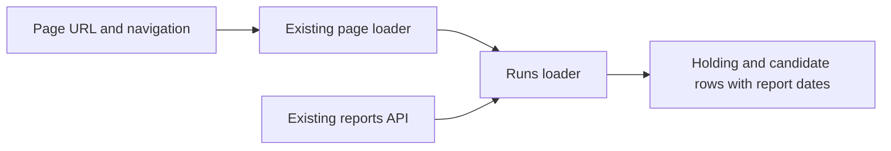

## Brief

Give every main Argus page a direct, reloadable URL. In Runs → New Run, display the last saved report date for every holding and watchlist candidate, and highlight reports older than seven days or absent reports. This is a plan-only request; production implementation is not authorized by this plan update.

Also investigate and plan repairs for the reported AMD StockTwits HTTP 403 and Reddit RSS HTTP 404. Explain whether registration, credentials or provider approval is required. Separate code reliability fixes from restoration that depends on external provider access.

Scope is the existing seven main pages, ticker-selection lists, and the sibling TradingAgents social fetchers and their immediate sentiment consumer/tests/docs. Preserve the six scenarios, in-memory draft, eligibility, full-portfolio review context, manifest validation and explicit paid confirmation. No framework migration, paid analysis, broker actions, real portfolio writes, account registration, subscription purchase or provider outreach. No production source changes in this planning update.

## Discovery

Read the project guide and RTK instructions. Independent read-only research: `discover_routes_freshness` (opmentix-researcher). Concrete task/criteria handoff: `plan_routes_freshness` (opmentix-planner). Host integrated both; no production files changed.

- `static/index.html:28–34` defines Portfolio, Watchlist, Reports, Fund Manager, Themes, Runs and Agents. `static/app.js:302–326` switches panels through `setTab` without URL/history handling; boot always opens Portfolio. `server.py:2525` serves the shell only at `/`.
- `static/app.js:1046` loads Runs data without report metadata; `renderRunTickerLists` renders ticker and holding/candidate detail only. Holdings take precedence over duplicate candidate tickers.
- `server.py:442–458` lists completed `complete_report.md` files, ordered by generation-folder date/time. `/api/reports` already exposes `latest_by_ticker` with `ymd`, `hms`, `analysis_date`, and timezone-aware `generated_at` where available. Reuse this API and its existing latest ordering for both groups.
- Date decision: use validated report-folder generation date (`ymd`) for this date-level warning, consistent with existing saved-report chronology. Do not substitute the market/analysis date, filesystem mtime, or assume a timezone for legacy timestamps. Compare with today's UTC calendar date; age > 7 days is stale, age = 7 is current. Future/invalid dates are unknown and visibly flagged.
- UI/UX Pro Max targeted `deep linking browser back` search returned Deep Linking and Back Button guidance: URLs reflect the page and native history preserves Back behavior. Preserve existing design tokens and use text warnings alongside color.



| Component | Description |
| --- | --- |
| Page URL and navigation | Explicit main-page paths, native links, initialization and Back/Forward. |
| Existing page loader | Reuses the current panel/loading flow and draft state. |
| Runs loader | Loads current portfolio, candidates and completed-report metadata. |
| Existing reports API | Supplies latest saved reports without new report endpoints. |
| Holding and candidate rows with report dates | Shows dates and distinct stale/missing/unknown warnings. |

### Social-source failure investigation — 2026-11-21

Independent read-only research: `social_failure_research` (opmentix-researcher); additional task planning: `plan_routes_freshness` (opmentix-planner). Host verified current official provider notices. No credentials or `.env` files read and no accounts or services changed.

- **StockTwits:** Sibling `tradingagents/dataflows/vendors/stocktwits.py:30,97–106` uses `https://api.stocktwits.com/api/2/streams/symbol/AMD.json` with a descriptive User-Agent and JSON Accept, without authentication. HTTP failures become a generic unavailable marker. A bounded unauthenticated GET using the same User-Agent at **2026-11-21 05:57 UTC returned HTTP 200/JSON**. The reported 403 is real user evidence but was not reproduced: the exact earlier denial reason remains unknown. Status alone does not establish a missing key; service-edge/IP/access-policy differences are possibilities, not confirmed causes. Keep the functioning path and improve safe diagnostics/failure classification; do not introduce authentication based on speculation.
- **Reddit:** Sibling `tradingagents/dataflows/vendors/reddit.py:68,185–225,280` still calls a combined public search RSS URL for `wallstreetbets+stocks+investing`. Bounded probes returned combined-feed 404 and single-subreddit 429. Those statuses alone do not isolate a joined-path bug. More decisively, Reddit's official notice says RSS support ended **November 13, 2026**, with no replacement for feeds outside communities one moderates. This is a retired-source problem; splitting URLs or registering an account does not restore RSS. The source comments claiming RSS is a working key-free alternative are outdated.
- **Existing invariants:** Reddit already distinguishes failed retrieval (`None`) from successful zero matches (`[]`); StockTwits also has an unavailable marker. The sentiment analyst prefetches news and both social sources, passes historical windows and Jev screening, and already instructs the model to flag unavailable sources in confidence/narrative. Extend those existing boundaries; do not invent a new coverage subsystem. Ensure the wording about collected sources/silence and the rendered report remain truthful when Reddit is retired or StockTwits is blocked.
- **Registration and keys:** No key was needed for the successful StockTwits test. Its developer portal currently closes new app registration; supported Enterprise API access is offered with custom pricing, so reliable authenticated access may require a provider arrangement, not just generating a free key. Reddit announced new public API requests stopped **October 31, 2026**, unregistered app access removal begins **January 12, 2027**, and remaining public API access ends **March 2027**. An ordinary Reddit account or newly generated OAuth credentials is not a proven replacement for this external research use case. Devvit registration alone does not establish suitability or entitlement for external sentiment extraction.
- **Repair boundary:** Plan immediate truthful handling of inaccessible/retired social coverage and tests. Restoring Reddit content or adding supported StockTwits authentication remains conditional on confirmed provider eligibility and access terms. No promise of full social-data restoration from local code changes or offline tests; external access could remain unavailable. Ask for a material provider/cost decision only once a concrete supported option is established.

Official sources checked on 2026-11-21:

- [Reddit November 10 changelog: RSS retirement and migration timeline](https://support.reddithelp.com/hc/en-us/articles/55472297340308-Changelog-November-10-2026).
- [Reddit October 8 changelog: new API requests close October 31](https://support.reddithelp.com/hc/en-us/articles/54353370049684-Changelog-October-8-2026).
- [StockTwits developer registration status](https://api.stocktwits.com/developers).
- [StockTwits plans: Enterprise API access](https://help.stocktwits.com/c/stocktwits-edge/stocktwits-edge/plans-compared).

## Plan

- [x] T1: Give every main page a canonical URL.
  - `server.py`: Serve the existing shell at `/portfolio`, `/watchlist`, `/reports`, `/fund`, `/themes`, `/runs`, `/agents`; `/` opens Portfolio. Use explicit paths so unknown API, static and page paths remain errors.
  - `static/index.html`: Replace main navigation buttons with native links and accessible current-page indication; retain existing visual design.
  - `static/app.js`: Centralize route-to-page mapping around `setTab`; initialize from URL, push history for ordinary navigation, restore on `popstate` without adding entries, and avoid duplicate history for the current page. Preserve modified-click/new-tab behavior and the in-memory draft; synchronize internal page changes too.
  - `static/app.js`: Initialize routing before the first page load. Ensure late asynchronous loads cannot change the current route/page or resurrect stale Run previews after navigation; reuse existing generation guards where applicable.
- [x] T2: Load current report metadata when opening Runs.
  - `static/app.js`: Fetch `/api/reports` with Runs data, normalize lookup ticker keys, and reuse `latest_by_ticker` for holdings and non-held candidates. Preserve completed-report/latest ordering.
  - `static/app.js`: Handle report-metadata request failure separately so the form remains usable, stale metadata is cleared, and unavailable data is not mislabeled as “No report.”
- [x] T3: Display report dates and freshness warnings in both New Run lists.
  - `static/app.js`: Render “Last report: YYYY-MM-DD” from a validated latest-report `ymd`; compare UTC calendar days. Label and highlight “Older than 7 days,” “No report,” and “Report date unknown.” Future/invalid dates are unknown; failed requests show “Report data unavailable.”
  - `static/app.js`: The API's raw `ymd` is **YYYYMMDD**, not ISO. Validate eight digits, date components and calendar round-trip before formatting; do not pass the raw value to permissive `Date.parse`. Recompute against an explicit UTC day when rendering Runs.
  - `static/index.html`: Explain saved report date versus market date and the >7-day rule. Update versioned URLs for changed frontend assets.
  - `static/styles.css`: Use existing semantic warning tokens, text alongside color, visible checkbox focus and wrapping at narrow widths; verify light/dark contrast. Indicators must not alter selection or start research.
- [x] T4: Verify routing, freshness and preserved run behavior.
  - `check_offline.py`: Isolated shell-route checks for all supported paths, root and unknown API/static/page errors.
  - `check_watchlist_export_ui_offline.js`: Supply the navigation generation in the existing extracted watchlist-handoff fixture.
  - `check_run_scenarios_offline.js`: `check_run_scenarios_offline.js` or a focused adjacent JavaScript check: Exercise actual navigation/date-rendering behavior, both ticker groups, latest report selection, normalized symbols, date boundaries and metadata failure.
  - `check_run_scenarios_offline.js`: Browser smoke checks: direct open/reload of all main pages, Back/Forward, native new-tab behavior, keyboard/current-page state, draft preservation, narrow layout and light/dark warning readability. Use synthetic fixtures and no real run submissions.
  - `.opmentix/harness/plans/20261121055253-add-page-routing-and-report-freshness-to/browser-check.py`: Adapt the prior Runs plan's fixture browser harness for explicit shell paths and report metadata. Preserve the closed plan's script/evidence; record new results under this plan. Intercept every API request and fail unexpected traffic.

- [x] T5: Make StockTwits failures explicit and actionable.
  - `../TradingAgents/tradingagents/dataflows/vendors/stocktwits.py`: Preserve the functioning public request path. Distinguish blocked access (401/403), missing endpoint/symbol (404), rate limits, timeouts, malformed/unexpected payloads and successful empty results in safe logs/unavailable text. Do not print credentials, response bodies or social content in error diagnostics.
  - `../TradingAgents/tradingagents/dataflows/vendors/stocktwits.py`: Retain the existing single-request, short-timeout/graceful string-return contract; no additional retries are needed, including for 401/403/404. Validate top-level and message payload structure before processing so malformed data becomes unavailable rather than empty or an uncaught exception. Do not claim a missing API key explains the original 403.
- [x] T6: Retire unsupported Reddit RSS and preserve truthful sentiment coverage.
  - `../TradingAgents/tradingagents/dataflows/vendors/reddit.py`: Stop using retired RSS as the default live retrieval path; return an explicit source-retired/unavailable marker without futile per-ticker RSS requests. Update obsolete key-free/RSS availability assumptions, reusing the current unavailable contract.
  - `../TradingAgents/tradingagents/agents/analysts/sentiment_analyst.py`: Reuse and tighten the existing source-limit instructions where necessary, including wording that all sources were collected. Prompts/reports must distinguish unavailable coverage from zero matches or neutral social sentiment, while healthy news and StockTwits evidence remain usable. Preserve historical filtering, Jev screening, untrusted-data boundaries, and research-only behavior.
  - `../TradingAgents/tradingagents/agents/analysts/sentiment_analyst.py`: Trace the all-inputs-unavailable path before editing: the existing `SentimentReport` schema requires directional/numeric output. At the existing sentiment-node boundary, return an explicit unavailable report without a fabricated Neutral/5 or model call when every input fetch failed, preserving the existing `messages` and `sentiment_report` string return contract. Distinguish valid empty evidence from failure using the existing fetcher contracts; prove downstream graph/report compatibility with fixtures rather than introducing a general provider-status service or changing the public schema.
  - `../TradingAgents/tradingagents/agents/analysts/sentiment_analyst.py`: Remove obsolete runtime RSS parsing/retry code coherently while preserving fetch signatures and subreddit constants still consumed by existing callers. Retain applicable date/screening coverage on available source paths; do not retain dead network adapters just to satisfy old tests.
  - `../TradingAgents/tradingagents/dataflows/date_window.py`: Remove retired Reddit RSS from the shared date-window documentation.
  - `../TradingAgents/tradingagents/agents/analysts/sentiment_analyst.py`: Evaluate a replacement only if a documented supported route exists for this use case and access is confirmed. Do not add speculative OAuth plumbing, URL splitting, mirrors, browser impersonation or a new paid service. Record externally blocked restoration separately from completed failure-handling work.
- [x] T7: Verify social-source behavior and document access requirements.
  - `../TradingAgents/tests/test_stocktwits_resilience.py`: Cover HTTP 200/empty/malformed payloads, 401/403/404/429/timeouts, safe reason reporting and bounded request counts.
  - `../TradingAgents/tests/test_reddit_fallback.py`: Replace assertions assuming one functioning combined RSS request with explicit retired-source/unavailable behavior and no futile default requests. Preserve or relocate valid date/screening tests without retaining a dead runtime adapter solely for tests.
  - `../TradingAgents/tests/test_structured_agents.py`: Sibling `tests/test_social_lookahead.py`, `tests/test_structured_agent_prompts.py`, `tests/test_structured_agents.py`, `tests/test_post_screen.py`, and affected existing sentiment tests: Verify available/empty/unavailable evidence, explicit coverage limits, all-inputs-unavailable output without invented scores or model calls, downstream compatibility, historical no-lookahead, screening and intact news/research-only behavior using fixture data and model stubs.
  - `../TradingAgents/tests/test_structured_agents.py`: Sibling `README.md` and relevant vendor docstrings: Explain current provider restrictions with official links, no proven missing-key diagnosis, conditional supported integration and any remaining access blocker. No automatic registration, purchases or provider contact.

Dependencies: T2 precedes T3; T4 validates T1–T3. T5/T6 own separate vendor repairs; T7 validates their common sentiment path. No new runtime dependency or report API is required. Keep route and freshness logic in their owning frontend flow rather than adding a general routing framework or changing global report chronology. Social work extends the existing vendor/consumer contract; restoration requiring a commercial or otherwise approved provider arrangement is a separate external dependency, not a passing-offline-test claim.

### Implementation order and proof

Implementation order: T1 → T2/T3 → T4, then T5 → T6 → T7, followed by the independent review loop, independent acceptance verification and curation. Preserve/adapt existing unrelated working-tree edits; do not overwrite files from the earlier discovery snapshot. At planning finalization, unrelated changes already exist in `README.md`, `check_broker_import_ui_offline.js`, `check_moomoo_offline.py`, `moomoo_import.py`, `server.py`, `static/app.js`, and `static/index.html`.

Required focused checks after implementation, from Argus root:

```bash
.venv/bin/python check_offline.py
node check_run_scenarios_offline.js
node check_broker_import_ui_offline.js
node check_watchlist_export_ui_offline.js
```

Run any new routing/freshness JavaScript check and this plan's adapted browser fixture harness with the available Playwright environment. Record its exact invocation and results; browser tooling unavailable is an acceptance limitation, not a claimed pass. Existing broker/watchlist checks cover shared navigation/script changes, using fixtures only.

Required focused checks from the sibling TradingAgents root:

```bash
.venv/bin/python -m pytest -q tests/test_stocktwits_resilience.py tests/test_reddit_fallback.py tests/test_social_lookahead.py tests/test_structured_agent_prompts.py tests/test_structured_agents.py tests/test_post_screen.py tests/test_research_only_profile.py
```

These are planned commands, not tests already executed. Use mocked external/model calls; no provider credentials or paid run are needed. Main implementation risks are asynchronous navigation, permissive raw-date parsing, obsolete RSS assumptions in tests, forced sentiment scores without evidence and preservation of unrelated edits. Offline checks do not establish provider availability.

### Acceptance criteria

1. All seven paths support direct links, reload, native new-tab opening and Back/Forward. `/` opens Portfolio; unsupported API/static/page paths remain errors rather than returning the shell.
2. URL, visible page and accessible navigation state stay synchronized. Main-page navigation preserves the in-memory New Run draft; a full reload retains existing reset behavior.
3. Both holdings and candidates display the latest saved report date, including direct first entry at `/runs`; a ticker held and saved as a candidate is shown only in holdings.
4. Fixed-clock fixtures cover ages 0, 6, 7 and 8 days, calendar boundaries, leap dates and multiple browser timezones. Exactly 7 days is current; >7 days is highlighted. Analysis dates and mtime do not influence the result.
5. Missing reports, invalid/missing/future report dates and failed report requests have distinct explicit text and visible warnings. Failed requests do not reuse old dates or block otherwise usable New Run controls.
6. Freshness never selects tickers, changes eligibility, refreshes reports, launches work or bypasses manifest review/paid consent. Existing scenario/draft tests continue to pass.
7. Focused offline checks pass and browser evidence records results and any limitations before implementation acceptance.
8. StockTwits success remains usable; an access denial, timeout, malformed payload and real empty result are distinguishable. 401/403/404 trigger no automatic retry. Tests prove bounded requests and safe diagnostics.
9. Default Reddit collection makes no calls to the retired RSS service and explicitly reports unavailable/retired coverage. It never reports no discussion based on a failed or skipped retrieval and makes no unsupported fallback promise.
10. Sentiment prompt/report contracts identify unavailable social sources and reduced evidence; they do not fabricate neutral/bullish/bearish measurements for inaccessible data. News and any successful social source remain usable.
    When all input fetches fail, the node returns an explicit unavailable report using the existing graph state contract without a model call or invented score; fixture checks establish downstream readability.
11. Existing historical no-lookahead, Jev screening, untrusted-content handling and research-only invariants pass focused fixture checks. No live model/paid run is required for this proof.
12. Access documentation distinguishes confirmed provider announcements and the successful unauthenticated StockTwits probe from the unresolved original 403. It explains why free registration/key generation is not a guaranteed fix.
13. Focused sibling tests pass. Any actual restoration dependent on provider approval/access remains explicitly unverified/blocked until supported credentials/access and a bounded live check establish it; graceful degradation alone must not be described as restored social feeds.

## Implementation

The harness recorded human approval and entered Implementation at 06:49 UTC. Delegated Argus routing, freshness, and fixture coverage (T1–T4) to `argus_ui` and sibling social-source handling and fixture coverage (T5–T7) to `social`. Each owns its repository's implementation files. The host owns this plan and recorded the pre-existing shared-file diffs for independent review.

- Argus serves the same shell on all seven paths. Native links, browser history and internal handoffs share the route switching flow. Initial navigation waits for session initialization before loading data, and health completes independently. The new ticker indicators use the newest completed report per normalized ticker and label unavailable data separately.
- TradingAgents retains the single StockTwits request and reports bounded failure reasons without raw responses. It reports retired Reddit RSS without network calls. The sentiment node preserves its result shape and returns an unscored Markdown result without invoking a model when all three source fetches are unavailable.
- Argus passed `.venv/bin/python check_offline.py`, `node check_run_scenarios_offline.js`, `node check_broker_import_ui_offline.js`, and `node check_watchlist_export_ui_offline.js`. TradingAgents passed the seven focused pytest files listed in the plan (121 tests). Both working trees passed `git diff --check`.
- [Isolated browser harness](./browser-check.py) passed 65 checks with no JavaScript errors or unmocked API requests. It covered slow boot, direct routes and reload, native new tabs, history, UTC freshness in Honolulu and Kiritimati, metadata failure, responsive layout, light/dark warning contrast, draft behavior, and manifest consent. Reproduction from the Argus root:

```bash
LD_LIBRARY_PATH=/tmp/argus-ui-browser-libs/usr/lib/x86_64-linux-gnu /tmp/argus-ui-browser-venv/bin/python -u .opmentix/harness/plans/20261121055253-add-page-routing-and-report-freshness-to/browser-check.py --project /home/dev/projects/trading/argus --artifacts /tmp/argus-ui-routing-freshness-final2
```

Round 1 assessment. All four findings were in scope under T1, T3, T4, T5 and T7. The respective developers fixed them and updated the fixtures. The backend, Runs and broker checks passed on Argus, and the sibling reviewer independently ran 119 passing focused tests before the fixes.

Round 2 evidence. The Argus reviewer independently reproduced delayed session and health handling with consistent page state, and passed the scenario, watchlist, broker and diff checks. The TradingAgents reviewer independently ran 121 focused tests and confirmed the missing-body rejection preserves optional metadata and successful empty results.

### Review loop

- round 1
  - reviewer: opmentix-reviewer (review_argus and review_social)
  - result: findings
  - tests: failed
  - findings: Delayed boot could restore the initial panel after navigation while keeping the new URL. The watchlist-export fixture lacked the new navigation state. The stylesheet cache key was not updated for the warning styles. StockTwits accepted a message without a body as usable evidence.

- round 2
  - reviewer: opmentix-reviewer (review_argus and review_social)
  - result: clean
  - tests: passed
  - findings: none

## Review

Independent reviewers `review_argus` and `review_social` reported a clean second round after the four findings in Implementation were fixed. The reviewers exercised delayed session and health responses, inspected native navigation and rendering/failure behavior, and confirmed StockTwits rejects malformed bodies while preserving optional metadata and successful empty results. The Argus scenario, watchlist/export, and broker UI checks passed. The TradingAgents focused suite passed all 121 tests. No live provider or paid-run result was used for review.

## Acceptance

Independent verifier `acceptance` reproduced all four Argus offline checks, the 121-test TradingAgents suite, and 65/65 Playwright checks. Browser output was written to `/tmp/argus-acceptance-20261121` with zero JavaScript errors and zero unmocked requests.

1. The explicit shell paths, root behavior, and unknown-path errors passed the server tests. Direct open, reload, Back/Forward, and native new tabs passed in Chromium.
2. Route, current-page indication, and panel matched in the browser, including delayed startup. The draft remains in the current document and resets on reload.
3. Both ticker lists rendered saved dates on direct Runs entry. Supplementary probes ran the production eligibility and report normalization code and confirmed case-insensitive deduplication, holdings taking precedence, and the newest report winning normalized-key collisions.
4. The fixed-date checks passed for 0, 6, 7, and 8 days, leap and calendar boundaries. Screens in Honolulu and Kiritimati agreed on the age-7 and age-8 boundary. Freshness reads the saved-folder date regardless of report analysis date or mtime.
5. Missing, invalid/future, and request-unavailable reports have distinct warnings. The isolated browser exercised metadata failure with usable controls, and contrast checks passed in both themes.
6. Browser actions preserved selection, scenarios, draft, and hash-bound consent. All launch requests were synthetic.
7. The four Argus checks and the 65-check browser harness passed with no browser or fixture API errors.
8. StockTwits fixtures passed for valid, empty, blocked, rate-limited, timed out, and malformed data. Requests were bounded and failure logs used safe diagnostics.
9. Reddit retirement fixtures passed with zero default RSS requests.
10. The all-unavailable branch produced readable Markdown and persisted through the report writer without a model call or a score. Healthy evidence remains available, and the prompt distinguishes no matches from unavailable sources.
11. Historical filtering, Jev screening, untrusted content, and research-only fixture checks passed.
12. Provider access details and links matched the documented announcements and bounded probe. The curator corrected the stale sibling README summary to say the analyst uses available news and StockTwits evidence, with Reddit unavailable after RSS retirement.
13. All 121 sibling tests passed. The original StockTwits 403 cause remains unknown. Reliable live access and any supported replacement for Reddit are unverified. No live model or paid/provider action was taken.

Curation by `curation` recorded canonical routes, report generation date and UTC freshness, and failure labels in the [project guide](../../knowledge/project-guide.md). Both repositories passed `git diff --check` after the documentation updates.

## Logs

- 2026-11-21 07:25 UTC — Integrated supplementary verification and curation, and prepared the human closure gate.
- 2026-11-21 07:23 UTC — Recorded independent acceptance results and flagged a stale sibling README summary for curation.
- 2026-11-21 07:18 UTC — Entered Review and recorded independent code inspection and fixture results.
- 2026-11-21 07:17 UTC — Recorded a clean independent second review in both repositories and completed T1–T7.

- 2026-11-21 07:16 UTC — Recorded final developer checks after round-one fixes and submitted the Argus changes for a second independent review.
- 2026-11-21 07:04 UTC — Recorded round-one independent review in both repositories and delegated the accepted fixes.
- 2026-11-21 06:52 UTC — Claimed the approved implementation stage and delegated the Argus and TradingAgents work.

- 2026-11-21 06:49 UTC — Normalized task file/change notes for harness validation; planning finalized for the implementation approval gate.
- 2026-11-21 06:46 UTC — Finalized planning after user approval: integrated planner refinements, implementation order, exact focused checks, working-tree safeguards and all-inputs-unavailable acceptance; production implementation remains unstarted.
- 2026-11-21 05:59 UTC — Extended the same plan with StockTwits 403 investigation, confirmed Reddit RSS retirement, provider registration/access constraints, and stable tasks T5–T7; no production changes.
- 2026-11-21 05:55 UTC — Created a scoped follow-up plan from independent code research and planning for seven main-page routes and New Run report-date warnings; implementation not started.
