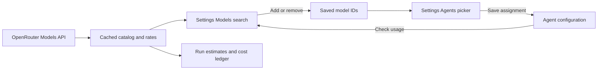

Diagrams: a mermaid block for a flow or design, then a table with columns Component and Description.

## Brief

Rename the main Agents page to Settings. Give agent assignments and prompts, the shared model list, and watchlist and spending policy their own sections. In Settings → Models, search OpenRouter by model name, publisher, or exact ID, review the model's details and pricing, then add it to the saved list. Remove unused models from that list. Saved models become choices for compatible Argus agents. Search, refresh, and list edits use model metadata only.

Keep the original GPT‑6.2 Sol, GPT‑6.2 Astra, Gemini, and pricing work within this flow. Preserve current assignments and per-seat overrides. Users can select an upgrade in Settings → Agents once the model is saved.

## Discovery

Independent research delegated to `catalog_research`. The host checked the provider's public API and traced the dashboard pricing path.

- Argus `server.py` exposes the sibling `addons/agent_config.py` payload through `GET /api/agents`. The Agents select in `static/app.js` uses `models` from that payload and keeps an existing ID visible when it is absent from the inventory. Native CLI curated choices are a separate catalog in `tradingagents/llm_clients/model_catalog.py`. Its OpenRouter picker already fetches IDs and names from the public API in `cli/prompts.py`.
- Argus seat estimates and TradingAgents fallback cost accounting both read the sibling `addons/openrouter_models.json`, but use separate loaders and path resolution. There are nine local entries, several without rates, and no Argus refresh path. The manifest includes inventory data and separately labels its configured budget-planning placeholder. Actual provider-reported cost already takes precedence in the ledger.
- The public OpenRouter catalog returned `openai/gpt-6.2-sol` and `openai/gpt-6.2-astra` on 2026-11-21 without credentials. Observed base input/output prices per million tokens were USD 2/10 and USD 8/40, respectively. The catalog also returned long-context overrides beginning at 272,000 prompt tokens, USD 4/15 and USD 16/60 respectively. For example, `google/gemini-4-argon` showed USD 2/10. These are catalog observations. Routed rates, cache, tools and other pricing dimensions can differ. [OpenRouter catalog API](https://openrouter.ai/docs/api/api-reference/models/get-models) [Sol](https://openrouter.ai/openai/gpt-6.2-sol) [Astra](https://openrouter.ai/openai/gpt-6.2-astra)
- A text input/output test alone includes Gemini entries designed for image/video generation and batch variants. Define eligibility against the capabilities of the existing synchronous agent clients, including tool or structured-output support where a role requires it. Keep preview variants identifiable and keep custom or previously saved IDs representable when a provider delists them.
- Google Gemini's direct models endpoint exposes model names, generation methods and limits. It does not supply rates. Google publishes Developer API prices separately, including distinctions for modality, long context, batch and caching. OpenRouter rates must stay attributed to OpenRouter. [Gemini models API](https://ai.google.dev/api/models) [Gemini Developer API pricing](https://ai.google.dev/gemini-api/docs/pricing)
- The current Argus page already combines seat editing with watchlist and spending policy. Native navigation resolves `/agents` in both `server.py` and `static/app.js`. The existing Agents and policy APIs have separate save flows. Keep those contracts and use the established page routing and styles for the new sections.
- Picker membership currently comes from the same rows used for estimates. The current loader skips agent reloads when edits are dirty, and applying a fresh agent payload recreates drafts. Catalog actions need a metadata-only update path. A refresh may update prices or availability without changing saved membership, assignments, or unsaved edits.
- The server fingerprints the model-rate file and the launch runner independently recomputes that fingerprint before execution. Change both sites together. The preview's price inventory currently includes unrelated models. Confirmation should bind effective rates and execution-relevant capabilities for the scoped model calls.
- The earlier upgrade proposal named three inherited Sol seats. Current defaults also include the fund manager and fund risk-aggressive seat. Move the upgrade into the user-controlled assignment flow described in the Brief.

## Plan

Independent planner `settings_plan` confirmed the existing navigation and write-lock contracts, the agent draft merge requirement, the five declared Sol defaults, and the matching server and runner fingerprint paths.

### Settings layout

Use the existing Argus shell, typography, and light/dark tokens. Settings opens the **Agents** section at `/settings`. **Models** has a direct link at `/settings/models`, and **Watchlist and spending** has a direct link at `/settings/watchlist`. Keep section navigation visible on narrow screens. Redirect old `/agents` bookmarks to `/settings` and preserve browser Back and Forward.

**Agents** groups seats by workflow and puts the current model and edit action up front. The existing editor remains the place for model selection, prompt, and supported advanced parameters. Keep prompt preview, diff, reset, and draft controls reachable. Link to Models beside the picker.

**Models** opens on the saved list with a **Search OpenRouter** action. Use a compact list with model name and ID, input/output prices, context size, and assignment status. Search results use the same price and detail conventions and show **Add** or **Saved**. Expand details on demand for supported capabilities, limits, and available price tiers. Explain removal restrictions with the relevant agent names. On narrow layouts, retain the prices and actions in stacked rows.

**Watchlist and spending** retains the existing limits, spending check, and independent policy save. Each section shows meaningful loading, empty, and error states with visible focus and keyboard-operable controls.

| Component | Description |
| --- | --- |
| OpenRouter Models API | Publishes model IDs, capabilities, availability, and catalog prices. |
| Cached catalog and rates | Stores validated provider metadata and rate provenance for search, display, and pricing. |
| Settings Models search | Lets users compare provider models, review details, and manage membership. |
| Saved model IDs | Persist the user's shared selection independently of refresh and billing data. |
| Settings Agents picker | Offers saved models compatible with the seat and keeps the current assignment visible. |
| Agent configuration | Holds the effective assignments and overrides used by the runners. |
| Run estimates and cost ledger | Read the relevant cached rates irrespective of saved-list membership. |

- [x] T1: Establish validated OpenRouter metadata and pricing.
  - `../TradingAgents/addons/model_inventory.py`: Share path resolution via `ARGUS_MODELS_CONFIG` and keep legacy inventory readable. Normalize exact IDs, model name and publisher, plain-text description, context and output limits, text modalities, supported parameters, preview status, rates and tiers, source, and successful refresh time. Use USD per million tokens for token rates and label any other units individually. Distinguish free, unknown, and unavailable data.
  - `../TradingAgents/addons/openrouter_models.json`: Bundle dated fallback rows for existing models, GPT‑6.2 Sol, GPT‑6.2 Astra, and eligible Gemini models with verified published rates.
  - `../TradingAgents/addons/agent_config.py`: Reuse the normalized inventory and use one snapshot per resolved view. Retain exact historical aliases where needed and avoid matching unrelated model variants. Retain historical or delisted rate records with freshness and availability explicit.
  - `../TradingAgents/addons/cost_ledger.py`: Use the shared inventory for model matching and fallback pricing.
- [x] T2: Add cached OpenRouter search and refresh.
  - `../TradingAgents/addons/model_inventory.py`: Fetch the fixed public Models endpoint server-side with bounded time and response size. Validate the response before atomic publication. Coalesce or serialize refreshes, retain the last usable snapshot on failure, and preserve fallback metadata. Keep provider calls outside read, run, and billing paths and outside the shared data write lock. On publication, coordinate with the run lock or return a retryable busy response.
  - `server.py`: Expose cached catalog search and details, with bounded results and exact ID matching. Refresh on explicit request and on entering Models when the cache is older than 24 hours. Keep cached search and the saved list usable while the refresh runs. Expose source, successful fetch time, stale/unavailable state, and refresh failures. Use the existing confirm token for refresh and mutations.
- [x] T3: Redesign the main page as Settings and build the Models workspace.
  - `server.py`: Add the Settings routes and old bookmark redirect through existing navigation. Preserve `GET/PUT /api/agents` and `GET/PUT /api/settings`.
  - `static/app.js`: Connect section navigation, search, model details, refresh, add, and remove. Merge updated membership without rebuilding agent or policy drafts. If another tab removes a draft's selected model, preserve the visible draft and let the user resolve the conflict.
  - `static/index.html`: Apply the Settings layout above. Keep rate units visible, use tabular numerals, show provider descriptions as text, and provide useful empty/search/failure states. Support keyboard focus, status announcements, and a narrow layout. Version changed frontend assets.
  - `static/styles.css`: Style the section navigation and responsive model rows using current Argus tokens.
- [x] T4: Preserve pricing and run confirmation integrity.
  - `../TradingAgents/addons/cost_ledger.py`: Apply supported long-context tiers per call using prompt tokens. Keep provider-reported charges authoritative and recorded costs immutable. Preserve budget policy.
  - `../TradingAgents/addons/agent_config.py`: Label incomplete and aggregate estimates, including fund-manager draft plus final, and distinguish pricing from budget-planning placeholders.
  - `server.py`: Use the same cached snapshot semantics for Runs and Theme Scout preview, confirmation, and runner preflight. Project only models used by the requested paid stages and canonicalize execution-relevant rates and capabilities in both the manifest and input fingerprint. Effective rate or assignment changes require fresh confirmation. Timestamp, row order, presentation details, and unrelated saved-list or catalog changes leave a reviewed preview valid. Preserve other input hashes and existing consent.
  - `run_inputs.py`: Encode the projected rate inputs deterministically alongside existing file digests.
  - `run_analysis.py`: Recompute the same stage-specific rate digest under the run lock before launch.
- [x] T5: Make saved models assignable through the existing agent workflows.
  - `../TradingAgents/addons/agent_config.py`: Map eligibility to the actual synchronous text, tool-use, and structured-output clients. Show preview status and seat compatibility. Allow additions usable by at least one Argus seat; disable incompatible seat choices with a reason. Exclude batch and incompatible image/video/live-audio/embedding workflows from new assignments. Keep previously assigned IDs visible if availability or capabilities change. Prioritize accurate capability labels over guesses when metadata is incomplete.
  - `server.py`: Expose each model's seat compatibility in model details and agent picker data.
  - `static/app.js`: Update the seat picker from saved membership and server-provided compatibility. Verify selecting tested OpenRouter GPT‑6.2 or Gemini models through the existing save path persists the exact model ID for runtime dispatch. An assignment changes only when the user saves it.
- [x] T6: Verify the Settings flow, compatibility, and pricing across both repositories.
  - `check_offline.py`: Cover Settings routes, authorization, migration, persistence, concurrent writes, and paid preview/runner preflight.
  - `check_run_scenarios_offline.js`: Preserve Runs behavior. Use a focused Settings browser fixture to cover history, search and detail states, cross-section drafts, keyboard operation, and narrow layouts.
  - `../TradingAgents/addons/check_agent_config.py`: Verify shared snapshot and legacy formats, provider failures and refresh concurrency, eligibility and exact-ID dispatch. Run focused native research-only, fund manager, and theme scout checks with stubs.
  - `../TradingAgents/addons/check_cost_ledger.py`: Cover tier thresholds, zero and unknown rates, provider-cost precedence, and immutable ledger amounts.
  - `README.md`: Document Settings routes and saved-model workflow, pricing source and units, refresh cadence and offline behavior, and the scope of estimates.
  - `../TradingAgents/README.md`: Document OpenRouter rate provenance, fallback billing, and estimate scope.
- [x] T7: Persist and protect the shared saved-model list.
  - `server.py`: Store saved exact IDs in an atomic, versioned `data/agent_models.json` under the configured data root. If the file is absent, seed membership from the original curated choices, current effective assignments (including custom IDs), and reset defaults. Before the first mutation, derive the same seed from fixed legacy choices and seat configuration so a prior provider refresh cannot seed the entire provider list. Persist the initial list with the first successful edit and distinguish an absent file from an intentionally saved list. Refresh never changes membership. Add is idempotent and validates eligibility against the server's catalog. Remove an unused model by exact ID without deleting pricing history.
  - `server.py`: Check assignments, reset defaults, and membership under the same existing write lock for list edits and agent saves. Return conflict with the referencing seats when removing an assigned model or one required for Reset to default. Concurrent or stale saves cannot assign a removed model. Preserve existing assignments and supported settings edits for legacy or delisted IDs, while blocking new incompatible assignments. Failed writes leave the previous list and seat configuration usable.

### Acceptance criteria

1. Settings replaces Agents in the main navigation. All three Settings paths open their section directly. The old bookmark redirects correctly, Back and Forward work, and the existing agent and policy save workflows remain accessible.
2. Find a GPT‑6.2 Sol, Astra, or compatible Gemini model by name or exact ID. Its details show OpenRouter price provenance, input/output rates per million tokens, context and model capabilities, and published tier thresholds when supplied. Free, unknown, preview, and unavailable states are distinguishable.
3. Add a compatible model from search, reload, and find it in the saved list and compatible seat pickers. Save an assignment and verify exact-ID dispatch in a model stub. Existing custom assignments, inherited choices, prompts, and advanced settings survive migration. Saving a selection is the only part of this flow that changes its assignment.
4. Remove an unused entry and verify it stays removed across refresh and reload. Assigned models and required reset defaults show which seats prevent removal. Unauthorized, malformed, duplicate, and concurrent operations leave list and assignments consistent. A failed write preserves the last saved state.
5. Cached Settings reads work offline. Explicit and stale-on-open refresh update successful metadata only after validation. Malformed, empty, timeout, and overlapping refreshes preserve the last usable snapshot and produce accessible status. Browse and edit the saved list without clearing in-progress agent or policy edits.
6. Reviews remain valid across unrelated list/catalog edits and timestamp-only or reordered refreshes. Relevant model/rate changes require a fresh preview. If an input changes between confirmation and runner startup, preflight rejects it before a model call. Provider-reported charges take precedence, fallback pricing applies supported tiers per call, and durable costs remain unchanged.
7. Exercise the full Settings flow with offline metadata and model stubs, including keyboard operation, light/dark themes, and narrow layouts. Pass the existing Runs, policy, runner-budget, and native/scout/fund-manager regression checks. No paid call or account change is needed for verification.

T1 provides the metadata for T2, T4, and T5. T2 and T5 support T7, and their contracts feed the Settings UI in T3. T6 verifies the integrated flow. Scope is the existing OpenRouter-backed Argus workflows. Direct provider billing and the standalone native CLI pickers are outside this plan.

## Implementation

The implementation is split across the Argus Settings frontend, Argus APIs and runner, and the shared TradingAgents metadata and pricing code. The writable cache defaults to TradingAgents `data/openrouter_models_cache.json`. The bundled seed remains available on first use. Current assignments and defaults were preserved.

### Review evidence

**Round 1**. In scope. The developers are addressing the findings with browser and offline regressions. The existing Argus offline, runner budget, Runs UI, and 65-case routing/freshness browser checks passed before these fixes.

**Round 2**. In scope. Round 1 regressions on tier rendering, search ordering, membership consistency, reset defaults, snapshot stability, retired price retention, and public catalog normalization were addressed. Round 2 findings are assigned to the responsible developers.

**Round 3**. In scope. A public metadata-only fetch also discovered time-conditioned price schedules without token thresholds. Handle these as additional pricing conditions and keep supported prompt-token tiers distinct. Re-run both the full public feed and the isolated browser flow.

**Round 4**. In scope. The integrated Settings browser flow passed after retry and agent read ordering fixes. Complete the remaining rate/status fixes and rerun the focused suite.

**Round 5**. Independent final-code recheck after round 4 fixes verified refresh recovery, stale agent reads, tier pricing parity, malformed price rejection, and time-dependent rate disclosure. Argus Settings browser, server, runner, budget, and Runs UI checks passed. TradingAgents inventory, agent configuration, cost ledger, fund manager, theme scout, and native research-only checks passed. A read-only OpenRouter fetch normalized 457 catalog rows.

### Review loop

- round 1
  - reviewer: opmentix-reviewer (settings_review)
  - result: findings
  - tests: failed
  - findings: Settings refresh could stay disabled on failure, superseded searches could overwrite newer data, and membership changes did not consistently constrain pickers. Saved-list protection needed readable names and clear reset-default reasons. The browser check found that the tier renderer used different fields from the normalized catalog. Refresh could drop historical rates, manifests could combine snapshots or fingerprint an unused Scout estimate, strict Scout capability needed correction, and accepted OpenRouter IDs and rate validation needed consistent semantics.

- round 2
  - reviewer: opmentix-reviewer (settings_review)
  - result: findings
  - tests: failed
  - findings: Previously valid legacy IDs could block editing. Boolean or malformed prices could publish, the combined fund-manager estimate applied a tier to both calls, a delayed agent reload could erase a new draft, and a refresh in another tab could disable the local refresh control indefinitely.

- round 3
  - reviewer: opmentix-reviewer (final_settings_review)
  - result: findings
  - tests: failed
  - findings: Refresh button did not redraw after completion. An agent GET started before a save could replace the final saved state. JavaScript and Python used different fallbacks for partial pricing tiers. Non-object or non-finite pricing metadata could replace a usable cache.

- round 4
  - reviewer: opmentix-reviewer (final_settings_review)
  - result: findings
  - tests: failed
  - findings: A matching tier could fill a missing base rate in Python while Settings returned unavailable. Superseded failed agent reads could still surface an error. Time-conditioned pricing needed an explicit note in model details. The inventory assertion needed to account for the new conditional pricing field.

- round 5
  - reviewer: opmentix-reviewer (final_settings_review)
  - result: clean
  - tests: passed
  - findings: none

## Review

Independent reviewers `settings_review` and `final_settings_review` checked the changes across Argus and TradingAgents. The final recheck reported no findings. It independently reproduced the refresh button lifecycle and compared the JavaScript and Python partial-tier estimates. Earlier findings and their resolutions are preserved above. The integrated browser and server checks passed after the fixes. No paid provider request was made.

## Acceptance

Independent verifier `settings_acceptance` reran the Settings workflow and focused checks.

1. **Settings navigation passed.** Direct links, bookmark redirect, browser history, and both existing settings save flows worked in the isolated browser.
2. **Model discovery and pricing passed.** The browser compared Astra base rates and a long-context tier, found a free Gemini preview, and refused the image-output model. The verifier independently checked bundled Sol, Astra, and Gemini rates and seat eligibility. A public metadata-only read normalized 457 models.
3. **Enrollment and assignment passed.** The browser enrolled Astra, saved a Scout assignment, and verified persistence. Agent-config fixtures exercised exact model dispatch, `:free` IDs, and edits to legacy assignments. Current assignments and defaults survived migration.
4. **Removal and write integrity passed.** The verifier covered authorization, idempotent add, protected assignments and reset defaults, concurrent assignment and removal, and persistence after refresh and reload.
5. **Cache and refresh passed.** The browser and inventory checks covered stale-on-open refresh, unsuccessful refresh and retry, and invalid or empty snapshots. The host supplemented the verifier's tests with an isolated TestClient probe. A simulated provider timeout used the configured bound and preserved the snapshot byte for byte. Two overlapping refresh requests serialized their fetches while cached search stayed available, then a successful retry published the new rate.
6. **Run confirmation and ledger passed.** The server tests verified semantic digests and renewed consent for relevant rates. The verifier independently changed a copied rate snapshot after computing the reviewed fingerprint and confirmed that the real runner exited with status 78 before starting a stage. Ledger fixtures passed for per-call tiers, provider-charge precedence, zero and unknown prices, and historical amounts.
7. **Regression suite passed.** Chromium checked keyboard interaction, 375px layout, light and dark mode, policy drafts, and delayed API responses. Argus server, runner, budget, Runs UI, and 65 prior browser routing/Runs checks passed. TradingAgents inventory, agent configuration, ledger, fund-manager, theme-scout, and seven research-only tests passed.

Browser reproduction uses the [Settings browser fixture](./browser-check.py) and a loopback Argus server with a temporary TradingAgents data root and synthetic OpenRouter feed. The verifier and host used synthetic model responses and made no paid requests or account changes. Account-specific provider routing was outside the verification scope.

Independent curator `finish_knowledge` updated the [project guide](../../knowledge/project-guide.md) with the Settings paths, saved-list and cache locations, refresh rules, run-confirmation contract, and focused checks.

## Logs

- 2026-11-21 14:50 UTC — Recorded independent Acceptance, the timeout and overlapping-refresh probe, and durable project guidance.

- 2026-11-21 14:43 UTC — Recorded independent Review evidence for the Acceptance gate.

- 2026-11-21 14:41 UTC — Recorded passing integrated checks and the clean independent recheck.

- 2026-11-21 14:38 UTC — Recorded fourth-round review and a passing integrated Settings browser flow.

- 2026-11-21 14:33 UTC — Recorded third-round review and live catalog compatibility findings.

- 2026-11-21 12:14 UTC — Recorded second-round review findings and fixes still in progress.

- 2026-11-21 12:00 UTC — Recorded independent review findings and delegated the fixes.

- 2026-11-21 11:23 UTC — Revised the plan for Settings, user-managed model membership, OpenRouter search, and explicit assignment changes.

- 2026-11-21 09:59 UTC — Integrated the independent planner handoff after planning approval and prepared the implementation gate.

- 2026-11-21 09:31 UTC — Created the follow-up task, checked live OpenRouter rates and recorded discovery for the planning gate.
